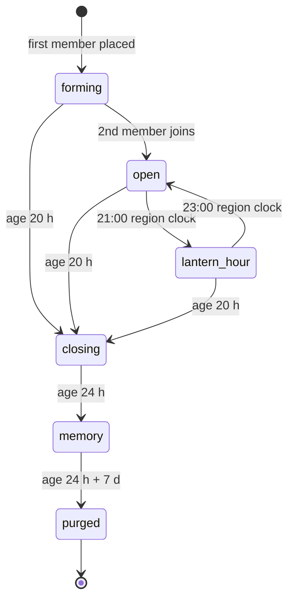
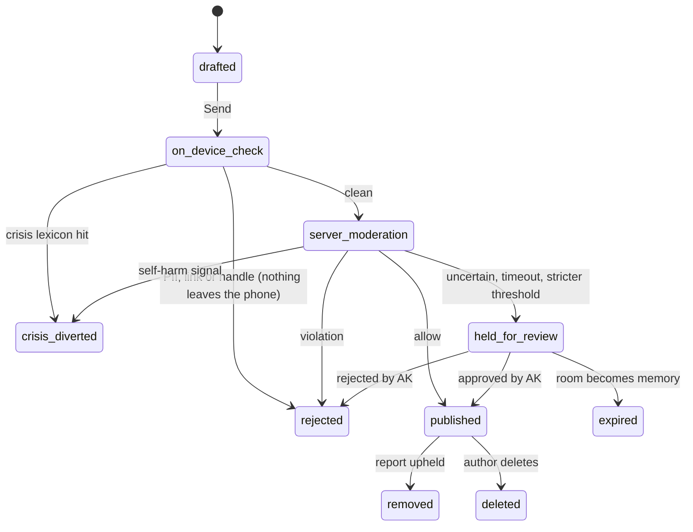
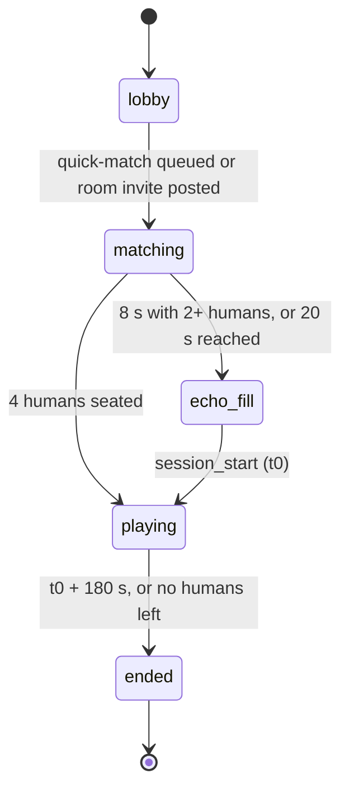
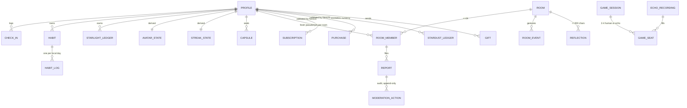

# Aura: Product Requirements Document

**Asan Innovators** | Prepared by: Kalyan Kumar Bedugam (AK) | *Building Beyond Boundaries*

| | |
|---|---|
| **Product** | Aura: social and gamified mood check-in app (iOS + Android) |
| **Owner / publisher** | **AKVega** (company App Store + Play accounts; data fiduciary / controller) |
| **Document** | PRD v1.1 (all open questions answered by AK) |
| **Date** | 23 Sep 2026 |
| **Status** | Decisions locked; ready for build planning |
| **Sources** | Market research, competitor analysis and 1M-download blueprint (Google Docs); store and regulatory fact-check of 23 Sep 2026 (`docs/research/`) |

### TL;DR
- **What:** a calm, pseudonymous app. You check in with how you feel in 2 taps, grow a celestial avatar that never dies or regresses, and feel less alone in 24-hour mood rooms where strangers who feel the same share silent gestures and short moderated reflections. You can also breathe together in a no-fail co-op game and write capsules to your future self.
- **Who:** everyone **13+**, with full access and one shared pool. Core audience: Indian students and young professionals, **Telugu/Tenglish-first**, then Hindi/Hinglish. Available **worldwide** (EU, UK and Australia open at beta).
- **Why now:** incumbents are either solo trackers (Daylio) or friends-only (Finch). No one offers low-pressure *stranger* support without chat.
- **v1 scope:** research Phase 1–2 in full (F1–F9 at P0, F10–F14 at P1), built solo by AK on Flutter + Supabase + NestJS/BullMQ. The avatar is AK's AI-generated celestial character, animated in code.
- **Dates:** start **5 Oct 2026**, closed alpha **w/e 10 Jan 2027**, open beta **w/e 2 May 2027**, public launch **30 Sep 2027**.
- **Biggest risks:**
  1. **Legal: no parental consent for under-18s, and mixed-age rooms.** This is AK's accepted risk; see F8 and Technical Constraints.
  2. **App Store:** Apple's rule against "random/anonymous chat" apps.
  3. **Moderation:** one moderator (AK) until 5,000 DAU, with OpenAI moderation only.
  4. **Empty rooms** at small scale.

### Decision log
| # | Decision | Made by | Status |
|---|---|---|---|
| D1 | v1 = research Phase 1–2 in full (incl. reflections + one co-op game) | AK | Locked |
| D2 | **13+ with full access, no parental consent, one mixed-age pool**; under-13 blocked. Invisible protections only (see F8/F9) | AK (revised; risk explained and accepted) | Locked |
| D3 | AK builds solo; **avatar = AK's AI-generated character art + code-animated layers** (no animator); lawyer engaged week 0 | AK | Locked |
| D4 | **Worldwide from alpha, except EU/UK/Australia until beta**; AKVega owns and publishes | AK | Locked |
| D5 | Flutter + Supabase + **NestJS modular monolith + Redis/BullMQ from day one**; **own receipt validation in NestJS** (no RevenueCat); PostHog Cloud; min iOS 16 / Android 7 | AK | Locked |
| DS-1…10 | Data-shape decisions (see Data Model) | AK | Locked |
| Q-series | All open questions answered (see Decision Record) | AK | Closed; items waiting on a lawyer or CA listed there |

**Tags used in this document:** `[ASSUMPTION]` = default to tune in alpha · `[LEGAL]` = needs the lawyer's opinion · `[STORE]` = depends on App Store / Play policy or console settings.

## Contents

1. [Overview](#1-overview)
2. [Goals & Success Metrics](#2-goals--success-metrics)
3. [User Personas](#3-user-personas)
4. [User Journey Map (Riya)](#4-user-journey-map-riya)
5. [User Stories](#5-user-stories)
6. [Feature Specification — Personal Core](#6-feature-specification--personal-core)
7. [Feature Specification — Social Layer](#7-feature-specification--social-layer)
8. [Feature Specification — Accounts, Safety & Monetization](#8-feature-specification--accounts-safety--monetization)
9. [Competitive Analysis](#9-competitive-analysis)
10. [Technical Constraints](#10-technical-constraints)
11. [Data Model (High Level)](#11-data-model-high-level)
12. [Notification & Communication Strategy](#12-notification--communication-strategy)
13. [Analytics & Tracking Plan](#13-analytics--tracking-plan)
14. [Error, Empty & Loading States](#14-error-empty--loading-states)
15. [Permission Flows](#15-permission-flows)
16. [Offline Mode Behaviour](#16-offline-mode-behaviour)
17. [Accessibility Requirements](#17-accessibility-requirements)
18. [Localization & i18n](#18-localization--i18n)
19. [Admin & Moderation Console](#19-admin--moderation-console)
20. [Timeline, Phasing & Delivery Risks](#20-timeline-phasing--delivery-risks)
21. [Decision Record & Remaining Actions](#21-decision-record--remaining-actions)
22. [Out of Scope (v1)](#22-out-of-scope-v1)

---

## 1. Overview

### Problem
Young Indians are under heavy, constant emotional load (competitive exams, first jobs in new cities, hostel and PG life, loneliness) and have almost nowhere safe to put it. Therapy is scarce and expensive (research doc: fewer than 0.75 psychiatrists per 100,000 people, ₹1,500–₹4,000 per session) and heavily stigmatised (*"log kya kahenge"*). Identity-linked social apps punish vulnerability, and the wellness apps that exist fail in one of two ways:

- **Solo trackers (Daylio, Bearable)** leave you alone with your feelings. When a bad week hits, logging stops, streaks break, and the empty calendar makes you feel worse, so you uninstall.
- **Gamified apps with group mechanics (Habitica, Forest)** add friends but punish the whole group when one person slips, which creates guilt spirals for exactly the people who most need support.
- **The closest incumbent (Finch)** is warm and non-punitive but only connects you with friends you already have. There's no way to feel understood by someone who feels the same way right now.

**Cost of not solving it:** people carry stress alone until it becomes a crisis. For the business, the whitespace is being approached from both sides: Finch could add stranger features, and chat-first entrants (e.g. YourSecret, Mar 2026) and Indian players such as Amaha are active in the space.

### Solution
**Aura** is a calm, pseudonymous iOS + Android app built around one loop:

> **Check in (2 taps) → your avatar glows → you're not alone → come back tomorrow.**

1. **Check in** with how you feel in under 5 seconds (F1).
2. **Grow your Aura**, a procedurally rendered celestial avatar that *is you*. It evolves as you look after yourself and **never dies or regresses**; on hard days it rests in a protective nebula (F2, F3).
3. **Sit with strangers who feel the same**: a 24-hour mood room, matched by mood, language and local evening, where people send silent gestures (a warm chai, a candle, "me too") and short, moderated reflections. There are no profiles, no DMs and no follower counts (F5, F6).
4. **Breathe together**: a 3-minute co-op breathing game with strangers. It has no score and no fail state (F7).
5. **Write to your future self**: time capsules that open on a date, or the next time you feel a certain way (F4).

Safety is designed in without limiting anyone: crisis routing (Tele-MANAS / 988 / local emergency), a fresh pseudonym per room, no private messaging, moderation of every piece of stranger-visible text, stricter automatic checks on anything involving under-18 accounts, and instant ban plus mandatory reporting for grooming or sexual content involving minors (F8, F9).

### Target users
| Segment | Who | Why they come | Priority |
|---|---|---|---|
| **College students (18–24)** | Engineering, medical and diploma students in Telangana/AP and other Indian cities; Telugu/Tenglish or English speakers | Exam stress, homesickness, no private space to talk | **Primary** (personas: Riya, Sai) |
| **Early-career professionals (22–30)** | First job, moved cities, living alone | Burnout, loneliness; will pay small amounts | Secondary (Arjun) |
| **Teens (13–17)** | JEE/NEET/board-exam students | Extreme pressure, little privacy. **Full access, no parental consent** (D2) | Secondary (Meera) |
| **Global English speakers** | Anyone 13+ outside India (EU/UK/AU from beta) | Same need for low-pressure support | Opportunistic; no dedicated GTM in v1 |

### What makes Aura different (one line each)
- **Stranger connection without chat**: empathy through gestures, not conversation.
- **Non-punitive by construction**: nothing you care about is ever taken away.
- **Co-op calm play**: shared activity with no failure and no competition.
- **Telugu-first, India-native**: Telugu, Tenglish, Hindi and Hinglish; UPI-backed store billing; ₹10–₹99 price points; a first month of Plus free; Tele-MANAS in the crisis flow.

### What Aura is not
Aura is **not therapy, not a diagnostic tool and not an emergency service**. It's a daily emotional check-in and peer-presence space. That line shapes copy, store listings and what the moderator does (see F9 and the Technical Constraints section).

### Source material
This PRD is built from three research documents supplied by AK: (1) *Global and Indian Market Research Analysis: Social and Gamified Mood-Tracking Ecosystems* (main source; saved at `docs/research/market-research.md`), (2) *Aura App: Top 10 Competitors & Unique Features Analysis* (a subset of doc 1's competitor section), and (3) *Blueprint for 1M+ Downloads* (four other app concepts; used here for the Flutter architecture and growth-loop thinking only). Market-size and competitor revenue figures in those docs are secondary estimates and have **not** been independently verified. Store-policy and regulatory facts were checked separately (see Technical Constraints). All open questions were answered by AK on 23 Sep 2026 (see Decision Record).

---

## 2. Goals & Success Metrics

### Goals
**User goals**
1. **Feel less alone, in under a minute a day.** At least 60% of room visitors answer "yes" to *"Did you feel a little less alone?"* (asked on 1 in 5 room exits).
2. **Build a self-care rhythm without guilt.** Users who hit a gap come back: 40% of users who enter Resting Nebula check in again within 7 days.
3. **Get perspective on hard days.** At least 30% of users who seal a mood-trigger capsule see it open within 60 days, and 70% of openings are rated "helpful" or better.

**Business goals**
4. **Prove retention before scale.** Hit D30 ≥ 10% in the open beta (India cohort). This gates public launch spend.
5. **Prove India will pay small amounts.** Paid conversion ≥ 2% of MAU within 60 days of monetization launch, with gross ARPPU ≥ ₹55/month (≈ 72% of that reaches Asan after GST and store fee; see F12).
6. **Stay safe at small-team scale.** Zero unresolved crisis-flagged items older than 1 hour, and reports below 5 per 1,000 room visits.

### North Star metric
**Weekly Supported Users (WSU)**: users who check in on **≥ 3 days** in a week **and** have **≥ 1 social moment** (gesture given or received, reflection published, or Breath Ripples session completed).

It captures both halves of the value: the personal habit and the "not alone" moment. It can't be pushed up by spammy notifications alone, because a social moment needs another person.

### Leading indicators (days to weeks)
| Metric | Definition | Success | Stretch | Measured |
|---|---|---|---|---|
| Onboarding completion | Install → first check-in saved | ≥ 70% | ≥ 80% | Daily, PostHog funnel |
| Check-in speed | Median time, mood-only check-in | < 5 s | < 3 s | Client timing event |
| Room conversion | Check-ins followed by a room visit within 10 min | ≥ 25% | ≥ 40% | Weekly |
| Gestures per visit | Gestures sent per room visit | ≥ 1.5 | ≥ 3 | Weekly |
| Reflection publish rate | Reflections published / submitted | ≥ 80% | ≥ 90% | Weekly. Low means over-blocking; expect lower in Telugu/Tenglish/Hinglish with OpenAI-only auto-moderation |
| Breath Ripples match time | p50 time to start (human or echo seats) | < 20 s | < 10 s | Daily |
| Human seat share | Share of Breath Ripples seats filled by humans (not echoes) | ≥ 30% at beta | ≥ 50% | Weekly |
| "Less alone" micro-survey | Yes / (Yes + No) | ≥ 60% | ≥ 75% | Weekly |

### Lagging indicators (weeks to months)
| Metric | Success | Stretch | Notes |
|---|---|---|---|
| D1 retention | 35% | 45% | Research doc's 45% target is used as the stretch goal |
| D7 retention | 18% | 25% | |
| D30 retention | 10% | 15% | Typical wellness apps sit far lower; Finch-level retention is the outlier |
| DAU/MAU | 25% | 30% | |
| Paid conversion (India) | 2% of MAU | 5% | Research doc claims 6.5–10.5%, which is unproven |
| Monthly ARPPU (India, gross) | ₹55 | ₹90 | ₹49 Plus + occasional cosmetics. Net ≈ 72% after GST and the 15% store fee |
| K-factor | 0.15 | 0.3 | Research doc's K > 1.1 assumes hard invite gates, which don't fit a pseudonymous app |
| App store rating | ≥ 4.5 | ≥ 4.7 | Both stores |

### Guardrail metrics (must not get worse)
| Guardrail | Threshold | Why |
|---|---|---|
| Reports per 1,000 room visits | < 5 | Early warning of a toxic room culture |
| Crisis-flagged items actioned | < 15 min during Lantern Hour, < 1 h otherwise | Duty of care |
| All reports actioned | < 24 h | Indian IT Rules grievance timelines are stricter for some categories `[LEGAL]` |
| Reports involving an under-18 account | Actioned < 4 h; grooming or sexual-content-involving-minor cases: instant ban + evidence + report per SOP, **100%** | Mixed-age rooms (D2) make this the key child-safety guardrail |
| Held reflections waiting > 12 h | < 5% of held items | One moderator (AK) until 5,000 DAU; a growing backlog is the signal to hire early |
| Notification opt-out rate | < 15% of notification-enabled users per month | Too many nudges is a form of pressure |
| Uninstall within 24 h of a streak ending | Lower than the D1 uninstall baseline | Checks that the non-punitive design actually works |

### Measurement notes
- All product targets are measured on **18+ users only**. Under-18 users (by stored DOB) are excluded from behavioural analytics (see Analytics & Tracking Plan); their safety guardrails are tracked server-side as non-identifying aggregates. Retention and conversion are reported separately for the **India cohort** and the **rest of world**.
- Evaluate at **Milestone A + 4 weeks** (alpha: qualitative plus D1/D7), **Milestone B + 30 days** (beta: D30, conversion, safety), and **Milestone C + 90 days** (launch).
- **Single-moderator exception (until 5,000 DAU):** AK is the only moderator, so the < 1 h crisis SLA applies 8 am–11 pm IST. Overnight, safety is automatic: crisis items are never published and the author sees the support sheet at once, and uncertain reflections are held (fail-closed). **Government/court orders (3 h) and nudity/CSAM grievances (2 h) page AK 24×7 from day one.** Hitting 5,000 DAU triggers the first moderator hire.
- **Kill/pivot signals:** if room conversion stays < 10% after 4 weeks of beta, the stranger layer isn't pulling its weight, so revisit the matching and entry points before adding more social features. If D30 < 6% at beta, fix the core loop before any paid acquisition.

---

## 3. User Personas

Five personas. **Riya is primary**: when a v1 trade-off is unclear, decide in her favour unless it weakens safety for Meera.

### Riya, 20 (primary)
**Snapshot:** Second-year engineering student in a Hyderabad hostel who feels a lot and tells no one.
- **Context:** Shared room, mid-range Android phone, patchy Wi-Fi `[ASSUMPTION]`. Telugu at home, Tenglish with friends, English in class. Homesick, but tells family "antha okay" (*naluguru emanukuntaru*: what will people think). Lives on Instagram and her college Discord; never posts how she feels.
- **Goals:** Name a feeling without writing an essay; know others feel it too; look after herself a little without a lecture.
- **Frustrations:** Instagram is a performance. Journaling apps feel like homework and give nothing back. Therapy apps and chatbots feel like admitting something is "wrong".
- **Success with Aura:** Uses the Tenglish UI and Telugu+Tenglish rooms, checks in most nights in under 5 s, drops in at Lantern Hour, comes back after a missed exam week without guilt.
- **Key features:** F1, F5, F2, F3, F9, F4.

### Arjun, 26
**Snapshot:** First-job software engineer in Bengaluru, living alone after a move, quietly burning out.
- **Context:** Remote-hybrid; some days pass with no in-person conversation. iPhone user `[ASSUMPTION]`. Pays for small digital things easily. A college friend in Dubai uses Aura too, with Lantern Hour at her own 9 pm.
- **Goals:** A short reset after work, company that isn't a dating app or group chat, and a clearer view of what drains him.
- **Frustrations:** Headspace felt solitary and pricey. Daylio: a release crunch broke his streak, the empty calendar made him feel worse, and he churned.
- **Success with Aura:** Breath Ripples a few evenings a week, spots his Sunday-night pattern in Insights, keeps Aura Plus after the free month, sometimes sends a Warm Tea.
- **Key features:** F7, F10, F12, F3, F11.

### Meera, 16
**Snapshot:** Class 11 NEET aspirant in Kota under constant pressure, with almost no privacy.
- **Context:** Coaching and self-study most of the day, lives in a PG, family sometimes checks her phone. Uses the full app in mixed-age rooms; nothing marks her as a teen.
- **Goals:** A private place to put the pressure down, proof that others feel the same, help that is easy to find on a bad night.
- **Frustrations:** Social apps are comparison machines; the coaching counsellor feels exposed; she fears anything her family could read.
- **Success with Aura:** Joins Storm rooms at Lantern Hour, plays Breath Ripples before sleep, sometimes sends a ₹10 Warm Tea, and is never contacted privately.
- **Key features:** F5, F7, F9, F1, F12.
- **Invisible protections (13–17):** no user-facing limits. Age never shown; no DMs or profiles for anyone; stricter grooming, PII and sexual-content moderation on content involving her; Minors & grooming lane; no behavioural analytics.

### Sai, 19
**Snapshot:** Telugu-first diploma student in Vijayawada on a budget Android phone, who types everything in Tenglish.
- **Context:** Final-year polytechnic student living with family; low-cost phone, storage always full, mobile data only `[ASSUMPTION]`. Reads Telugu more easily than English; writes "chala tired ga undi". Finds apps via YouTube and Instagram creators.
- **Goals:** Say how he feels in his own words; feel less alone about placements and family expectations; spend little.
- **Frustrations:** English-only wellness apps feel "not for people like me"; heavy apps lag; trials that become surprise charges.
- **Success with Aura:** Uses the Telugu UI, posts Tenglish reflections, tries the free month of Plus, and never needs to pay for the core.
- **Key features:** F1, F5, F6, F2, F12.

### AK, moderator / ops (Kabir, 29, from 5,000 DAU)
**Snapshot:** AK is the only moderator until 5,000 DAU; Kabir, 29, is the planned first hire at that point.
- **Context:** Moderates alongside building the product, from laptop and phone. Reads English, Telugu and Tenglish (the alpha room languages). Peak is India's Lantern Hour; users abroad add evenings at other hours.
- **Goals:** Crisis flags < 15 min during India's Lantern Hour `[ASSUMPTION]` and < 1 h from 8 am to 11 pm IST; under-18 reports < 4 h; all reports < 24 h; no burnout.
- **Frustrations:** Generic admin panels with no priority, context, or protection from distressing content.
- **Success with Aura:** Most urgent item first, one-step actions (grooming: ban, evidence, report), queue empty by midnight.
- **Key features:** F9, F6, F8 (under-18 flag, bans).

### Persona summary
| Persona | Primary features | Biggest risk |
|---|---|---|
| **Riya** | F1, F5, F2, F3 | First room feels empty or unsafe; Aura becomes one more mood diary and she is gone by D7 |
| **Arjun** | F7, F10, F12 | Feels judged on return after a gap and churns as with Daylio; or Plus feels thin after the free month |
| **Meera** | F5, F9, F7 | An adult stranger in a mixed room tries to move her off Aura or sexualise a reflection |
| **Sai** | F1, F5, F6 | Tenglish reflections held too often, or the app lags on his phone |
| **AK** | F9, F6 | Solo capacity: a crisis or grooming item waits past SLA, overnight or at Lantern Hour |

---

## 4. User Journey Map (Riya)

Riya's first four weeks, assuming the post-launch feature set (Milestone C, so F11 and F13 exist) `[ASSUMPTION]`. Day 0 is install day, a weeknight during the semester. Emotion score runs from −2 (low) to +2 (high).

### Journey at a glance

| Stage | What Riya does | Touchpoints | Thinks / feels | Score | Drop-off risk | Design response |
|---|---|---|---|---|---|---|
| **Awareness** (Day −7 to 0) | Sees a Telugu Instagram creator's reel on exam stress featuring Aura, then a classmate's avatar card in the college Discord and a Reddit thread; searches the Play Store | Creator content, F13, Discord, Reddit, store listing | "Cute. But can people see who I am?" | 0 | **High.** "Strangers" reads as a chat or dating app | Listing (English and Telugu) leads with: no real name, no DMs, no photos, no follower counts; screenshots show avatars and gestures, not chat |
| **Install & onboarding** (Day 0, 11:30 pm) | Picks Tenglish first; Google sign-in, neutral DOB, reads "No one can message you"; Telugu+Tenglish room pool | F8, F14 | "Do they want my number?" then "Oh, it talks like my friends" | −1 → +1 | Medium. Long intro, permission walls, phone number demand | Language first; no phone or real name; notification permission after the first check-in, with a time picker; no paywall in the first 24 h |
| **First check-in** (Day 0) | Taps Drained, tags Study and Alone, skips the note; Starlight flows into her Spark, which brightens and shifts hue | F1, F2 | "That's it? Nice." | +1 | Medium. Feels like every other mood tracker | Avatar reacts instantly; "Join a room of people feeling this" appears right away |
| **First room** (Day 0, 11:45 pm) | Joins The Rain Sanctuary as "Quiet Comet"; sends Me Too twice; posts "exams valla chala tired, intiki vellali anipistundi"; gets a Hug and You're Not Alone within 10 min; answers "Yes" to "Did you feel less alone?" | F5, F6, F9 | "Other people are awake and feeling this too." | +2 | **High.** Empty room at midnight, a held reflection, or one unkind reflection | Cold-start merge and "N people have been here today"; gestures persist 24 h; held items say "a person is checking this"; next Lantern Hour shown; report/block on every item |
| **Habit forming** (Days 1–7) | Checks in at her 10:30 pm reminder; adds Hydrate and Sleep on time; visits Lantern Hour (9–11 pm her time) 3 evenings; earns her first rest day; on Day 6, after a good viva, seals a capsule "open the next time I feel Overwhelmed" | F1, F2, F3, F4, F5, F10, F14 | "I look forward to 9 pm now." | +1 | **High.** Novelty fades around Days 3–5 | One reminder at her chosen time; first evolution (Spark → Ember) within week 1 `[ASSUMPTION: Starlight tuning]`; Aura Sky fills with colour |
| **First bad week** (Days 9–15, mid-sems) | Misses Days 9–11. Two rest days cover 9–10; avatar enters Resting Nebula. At 1:40 am on Day 12 she checks in Numb and writes "inka naa valla kaadu"; support sheet appears; she does the grounding exercise | F2, F3, F9 | "I failed that paper. Everyone expects too much." Then "It waited for me." | −2 → 0 | **Highest.** Guilt at a broken streak, or a preachy crisis response | Rest days applied silently; Nebula, not decline; "Your glow carries on" with 10 lifetime glow days; calm, dismissible support sheet; no one notified |
| **Weeks 3–4** (Days 16–28) | Day 18: checks in Overwhelmed before her lab exam; Day 6 capsule fires. Day 20: joins "Breathe together" at Lantern Hour (2 people + 1 echo). Day 24: hits the free limit of 3 mood-trigger capsules, sees Aura Plus (first month free, then ₹49/month or ₹399/year) and starts the trial | F4, F7, F12 | "Past me was right." "That was oddly calming." "Free for a month, I'll decide before it charges." | +2, +1, 0 | Medium. Capsule lands badly; echo feels fake; trial feels like a trap | Open-now / keep-for-later choice; echoes clearly labelled; trial shows end date and price after, reminder before renewal `[ASSUMPTION]`; no offer right after a Storm or Rain check-in |

### Stage notes

**Awareness.** Riya never searches for "mental health". She arrives online (creator, Discord, Reddit), so the store listing must answer "will anyone know it's me?" before it explains features. Share cards carry the avatar only, never mood data.

**Install & onboarding.** Tenglish copy is the first sign Aura is made for her. The DOB screen is neutral (no pre-filled year), so she has no reason to lie. Goal: first check-in inside onboarding (≥ 90% of completers).

**First check-in.** Two taps and a visible avatar change; the avatar is procedural (drawn in code on the phone), so it responds at once, even offline. The room offer is the moment Aura stops being a diary. If this check-in is her last, Aura has only beaten Daylio on animation.

**First room.** Lantern Hour is over and only 3 people are online, but async presence and 24-hour gestures mean her reflection still gets two gestures within minutes. Tenglish reflections are held for review more often than English; hers passed, but a hold must read as care, not rejection. The micro-survey feeds the "felt less alone" ≥ 60% target. One harsh reflection would undo everything, so moderation and one-tap block matter most on night one.

**Habit forming.** The reminder is at her time and about her, never about the streak. Lantern Hour becomes an appointment. Her first rest day arrives with "banked for a busy day", which sets up the next stage. Sealing a capsule on a good day plants the Week 3 payoff.

**First bad week.** This is where solitary trackers lose people to guilt (research doc). Rest days cover two of her three missed days, so the streak still ends; the product must make that feel like nothing. The on-device lexicon catches her Tenglish note. The sheet shows Tele-MANAS 14416 and the grounding exercise, can be closed, and holds the welcome-back animation until afterwards `[ASSUMPTION]`. It may be exam stress rather than risk, so the tone is caring, not alarmed.

**Weeks 3–4.** The capsule fires on the kind of day it was written for. Breath Ripples fills a seat with a labelled echo. The Plus offer comes at a neutral moment, with the free path visible and the trial's end date plain; she decides around Day 54, outside this map. She now counts as a Weekly Supported User.

### The 3 moments that most decide retention
1. **First gesture received (Day 0).** If her first room gives her nothing back, Riya files Aura as another mood tracker. Drives D1 and "felt less alone".
2. **The return after the first missed stretch (Days 11–12).** Resting Nebula, silent rest days and "Your glow carries on" have to beat the guilt that ends most tracking habits. Drives D30.
3. **The first mood-trigger capsule opening (Day 18).** Her own words arriving on the kind of day she wrote them for turns Aura from a tracker into something personal and gives her a reason to seal the next one. Drives D30 and the Plus trial decision.

---

## 5. User Stories

Format: *As a [user], I want [capability] so that [benefit].* IDs are stable (gaps are removed stories); each story fits one sprint. An edge-case story carries the priority of the feature it protects. **Edge** notes give expected behaviour for error, empty or risky states. Everyone 13+ gets the same features; **(13–17)** marks the invisible protections that apply when an under-18 account is involved.

### Riya (student, 20)

| ID | Pri | F-ID | Story |
|---|---|---|---|
| US-01 | P0 | F1 | As Riya between classes, I want to record how I feel in two taps so that checking in never feels like homework. |
| US-02 | P0 | F1 | As Riya, I want to optionally add tags, a short note or a voice note so that I can later see what was behind a feeling without always explaining it. |
| US-03 | P0 | F1 | As Riya on patchy hostel Wi-Fi, I want my check-in, Starlight and avatar change to work offline so that a bad connection never loses how I felt. **Edge:** queued check-ins sync later with original timestamps; the room offer waits until I'm online and says so. |
| US-04 | P0 | F5 | As Riya after a check-in, I want to join people feeling the same thing today so that I know I'm not the only one. |
| US-05 | P0 | F5 | As Riya entering my first-ever room late at night, I want to see that others were here today and still leave gestures that will be seen later so that a quiet room doesn't feel like rejection. **Edge:** adjacent moods merge first; if still near-empty, show "N people have been here today" and when Lantern Hour starts. |
| US-06 | P0 | F5 | As Riya, I want a predictable time each evening (Lantern Hour, 9–11 pm my local time) when rooms are busiest so that I can drop in when people are actually there. |
| US-07 | P0 | F5 | As Riya, I want to give and receive gestures under a fresh pseudonym per room so that nobody can link my feelings to me. |
| US-08 | P0 | F6 | As Riya, I want my short reflection to go live within seconds, or a kind reason why not, so that I'm never silently ignored. |
| US-09 | P0 | F9 | As Riya, when a reflection or pseudonym upsets me, I want to mute, block or report it in one step and stop seeing it at once so that the room still feels safe. **Edge:** the blocked person isn't told and is never matched with me again `[ASSUMPTION]`. |
| US-10 | P0 | F9 | As Riya at 2 am, writing something that signals I might hurt myself, I want calm support with Tele-MANAS 14416 one tap away and a 60-second grounding exercise so that I reach real help. **Edge:** lexicon covers Telugu and Tenglish; works offline from cached helplines; never behind login, paywall or a spinner; nobody is notified automatically. |
| US-11 | P0 | F2 | As Riya, I want my avatar to change visibly when I drink water, sleep on time or breathe so that self-care has something to show for it. |
| US-12 | P0 | F3 | As Riya after missing exam-week days, I want banked rest days applied automatically and my avatar resting, not suffering, so that coming back feels welcome. **Edge:** if the streak ends anyway, show "Your glow carries on" with lifetime glow days; no red, no loss copy, no streak-loss push. |
| US-13 | P0 | F4 | As Riya on a good day, I want to seal a message that opens on a date or the next time I feel a chosen mood so that my future self hears from someone who knows me. |
| US-14 | P0 | F4 | As Riya, when a mood-trigger capsule fires on a day I checked in Overwhelmed, I want to choose "open now" or "keep for later", with support one tap away, so that my own words help rather than hit too hard. **Edge:** a capsule crisis-flagged at sealing shows support options before content; "keep for later" doesn't start the 7-day cooldown `[ASSUMPTION]`. |
| US-15 | P0 | F14 | As Riya, I want at most one check-in reminder a day, at a time I choose, so that notifications feel like a friend, not a nag `[ASSUMPTION: cap of one]`. |
| US-16 | P1 | F13 | As Riya, I want to share my avatar's evolution as an image with no mood data so that I can post it on Instagram without revealing how I feel. |
| US-17 | P2 | — | As Riya, I want a private room with one close friend so that we can support each other the same way (post-v1, "Bring a friend"). |

### Arjun (working professional, 26) and users abroad

| ID | Pri | F-ID | Story |
|---|---|---|---|
| US-18 | P0 | F7 | As Arjun after a draining day, I want to breathe in sync with a few strangers for three minutes, with no score or chat, so that I calm down without performing. |
| US-19 | P0 | F7 | As Arjun at an off-peak hour, I want the session to start within 20 s, with labelled echoes if no one joins, so that I'm never left in an empty lobby. |
| US-20 | P0 | F7 | As Arjun, when a partner disconnects mid-session, I want it to carry on with their light dimming into an echo so that their network doesn't break my calm. **Edge:** if my connection drops, the pacer keeps running locally and I rejoin if back within 10 s `[ASSUMPTION]`; otherwise it ends gently, no error screen. |
| US-21 | P0 | F3 | As Arjun returning after three weeks away, I want my avatar to wake with a welcome-back moment and lifetime glow days intact so that I stay instead of uninstalling. **Edge:** nothing sent during the gap mentions streaks or loss; the first screen is a check-in, not a list of missed days. |
| US-22 | P1 | F10 | As Arjun, I want a mood calendar with simple patterns, such as which tags appear on Drained days, so that I can spot what is burning me out. |
| US-23 | P1 | F11 | As Arjun, I want to check in without opening the app so that it fits between meetings. |
| US-24 | P1 | F12 | As Arjun, I want to keep Aura Plus after the free month (₹49/month or ₹399/year) via my App Store account and cancel there any time so that paying is as simple as any other app `[STORE]`. |
| US-25 | P1 | F12 | As Arjun, I want to send a ₹10 Warm Tea to a pseudonym whose reflection moved me so that I can offer more than a free gesture. |
| US-26 | P1 | F12 | As Arjun, when a gift purchase fails or stays pending, I want to know plainly whether I was charged and whether it was sent so that I never pay twice or leave a stranger half a gift. **Edge:** pending purchases deliver once the store confirms, even after the room closes (into the recipient's room memory) `[ASSUMPTION]`; failures show "no charge, nothing sent" with no auto-retry. |
| US-46 | P0 | F5 | As Arjun's friend in Dubai, I want Lantern Hour at 9–11 pm Dubai time with room-mates who share my evening so that rooms are busy when I'm awake. **Edge:** time zone from the phone, never location; a thin region pool merges with the nearest region `[ASSUMPTION]`. |
| US-47 | P0 | F9 | As Arjun's friend in Dubai, I want the support sheet to tell me to call my local emergency number, not show numbers I can't use, so that help is real where I am. **Edge:** India shows Tele-MANAS 14416 / 1-800-891-4416, the US 988, everywhere else the local-emergency fallback plus grounding; region from device settings `[ASSUMPTION]`; works offline. |

### Meera (16, mixed-age rooms)

| ID | Pri | F-ID | Story |
|---|---|---|---|
| US-31 | P0 | F9 | As Meera, I want help one tap away on every screen, knowing no one (family, coaching centre) is alerted automatically, so that I'm not afraid to use it. **Edge:** nothing appears on the lock screen `[LEGAL: any duty to alert for a minor at imminent risk]`. |
| US-32 | P0 | F9 | As Meera, when a stranger's reflection makes me uneasy, I want my report handled quickly so that I trust something happens. **(13–17)** Minors & grooming lane, actioned < 4 h; my age is never shown. |
| US-48 | P0 | F5, F7, F12 | As Meera, I want to join rooms, play Breath Ripples and send a ₹10 Warm Tea like everyone else, with nothing marking me as a teen, so that Aura doesn't feel like a kids' version. **(13–17)** No visible limits. Invisibly: stricter grooming, PII and sexual-content thresholds on reflections I write or can see `[ASSUMPTION]`; no behavioural analytics. Purchases follow any family approval my store account applies `[STORE]`. |

### Sai (19, Telugu-first)

| ID | Pri | F-ID | Story |
|---|---|---|---|
| US-49 | P0 | F5, F6 | As Sai, I want the app in Telugu and to post Tenglish reflections in the Telugu+Tenglish room pool so that I can say how I feel in the words I actually type. **Edge:** room pool defaults to my UI language, changeable in Settings `[ASSUMPTION]`; a held reflection says "a person is checking this", never just vanishes. |
| US-50 | P0 | F2, F7 | As Sai on a budget Android phone, I want the avatar and Breath Ripples to run smoothly and the app to stay small so that Aura never lags or gets deleted for space. **Edge:** below mid-range, the procedural renderer drops to a lighter quality tier automatically. |
| US-51 | P1 | F12 | As Sai, I want the free first month of Aura Plus to show its end date (with a reminder 48 h before it ends) and the price after (₹49/month or ₹399/year), and to cancel in Google Play before paying, so that a trial never becomes a surprise charge. **Edge:** one trial per store account `[STORE]`; reminder 3 days before renewal `[ASSUMPTION]`; never offered within 24 h of onboarding or right after a Storm or Rain check-in; sealed capsules still open after it ends. |
| US-40 | P0 | F9 | As Sai, when a moderation decision feels unfair, I want a named Grievance Officer (AK) I can write to in English or Telugu so that a real person is accountable. **Edge:** acknowledged in 24 h, resolved in 7 days `[LEGAL]`. |

### AK (only moderator until 5,000 DAU; then Kabir)

| ID | Pri | F-ID | Story |
|---|---|---|---|
| US-41 | P0 | F9 | As AK, I want one queue ordered crisis > minors & grooming > harassment > spam, with SLA timers and a phone alert when a crisis or grooming item waits 5 min unassigned `[ASSUMPTION]`, so that nothing urgent is missed while I'm coding. |
| US-42 | P0 | F6, F9 | As AK facing a crisis-flagged reflection, I want the text, quadrant, whether an under-18 account is involved, whether the support sheet was shown and the author's recent flags on one screen, with a short playbook, so that I act within 15 min at Lantern Hour. **Edge:** no real identity shown; actions are keep unpublished, release as false positive, or escalate; authors are never struck for a crisis flag. |
| US-43 | P0 | F9 | As AK, I want to apply a strike, shadow-mute or ban with a reason code, and the reporter told it was handled, so that enforcement is consistent and reporters feel heard. |
| US-52 | P0 | F9 | As AK, when a report or auto-flag shows someone pushing an under-18 account toward contact or sexual content, I want one action that bans them at once, preserves the evidence and starts the mandatory report so that the minor is protected even with one moderator. **Edge:** pages me 24×7; evidence held 180 days, exempt from the room purge; device also banned `[ASSUMPTION]`; report under POCSO and IT Rules `[LEGAL: recipient, timeline, non-India duties]`; reporter sees only "handled". |
| US-45 | P1 | F9 | As AK, I want a weekly view of reports per 1,000 room visits, SLA hit rate and DAU against the 5,000 hiring trigger so that I know when to bring Kabir in. |

---

## 6. Feature Specification — Personal Core

Solo features. All work offline unless stated. Every feature here is the same for everyone 13+; for under-18 users the only differences are invisible and are noted per feature.

### Shared definitions

| Term | Definition |
|---|---|
| **Aura day** | Local day with a **04:00 rollover** (accepted default, tune in alpha): a 01:30 Wednesday check-in counts for Tuesday. Students are up past midnight; a midnight cut would split one evening in two. |
| **Active day** | An Aura day with ≥ 1 check-in or ≥ 1 habit. |
| **Day stamp** | Every record stores `created_at` (UTC), `tz_offset` and `aura_day`. All three are set on device and never recomputed. |
| **Starlight** | Progression points that only go up. They are earned only: never sold, spent, gifted or granted by Plus. |

**Clock rules** `[ASSUMPTION]`
- A day skipped only by timezone travel is not missed. A record dated after the server's current date earns no Starlight or streak credit.
- The same rules run twice: a pure Dart engine on device (provisional) and the NestJS ledger service (authoritative, DS-5) after merging devices. One shared set of JSON test vectors runs in both CI suites so they cannot drift. The ledger is keyed by source record id, so re-syncs never double-count.

### F1 Mood Check-in

**P0 · Milestone A.** Riya won't tell anyone how she feels; Arjun quit Daylio because logging felt like a chore. Checking in must be faster than opening the camera and work with no signal.

**Behaviour**
- **Tap 1 = mood** from a fixed 4×4 grid grouped by quadrant (glyph + label; never reorders). **Tap 2 = Save.** Optional: tags (10 defaults + ≤ 10 custom, ≤ 20 chars `[ASSUMPTION]`), note ≤ 500 chars, voice ≤ 60 s.
- **Local-first:** written to encrypted Drift and confirmed before any network call. Starlight, streaks, Nebula wake and capsule triggers all evaluate on device.
- **After saving, in this order:**
  1. the crisis sheet, if the note matched the lexicon (F9)
  2. a mood-trigger capsule, if one fires (F4)
  3. Starlight, then "Join a room of people feeling this" (F5)
- **Unlimited check-ins;** only Starlight is capped. Edit for 24 h, delete anytime; deleting never removes Starlight or glow days.
- **Backfill** up to 7 days `[ASSUMPTION]`: shown in Insights only, earns nothing, no streak effect, fires no capsules.
- **Voice notes are not crisis-scanned in v1.** "I need help now" stays visible.

| ID | Pri | Requirement | Acceptance criteria |
|---|---|---|---|
| REQ-CHK-01 | P0 | Mood-only check-in in 2 taps, median < 5 s | Given Home, when the user taps a mood then Save, the entry is saved. Median `duration_ms` < 5,000; p90 < 8,000 `[ASSUMPTION]`. |
| REQ-CHK-02 | P0 | Fully offline | In airplane mode, save confirms < 300 ms, credits Starlight, syncs ≤ 60 s after reconnect. Negative: never a spinner, error or retry. |
| REQ-CHK-03 | P0 | Notes crisis-checked on device | A lexicon hit in any shipped language (English, Telugu, Tenglish; Hindi and Hinglish from beta) shows the support sheet first, and the entry still saves. Negative: a clean note shows no sheet. |
| REQ-CHK-04 | P0 | Room prompt after save | Shown after every live check-in, to every user 13+. Negative: it never appears before the crisis sheet or a firing capsule (order above). |

**Edge cases & states**
- **Double-tap on Save:** one entry (idempotent client id). **App killed before Save:** nothing saved.
- **Storage full:** text saves; voice is dropped with a notice.

**Under-18 users:** identical. Invisible only: excluded from behavioural analytics (aggregate counts only).

**Post-v1 (P2):** custom moods, an intensity slider, on-device voice transcription for crisis scanning, watch check-in, HealthKit / Health Connect.

### F2 Habit-Responsive Avatar (incl. habits)

**P0 · Milestone A.** Finch shows people will care for a character when self-care is hard (research doc), but Arjun doesn't want a pet. In Aura the avatar *is* the user: small self-care makes you glow.

**Habits**
- 6 defaults (Hydrate, Sleep on time, Move, Breathe/Meditate, Journal, Go outside) + ≤ 3 custom (≤ 30 chars, crisis-scanned); user picks which show.
- **Binary, self-reported,** per Aura day. No "missed" state, red or cross.
- **Auto-complete** `[ASSUMPTION]`: Breathe after the 60 s exercise or a Breath Ripples session; Journal after a note ≥ 50 chars or sealing a capsule.

**Starlight** (accepted default, tune in alpha)

| Source | Starlight | Limit |
|---|---|---|
| First check-in of the day | 10 | once |
| Each further check-in | 2 | the next 2 only |
| Each habit | 5 | once a day |
| **Daily cap** | **60** | all sources |

Plus does not multiply Starlight.

**Stages** (accepted default): Spark 0 → Ember 100 → Glow 400 → Radiance 1,200 → Constellation 3,000. At ~20 a day, Ember lands on day ~5 (inside week 1, for D7) and Constellation around month 5. After that, every 500 Starlight adds a star to the user's constellation (max 12).

**Traits**
- **Hue** blends the last 14 days of moods (Sunrise gold, Moonlight silver-blue, Rain teal, Storm violet). Every hue must look equally beautiful; Storm is never "sick". No data → hue holds.
- **Starlight rings** (Breathe) and **cosmic glow** (Sleep) unlock at 5 / 20 / 50 lifetime completions, permanently.
- Only hue moves, and only sideways. Cosmetics (F12) never change stage or traits.

**Resting Nebula**
- **Entry** at the 04:00 rollover ending the 2nd consecutive inactive day: soft clouds, slow breathing idle, no sad face, no neglect copy. Rest days don't prevent it; it's a look, not a penalty.
- **Wake:** the next check-in or habit fires `wakeUp` (≤ 4 s, skippable) with one micro-goal, never a list of what was missed.

**Hybrid avatar: character art + code (AK, 23 Sep 2026)**
- **Base character art:** a chibi-style celestial meditator (translucent galaxy body, flowing hair with golden rim light, closed smiling eyes, a 4-point star on brow and heart, gold and blue orbit rings), AI-generated by AK. Master file in `design/avatar/aura_master_v1.png` (transparent PNG). A `manifest.json` records the anchors (brow, heart, centre) and `bakedRings`, so new bases (a clean ring-less version, other body forms) drop in without code changes.
- **Everything alive is code:** fragment-shader aura glow (hue, glowLevel), Resting Nebula clouds, breathing float (±2% scale, ~6 s cycle), brow and heart glints, orbs orbiting the ring paths (one per `ringCount`, a third procedural ring at 3), twinkling sparkles, and the constellation arc. The hue tint on the character is subtle (≤ 25%) so every quadrant stays beautiful. `flutter_animate` handles one-shot moments. No Rive in v1.
- **Stages change presence, not identity:** spark is smaller and dimmer, ember warmer, glow full size, radiance adds a strong halo, and constellation adds the star arc. The character is the same at every stage.
- **Representation** `[ASSUMPTION]`: v1 ships one character. Masculine and androgynous body forms in the same style are the first cosmetic/identity addition (see Post-v1), so users like Arjun and Sai can see themselves.
- **One input:** an immutable (Freezed) `AuraAvatarState`, built from the server snapshot (DS-5) or the offline projection. The renderer is a pure function of state + elapsed time, so the same state always draws the same frame.

| Field | Type | Values |
|---|---|---|
| `stage` | `AuraStage` enum | spark · ember · glow · radiance · constellation |
| `hue` | double | 0–360°, from the 14-day mood mix |
| `isResting` | bool | Resting Nebula |
| `ringCount`, `glowLevel` | int | 0–3 (Breathe / Sleep unlocks) |
| `constellationStars` | int | 0–12 |
| `equippedCosmetics` | `Set<CosmeticId>` | empty = none; visual only |

- **Moments are events, not state:** `evolve`, `wakeUp` and `celebrate` arrive on a stream with an id and play once per id. Reduce Motion is read from `MediaQuery`, not stored in the state.
- **Quality tiers** `[ASSUMPTION]`, picked at launch and re-checked while running:

| Tier | Used when | What changes |
|---|---|---|
| High | Default | Full particles, 2 shader passes, 60 fps |
| Low | Android with ≤ 3 GB RAM, battery saver on, or frames over budget for 2 s | ≤ ⅓ of the particles, 1 shader pass, 30 fps idle |
| Still | Reduce Motion; home widget and share-card snapshots (a PNG drawn from the same state) | One painted frame; a slow glow only under Reduce Motion |

- **Fallback chain:** shader fails to load → painter-only (same state, no glow); painter throws → bundled PNG of the current stage (exported from the renderer at build time). The avatar is never blank.

| ID | Pri | Requirement | Acceptance criteria |
|---|---|---|---|
| REQ-AVA-01 | P0 | Never regresses | Stage and traits survive inactivity, deletions, refunds and downgrades. Negative: deleting every check-in leaves the stage unchanged. |
| REQ-AVA-02 | P0 | Starlight per table | 3 check-ins + 9 habits in a day = 59. Negative: a 4th check-in earns 0, and no day ever exceeds 60. |
| REQ-AVA-03 | P0 | Never sold | No SKU, gift, Plus perk or Stardust path grants Starlight. Checked on every catalogue change. |
| REQ-AVA-04 | P0 | Nebula after 2 idle days | Last active Mon → `isResting` from Thu 04:00; the next habit fires `wakeUp`. Negative: not resting at Wed 23:00. |
| REQ-AVA-05 | P0 | Evolution plays once | Crossing 100 offline plays `evolve` once. Negative: a later sync on a 2nd device doesn't replay it. |
| REQ-AVA-06 | P1 | Renderer honours the `AuraAvatarState` contract | Golden tests draw every stage × resting × tier at a fixed time and match; each field visibly changes the frame. Negative: an out-of-range value (e.g. `ringCount` 5) is clamped, never throws. |
| REQ-AVA-07 | P0 | Never blank; degrades on weak phones | On a 3 GB Android the Low tier is chosen at launch. A forced shader failure shows the painter-only avatar; a forced paint failure shows the stage PNG. Negative: no path shows an empty avatar slot or crashes. |

**Edge cases & states**
- **Performance targets** `[ASSUMPTION]`: High tier ≥ 55 fps on a 4 GB RAM Android; Low tier ≥ 30 fps on 2–3 GB.
- **All habits hidden:** check-ins alone still grow the avatar.

**Under-18 users:** identical, including cosmetic purchases (F12). Invisible only: excluded from behavioural analytics.

**Post-v1 (P2):** body forms (masculine and androgynous character bases in the same art style; high priority), habit quantities, HealthKit auto-complete, the avatar in the Shared Universe Album, optional Rive layer on the same state.

### F3 Gentle Streaks & Rest Days

**P0 · Milestone A.** Broken streaks make people quit mood trackers in bad weeks (research doc). Riya will miss exam days; coming back must feel rewarded.

**Behaviour**
- **Glow streak.** Active days in the current run. Rest days bridge the run but add nothing to it.
- **Lifetime glow days.** Distinct active days. The count never decreases.
- **Earning:** every 4 active days → +1 rest day; the counter pauses while the bank is full (3). New users start with **1 welcome rest day** `[ASSUMPTION]`.
- **Applying (automatic, never prompted).** On return after N idle days:
  - **N ≤ bank:** N rest days are spent and the streak continues.
  - **N > bank:** the streak ends, **nothing is spent** and the bank carries over.
- **During a gap:** "Resting · your glow is safe" if the bank covers it, otherwise nothing. No countdowns.
- **Streak end:** "Your glow carries on" shows once, with the unchanged avatar, lifetime glow days and the new streak. No red, no old number, no "lost". Longest streak lives only in Insights.
- **Never** streak-loss pushes; never rest days via money, Stardust, Plus or ads. Optional "Hide streak number" setting `[ASSUMPTION]`.

| ID | Pri | Requirement | Acceptance criteria |
|---|---|---|---|
| REQ-STK-01 | P0 | 1 rest day per 4 active days, bank max 3 | Bank 2 + counter 3, active today → bank 3. Negative: at bank 3, 4 more active days leave it at 3. |
| REQ-STK-02 | P0 | Auto-applied | Bank 2; active Mon, idle Tue–Wed, active Thu → streak continues, bank 0, Tue–Wed shown as rest days. |
| REQ-STK-03 | P0 | Oversized gap spends nothing | Bank 2, 3-day gap → streak ends, bank stays 2, end screen shows once. |
| REQ-STK-04 | P0 | No paywall, ads or loss pushes | Negative: the catalogue and Plus entitlements have no rest-day item. The build fails on any streak-loss template (F14). |
| REQ-STK-05 | P0 | Day rules | A 03:59 check-in counts for the previous day. A gap caused only by travel is not missed. |

**Edge cases & states**
- A habit-only day counts as active. Backfill never fills a gap. Across devices, active days are the union.

**Under-18 users:** identical. Invisible only: excluded from behavioural analytics.

**Post-v1 (P2):** planned rest days (e.g. exam week), and a weekly-rhythm mode where 3 active days make a "glow week".

### F4 Personal Time Capsules

**P0 · Milestone A.** A capsule turns a good moment into help for a bad one: Riya seals "you've done this before" for her next Overwhelmed day; Arjun seals a one-year note in his first Bengaluru week.

**Behaviour**
- **Contents:** title (≤ 60 chars, visible while sealed) plus text ≤ 2,000 chars, voice ≤ 2 min (Plus 10 min) and/or ≤ 3 photos (2,048 px, EXIF/GPS stripped `[ASSUMPTION]`).
- **Sealing:** a lexicon hit shows the support sheet; the capsule still seals, flagged `sealed_in_hard_moment`.
- **Date unlock:** 1 week–5 years ahead, at 10:00 local `[ASSUMPTION]`. Local notification scheduled at sealing (works offline); deduplicated server push as backup.
- **Mood-trigger unlock:** target is one mood or a quadrant. Arms 24 h after sealing `[ASSUMPTION]`, fires on the next matching check-in. After any trigger capsule opens, none fires for 7 days (global cooldown); oldest match first.
- **Limits:** Free = 3 active trigger capsules, unlimited date capsules (fair-use cap 200 `[ASSUMPTION]`). Plus = unlimited triggers, 10-min voice. Downgrade deletes or locks nothing; it only blocks new triggers while ≥ 3 are active.
- **Sealed means sealed:** no early open, no edit. Delete is allowed and never shows content.
- **Opening:** skippable ~4 s ceremony (static under Reduce Motion). Hard-moment capsules first show "You wrote this during a hard moment. Open when you're ready" with a help button. "Keep for next time" re-arms a trigger capsule.
- **Encryption:** content encrypted on device; server stores ciphertext plus unlock metadata only (type, date, target, armed). Keys per Data & Privacy.

**Crisis collision rule.** If a capsule would fire on a crisis-flagged check-in (lexicon hit, or "I need help now" after saving), it is **held**. The support sheet shows first, then a card offers "A note from past you is waiting. Open now, or later?"
- **Now** counts as the fire and starts the cooldown.
- **Later** keeps the capsule armed for the next unflagged match, with no cooldown.

Why: help is time-critical and must never wait behind anything. Capsule content is unreviewed and may come from a hard moment, so it shouldn't be the first thing someone in acute distress sees.

| ID | Pri | Requirement | Acceptance criteria |
|---|---|---|---|
| REQ-CAP-01 | P0 | Date capsule, 1 week–5 years | Negative: the picker blocks < 7 days and > 5 years. Opens at 10:00 local, offline too. |
| REQ-CAP-02 | P0 | Trigger arms at 24 h | Sealed Mon 18:00 for Overwhelmed → a Mon 22:00 Overwhelmed check-in doesn't fire it; one on Tue 19:00 does. |
| REQ-CAP-03 | P0 | 7-day global cooldown | Opened Mon 09:00 → no trigger capsule fires before the next Mon 09:00. |
| REQ-CAP-04 | P0 | Free: 3 active; Plus: unlimited | A 4th trigger capsule on Free shows the Plus explainer and "make it a date capsule". Negative: date capsules never hit the limit. |
| REQ-CAP-05 | P0 | Voice length by tier | Recording stops at 2:00 on Free and 10:00 on Plus. Old 10-min recordings still play after a downgrade. |
| REQ-CAP-06 | P0 | Crisis hold | A flagged match shows the support sheet; the capsule stays sealed. "Later" starts no cooldown. |
| REQ-CAP-07 | P0 | Encrypted on device | The DB row and Storage object hold only ciphertext. Negative: Kabir's moderator tools can't display capsule content. |

**Edge cases & states**
- Unlock passes while the phone is off → opens on next launch. After a timezone change → 10:00 in the current zone.
- Account deletion removes all capsules; the confirmation states how many sealed ones will be lost.

**Under-18 users:** identical. Invisible only: excluded from behavioural analytics.

**Post-v1 (P2):** community capsules, capsules to a friend, location triggers, "open early" with friction.

### F10 Insights ("Aura Sky")

**P1 · Milestone B.** Arjun liked Daylio's Year in Pixels but found it clinical. Aura Sky shows history as a night sky, with plain-language patterns that never diagnose.

**Behaviour**
- **Sky calendar:** each day is a star in its most frequent quadrant's colour (split star for mixed days, faint ring for rest days). Inactive days are plain dark sky, never grey or crossed out. Month and year views; tap a day for its entries.
- **Patterns.** Quadrant mix, time of day, tag × quadrant, habit × quadrant. **Computed on device and never uploaded.**
- **Thresholds** `[ASSUMPTION]`: under 7 check-ins, calendar only plus "Patterns appear after 7 check-ins (4/7)". Any pattern needs ≥ 7 check-ins over ≥ 5 days; tag/habit patterns also need the item on ≥ 3 days and ≥ 14 check-ins. Weak patterns are hidden, not caveated.
- **Copy** `[LEGAL]`. Descriptive only: "more often", never "because". No scores, labels or diagnoses.
- **Care card** `[ASSUMPTION]`: if ≥ 80% of ≥ 7 check-ins in 14 days are Storm/Rain, show "It's been a heavy couple of weeks" with the support sheet and a room. Never pushed.
- **Free:** full calendar, 30-day patterns, lifetime stats. **Plus:** any range, habit × mood, monthly review. CSV export is free `[LEGAL]`.

| ID | Pri | Requirement | Acceptance criteria |
|---|---|---|---|
| REQ-INS-01 | P1 | Threshold gating | 6 check-ins → no patterns, shows "6/7". Negative: 7 check-ins over 4 days still show none. |
| REQ-INS-02 | P1 | On-device only | A network capture shows no mood, tag or note data leaving the device. |
| REQ-INS-03 | P1 | Copy rules | A template linter fails the build on banned words ("because", "disorder", "depressed"…). |
| REQ-INS-04 | P1 | Care card | 8 of 9 recent check-ins in Storm or Rain → the card shows. Negative: no push is sent. |
| REQ-INS-05 | P1 | Plus gates depth only | Negative: the calendar and history are never gated, whatever the tier. |

**Edge cases & states**
- Deleted entries leave the sky; lifetime counts stay. Empty state: a quiet sky and a "Check in" button.
- Year view renders < 500 ms with 2 years of data `[ASSUMPTION]`.

**Under-18 users:** identical. Patterns stay on the phone for everyone, so no server-side profiling exists to switch off. Invisible only: excluded from behavioural analytics.

**Post-v1 (P2):** a Year-in-Stars recap, a therapist PDF export, sleep and step correlations.

### F11 Home-screen widget

**P1 · Milestone C.** The fastest check-in doesn't open the app: Arjun between meetings or Riya in a lecture logs a mood in two taps.

**Behaviour**
- **iOS (WidgetKit + App Intents):** medium on iOS 17+ is interactive: tap a quadrant, then one of its 4 moods → "Saved · +10 Starlight". Small shows the avatar and deep-links to `aura://checkin`. Below iOS 17 both sizes deep-link.
- **Android (Jetpack Glance):** 4×2 does the same two taps via `ActionCallback` without launching the app; 2×2 deep-links.
- **Data path:** the widget writes a mood-only record (client id + day stamp) to a shared store (iOS App Group; Android app-private storage). The app imports it into Drift on next launch or background refresh, then syncs. Widget Starlight is provisional until import.
- **Shows** the avatar (a still PNG of the current `AuraAvatarState`, written by the app), "How are you feeling?", today done or not; larger sizes add "Need help" (F9). Capsules never open here: a match shows "Something from past you is waiting".
- **Privacy defaults (everyone):** lock screen, StandBy and Always-On never show mood names, colours or history; lock-screen accessories show only a star deep link. "Show my last mood" is **off** by default (`privacySensitive` on iOS). **Discreet widget** `[ASSUMPTION]`: plain star, no "Aura" wordmark, no mood words; available to all users, **off by default**.
- **Refresh** after each check-in, at 04:00 and on Nebula change.

| ID | Pri | Requirement | Acceptance criteria |
|---|---|---|---|
| REQ-WID-01 | P1 | Check in without opening the app (iOS 17+, Android) | A quadrant tap then a mood tap saves the check-in, and the app never comes to the foreground. |
| REQ-WID-02 | P1 | Offline | A save in airplane mode succeeds, then imports and syncs exactly once. |
| REQ-WID-03 | P1 | No mood history on lock screen | Fresh install: lock-screen and StandBy renders show no mood labels or colours. Negative: "Show my last mood" on still shows none there. |
| REQ-WID-04 | P1 | Discreet mode; iOS < 17 fallback | In Discreet mode, no rendered text contains "Aura" or a mood word. On iOS < 17, a tap opens the check-in sheet directly. |

**Edge cases & states**
- Signed out → "Open Aura to continue", input disabled. The shared store is versioned so the importer accepts older records after updates.

**Under-18 users:** identical, same defaults. Invisible only: excluded from behavioural analytics.

**Post-v1 (P2):** an iOS 18 Control Center control, watch complications, a Lantern Hour Live Activity.

### F13 Share cards

**P1 · Milestone C.** With no public profiles, cards are a key growth channel (K target 0.15–0.3). Riya can post an avatar milestone to her story without revealing how she feels.

**Behaviour**
- **Card types:** Evolution (Ember → Constellation), Glow milestone (7 / 30 / 100 / 365 lifetime days `[ASSUMPTION]`), Capsule anniversary ("Sealed a capsule 1 year ago").
- **Rendered on device:** `RepaintBoundary` → 1080×1920 PNG, using the Still tier of the avatar renderer. No server rendering or upload.
- **Shows** avatar (stage, rings, glow, cosmetics), milestone line, wordmark, store link. **Never** moods, quadrants, tags, notes, capsule text, dates, streak count, pseudonyms, usernames or IDs.
- **Hue:** cards use the template's fixed palette, not the mood-derived hue, since that mapping is visible in-app and could be decoded into moods.
- **Sharing:** OS share sheet (`share_plus`) or "Save to Photos" (add-only permission) only; no social SDKs, no pixels. Links carry a random share token `[ASSUMPTION]` not derived from the user id.
- **Prompt.** Offered once per milestone. No reward for sharing `[STORE]`.

| ID | Pri | Requirement | Acceptance criteria |
|---|---|---|---|
| REQ-SHR-01 | P1 | 1080×1920 PNG made on device | Renders in < 1 s, offline too. |
| REQ-SHR-02 | P1 | No mood or identity data | Templates bind only whitelisted fields (stage, traits, cosmetics, milestone). Golden-image test for each type. Negative: injecting a mood field or a pseudonym fails the build. |
| REQ-SHR-03 | P1 | No reward for sharing | Starlight and Stardust ledgers hold no entry tied to a share. |
| REQ-SHR-04 | P1 | Under-18 shares are untracked | An under-18 account's share uses a plain store link with no token and sends no analytics event; the card looks identical. Negative: the share action is never hidden or limited by age. |

**Edge cases & states**
- Low memory → retry at 720×1280. Several milestones at once → one prompt, for the highest.

**Under-18 users:** same cards and share flow. Invisible only: no share token and no analytics (REQ-SHR-04).

**Post-v1 (P2):** square and MP4 formats, a yearly "Aura Wrapped" card, a "Bring a friend" invite card.

---

## 7. Feature Specification — Social Layer

Covers F5 Mood Rooms, F6 Reflections and F7 Breath Ripples. F8 age gate, F9 safety and moderation, and F12 gift billing are specified elsewhere; this section defines only their hooks.

### Shared rules for every stranger surface

- **One mixed-age pool.** Everyone 13+ shares the same rooms, reflections, games and echoes, with no feature limits. No partition, queue or fallback step uses age.
- **Server boundary (DS-10).** Stranger-facing reads and writes go through NestJS or Postgres RPCs returning pseudonyms only; clients never see another user's account ID, age or DOB. Each membership gets a random `member_id` and a generated pseudonym that can't carry abuse or contact details.
- **Silhouettes are not fingerprints:** evolution stage, mood hue and at most one standard cosmetic; limited items render generic `[ASSUMPTION]`.
- **Never present:** DMs, text replies, profiles, follower counts, public gesture tallies, photos, links, paid priority entry.

**Under-18 accounts.** Same full experience; no client can tell who is under 18. Invisible protections, from the stored DOB (F8):
- **Stricter auto-moderation** for grooming, PII and sexual content on any reflection by an under-18 account or in a room containing one (F6).
- **Reports involving an under-18 account** (either side) go to the **Minors & grooming** lane (F9).
- **Instant ban, evidence preservation and mandatory reporting** (POCSO / IT Rules) for sexual content involving minors or grooming (F9) `[LEGAL]`.
- **Gift signal:** 3+ gifts in 7 days from one adult to the same under-18 account flag that lane; gifts still go through `[ASSUMPTION]`. Analytics: aggregate only.

| Surface | "I need help now" (F9) | Report / Block / Mute | Send a gift (F12) |
|---|---|---|---|
| Room header | Lifebuoy icon, every room state incl. memory | Room menu: "Report a problem here" | — |
| Member sheet (tap a silhouette) | — | All three | Yes, any 13+ account |
| Reflection card and composer | Text link under the composer | All three, from the card's ⋯ menu | Yes, from the gesture tray |
| Breath Ripples HUD | Lifebuoy top-right, whole session | Tap a light: all three | Never; no commerce in the game `[ASSUMPTION]` |

**Report reasons** (one tap, optional note; lanes per F9): (1) in danger or self-harm → crisis lane, reporter sees helplines; (2) harassment; (3) sexual content or advances; (4) hate; (5) contact or personal info; (6) spam or selling; (7) may be under 13 → Minors & grooming; (8) other.

**Block** is account-level: content hidden both ways, the pair never matched again. **The blocked user sees no change:** gestures to the blocker look sent but are dropped, and a gift fails before any charge. **Mute** is per membership: hides that member's reflections, gestures and pulses for you only.

---

### F5 Mood Rooms

**P0 · Milestone A (closed alpha).** Riya, "Anxious" at 11 pm before an exam, and Arjun, home to an empty flat, need proof in two taps that others feel the same right now. A Mood Room is a small, temporary, pseudonymous space where support is given through gestures.

#### Behaviour
- **Entry:** every saved check-in (F1) offers "Join a room of people feeling this"; active rooms sit in a Home "Your rooms" strip. No browsing.
- **One active room per user per quadrant**; you return to it with the same pseudonym.
- **Size and life:** up to **24 members** (membership, not concurrency); **24 h** from creation; no new members after 20 h `[ASSUMPTION]`; then read-only **memory** for **7 days**; then purged.
- **Shows:** theme, silhouettes with mood chips, "5 here now", "18 people have been here today", gestures, reflections (F6). **Counts are real members**, never echoes or staff.
- **Gestures:** the 8 presets, aimed at a member, a reflection or the room. The recipient sees "Quiet Comet sent you Warm Tea"; others see an unnamed animation. Only authors see counts on their reflections `[ASSUMPTION]`.
- **Lantern Hour 21:00–23:00 local**, per timezone region: a shared lantern event in open rooms; matching concentrates people.
- **Leaving** frees the quadrant slot; no rejoining. **Exit micro-survey** "Did you feel less alone?" after ≥30 s, max once a day `[ASSUMPTION]`.

#### State machine

Closing accepts no members; members can still post ("becomes a memory at 11:40 pm"). Memory is read-only; report and block work. Purge (pg_cron) hard-deletes content, pseudonyms and memberships; reported items go to the F9 evidence store (180 days) `[LEGAL]`.

#### Matching and realtime

**Partition key:** `language_pool × quadrant × timezone_region`, via NestJS `POST /rooms/match`, p95 ≤ 800 ms `[ASSUMPTION]`; thresholds in `matching_config`, tunable without a release. **Live** = Presence within 2 min. **Joinable** = under 20 h old, < 24 members, no block with the joiner.

- **Language pools:** English · Telugu + Tenglish · Hindi + Hinglish, from the app language `[ASSUMPTION]`. **Hindi + Hinglish rooms stay off** (flag) until moderation is ready, beta at the earliest; those users join English meanwhile.
- **Timezone regions** `[ASSUMPTION]`, by device UTC offset at join, each with one Lantern Hour clock so members share an evening (±2 h): `americas` ≤ -2:30 (America/Chicago) · `europe_africa` -2:00 to +3:00 (Europe/Berlin) · `south_asia` +3:30 to +6:30, incl. Gulf (Asia/Kolkata) · `east_asia_pacific` ≥ +7:00 (Asia/Tokyo).

| Step | Rule | Used when |
|---|---|---|
| 0 | Return to the user's active room for this quadrant | User holds one |
| 1 Exact mood | Joinable room whose seed (creator's) mood matches, ≥1 live | Found |
| 2 Quadrant | Joinable partition room with most live members | Step 1 empty |
| 3 Adjacent merge | Neighbouring quadrant on the same pleasantness side (Storm↔Rain, Moonlight↔Sunrise), ≥3 live. **Never pleasant with unpleasant** | Partition < 3 live over 15 min |
| 4 Async | Partition room with most 24 h activity, else a new room; "N people have been here today" | Nothing live |

- **New room spawns** when nothing is joinable, or outside Lantern Hour when the best candidate has ≥12 live `[ASSUMPTION]`. In Lantern Hour rooms fill to 24 first.
- **Thin-partition merge** `[ASSUMPTION]`: < 12 joins in 24 h → same language and quadrant in the busiest region (expected `south_asia`); if still thin, non-English pools merge into English. Merged rooms keep their home region's Lantern Hour.
- **Re-entry within 24 h:** server-side `room_members` restores seat and pseudonym via the Your rooms strip, a same-quadrant check-in or a notification (F14).
- **Realtime (transport unchanged):** private Supabase Realtime Broadcast channel `room:{room_id}`; Presence `{member_id, pseudonym, silhouette_id, mood}`. Writes via the DS-10 layer enforce limits and blocks, then Broadcast IDs only (`gesture_sent`, `reflection_published`, `reflection_removed`, `room_state`); text is fetched through that layer, so blocked pairs never see each other's content.

#### Requirements

| ID | Priority | Requirement | Acceptance criteria |
|---|---|---|---|
| REQ-ROOM-01 | P0 | Room offer after check-in | Any 13+ account sees the offer after a saved check-in, identical at every age. Negative: offline, it reads "Rooms open when you're back online" and makes no call. |
| REQ-ROOM-03 | P0 | Fallback ladder and cap | ☐ Steps run 0→4 ☐ Step 3 never pairs Storm/Rain with Moonlight/Sunrise ☐ Step 4 always returns a room ☐ Negative: concurrent joins never create a 25th member. |
| REQ-ROOM-04 | P0 | One room per quadrant | Arjun, in a Storm room since 10:00, checks in "Frustrated" at 18:00 and returns to it with the same pseudonym. Negative: never two Storm rooms. |
| REQ-ROOM-05 | P0 | Fresh pseudonym per room | One account in two rooms has different pseudonyms and member_ids. Negative: no response to another client contains an account_id. |
| REQ-ROOM-06 | P0 | Gestures | 8 presets reach live recipients < 1 s p95. Negative: unknown or over-limit gestures are rejected server-side. |
| REQ-ROOM-07 | P0 | Lifecycle and counts | Read-only at 24 h; 0 content rows after 24 h + 7 d outside the evidence store; counts are real members. Negative: non-members can't read a memory. |
| REQ-ROOM-08 | P0 | Safety hooks | Report/block/mute ≤2 taps from sheet, card and menu; help icon in every state. Negative: the blocked user's UI shows no change. |
| REQ-ROOM-09 | P1 | Gift entry (F12) | On member sheet and gesture tray for every 13+ account. Negative: never in Breath Ripples; gifting a blocker fails before charge. |
| REQ-ROOM-10 | P0 | Partition and merge | A Dallas Telugu partition with < 12 joins in 24 h merges into `south_asia`; a busier one stays. Negative: no Hindi + Hinglish room while the flag is off. |
| REQ-ROOM-11 | P0 | Regional Lantern Hour | `south_asia` rooms run it 21:00–23:00 IST, `americas` on America/Chicago incl. DST. Negative: never outside the window. |
| REQ-ROOM-12 | P0 | Age stays server-side | Meera (16) and Arjun (26) can share a room. Negative: no client payload holds age, DOB or an under-18 flag; clients can't unset stricter moderation. |

#### Abuse and safety hooks
- **Limits** `[ASSUMPTION]`: 3 new room joins per quadrant per 24 h (re-entry free); gestures 1 per 2 s, 40 per room per hour, same gesture to same member ≤3 per 10 min; 1 "Breathe together" invite per 10 min; reports unlimited for reason 1, 20/day otherwise.
- **Over-limit gestures drop silently**; 3 limit hits in 24 h shadow-mute that account's gestures for 24 h and signal F9 strikes.
- **No following:** fresh pseudonyms, no profiles, the join limit and no rejoin stop anyone tracking a target across rooms.

#### Under-18 accounts
- Same rooms, Lantern Hour, gifts and survey; protections (Shared rules) end invisibly at 18.
- "May be under 13" reports from 2 distinct members pause that account's rooms and games pending review `[ASSUMPTION]`.

#### Liquidity and cold start
- **Alpha (~300–500 invited; English, Telugu + Tenglish):** mostly `south_asia`, so thin regions and pools merge; ~10–15 joins and one room per quadrant per day `[ASSUMPTION]`. Step 1 off. IST Lantern Hour is the live window, with an opt-in reminder (F14).
- **Beta (~20,000):** EU, UK and Australia open; up to 48 partitions, auto merge, all ladder steps.
- **Never fake presence:** no bots, seeded members or inflated counts.

#### Post-v1 (P2)
- **Bring-a-friend private rooms** (hook: `rooms.kind`). Purge emits a content-free `room_closed` summary for the Shared Universe Album.

---

### F6 Reflections

**P0 · Milestone B (open beta).** Arjun wants to say "first Diwali alone in this city" without a reply thread to manage. Reflections are short moderated posts in a room, answered only with gestures.

#### Behaviour
- **Composer:** ≤200 characters, emoji allowed. Max **3 per user per room per rolling 24 h** ("2 of 3 left today"), 10 per account per day `[ASSUMPTION]`.
- **Not allowed:** links, @handles, emails, phone numbers (incl. +91, spacing, and digits spelled out in English, Telugu or Hindi, any script), UPI IDs, contact-swap phrases ("insta id", "telegram pe aao", "number ivvu").
- **Published:** newest first, no ranking or editing; author can delete; purged with the room.
- **Held:** only the author sees "Waiting for a quick check" (overnight: "This may take until morning"); expires unpublished if the room becomes a memory first.
- **Rejected:** gentle copy by category ("Reflections can't include contact details. Want to try without it?"); text returns to the composer. Only harassment, hate, sexual and spam are strikes (F9).
- **Crisis-diverted:** never published; the F9 support sheet opens at once; item enters the crisis lane; no strike.
- **Fail closed:** omni-moderation error or > 5 s → held; nothing is released by timeout. Offline sends queue and run the pipeline on reconnect.

#### State machine

#### Moderation pipeline
1. **On-device:** PII/link regex plus crisis and contact-swap lexicon in EN, TE, Tenglish, HI and Hinglish (shared with F9); works offline.
2. **Server** (NestJS, **p95 ≤ 2 s** Send-to-outcome): repeats step 1 plus a grooming phrase list, then **OpenAI omni-moderation**, the only automated classifier (no LLM). Self-harm → crisis-diverted; sexual/minors or grooming → rejected to Minors & grooming; high → rejected; medium → held; else published.
3. **Stricter thresholds** for sexual, harassment, grooming and PII when the author or any room member is under 18; also for Telugu, Tenglish and Hinglish, where omni-moderation is weaker `[ASSUMPTION]`.
4. **Human queue:** AK alone until 5,000 DAU (F9). **While he sleeps** (00:30–07:30 IST `[ASSUMPTION]`) clean text auto-publishes and holds wait; crisis diversion needs no human (overnight target: F9); a sexual/minors or grooming hit shadow-mutes the author until review `[ASSUMPTION]`.
5. **Near-duplicates** in more than 2 rooms within 24 h are held as spam `[ASSUMPTION]`.
6. **Auto-hide** after 3 reports from distinct members, or 1 sexual or contact report when the author or reporter is under 18 `[ASSUMPTION]`.
7. **Kill switch:** a per-partition flag pauses the composer ("Reflections are resting for a bit. Gestures still work."); set by AK or at > 50 held `[ASSUMPTION]`, so overnight holds don't trip it.

#### Requirements

| ID | Priority | Requirement | Acceptance criteria |
|---|---|---|---|
| REQ-REF-01 | P0 | Length and daily cap | 201 characters disables Send. Negative: a 4th reflection in one room within 24 h is blocked in the UI and rejected by the API. |
| REQ-REF-02 | P0 | No contact details | "98765 43210", "insta: @quietcomet", "name@okaxis" and a number spelled out in Telugu are rejected on-device. Negative: the same text sent straight to the API is rejected. |
| REQ-REF-03 | P0 | Latency, fail closed | Outcome ≤2 s p95; omni-moderation down → held; overnight holds wait for AK or room close. Negative: 0 reflections published without a server or moderator decision. |
| REQ-REF-04 | P0 | Crisis diversion | Crisis-lexicon text in any of the 5 languages is not published; the sheet opens < 1 s, day or night; item enters the crisis lane. Negative: no other member sees it; no strike. |
| REQ-REF-05 | P0 | Held and gesture-only | Only the author sees held items. Negative: API rejects any `parent_id` (reply) payload; no edit endpoint exists. |
| REQ-REF-06 | P0 | Auto-hide | 3 distinct reports, or 1 sexual/contact report involving an under-18 account, hide the item within 5 s. Negative: repeat reports by one member count once. |
| REQ-REF-07 | P0 | One external classifier | Reflection text leaves Aura only to OpenAI omni-moderation. Negative: no LLM or other provider call in the path. |
| REQ-REF-08 | P0 | Invisible under-18 thresholds | A borderline sexual score is held in a room with an under-18 account, published in an all-adult one. Negative: identical UI and copy; nobody can infer an under-18 member. |

#### Abuse and safety hooks
- Caps (3/room, 10/day), near-duplicate hold, and all reflections held while an account has an active strike (F9).
- Report, block and mute on every card; blocked pairs never see each other's reflections.

#### Under-18 accounts
- Same composer and caps; protections above are invisible. Minors & grooming items stay in the evidence store, never the F9 training corpus `[ASSUMPTION]`.

#### Liquidity and cold start
- **Alpha:** not shipped; rooms run on gestures alone.
- **Beta:** **target held rate** ≤5% English, ≤20% Telugu, Tenglish, Hinglish `[ASSUMPTION]`; AK clears ~300 reviews a day `[ASSUMPTION]`; the kill switch covers overload. Held rates gate Hindi + Hinglish rooms.

#### Post-v1 (P2)
- **Text replies** (hook: nullable `parent_id`, rejected in v1). **Community capsules** reuse this pipeline.

---

### F7 Breath Ripples

**P0 · Milestone B (open beta).** In exam week words are too much for Riya; a 3-minute co-breath with 1 to 3 strangers gives company without conversation. Nothing one player does can hurt the others.

#### Behaviour
- **Session:** 2–4 seats; 10 s settle-in, **16 cycles** of inhale 4 s / exhale 6 s, 10 s fade-out: 3 min `[ASSUMPTION]`.
- **Input:** hold to inhale, release to exhale; "tap to switch" mode, haptic pacer and reduce-motion for accessibility.
- **Visuals:** night ocean, one light per seat; better sync, wider ripples, more fish. **Minimum ripple and 3 fish always.** No score, number, countdown, leaderboard, voice or text.
- **Contact:** one-tap haptic pulse and 3 gestures: Hug, Deep Breath, You're Not Alone `[ASSUMPTION]`.
- **Leaving is silent:** your light dims into an echo; others never see "left" or "failed".
- **End:** "Breathe again", "Back to room", "Done", optional "How do you feel now?" (F1). ≥8 cycles logs the Breathe habit (F2) `[ASSUMPTION]`.
- **Entry:** "Breathe together" in a room (room pseudonym) or quick-match from Home (fresh pseudonym).

#### State machine

**Player states:** *playing* (events arriving; light breathes) → *disconnected* (nothing for 3 s; light follows the pacer) → *echo* (> 10 s or left; light dims, labelled "echo", driven by a recording; brightens back on one reconnect).

#### Matching and realtime
- **Quick-match: one global queue** (no language pool or age split); blocked pairs excluded. Clients poll the NestJS `game-match` endpoint every 2 s; its RPC groups atomically (`FOR UPDATE SKIP LOCKED`).
- **Start rules:** 4 humans → start; at 8 s with ≥2 humans → start and echo-fill; at 20 s → start with whoever waits plus echoes. **Max wait 20 s**; no "no one found" screen.
- **Room invite:** "Quiet Comet wants to breathe together · 2/4" shows to live members for 20 s, then starts with echo-fill.
- **Channel (transport unchanged):** private Supabase Realtime Broadcast `game:{session_id}`, Presence for join/leave. Breath events go client to client; seats, reports and echoes are written via DS-10. Clients estimate server clock offset at lobby; the pacer runs locally from `t0`.

| Event | Payload | Sender, rate |
|---|---|---|
| `session_start` | `{t0, inhale_ms, exhale_ms, cycles, seats:[{seat, kind: human\|echo\|guide, label}]}` | Server, once |
| `breath_state` | `{seat, phase: in\|out, t}` | Player, per press/release |
| `pulse` | `{seat, t}` | Player, ≤1 per 3 s |
| `gesture` | `{seat, type, t}` | Player, ≤1 per 5 s |
| `heartbeat` | `{seat, t}` | Player, every 2 s if idle |
| `seat_update` / `session_end` | `{seat, kind, label}` / `{t}` | Server |

`t` = event time in server-clock ms. Normal play is < 1 event/s; **hard cap 10 events/s/player** (client throttles, receivers ignore excess, server flags to F9). **Latency** `[ASSUMPTION]`: built for p95 RTT ≤ 400 ms on Indian 4G; lights interpolate over 250 ms; sync uses `t`, so it holds up to 1.5 s one-way delay, incl. players far from Mumbai.

**Sync (client-side only; never shown as a number, never sent):** for each inhale or exhale start *k*, seat *i* has time *tᵢₖ* (humans from `breath_state`, echoes from their recording, guides from the pacer). *refₖ* = median of *tᵢₖ*; alignment *aᵢₖ* = max(0, 1 − |*tᵢₖ* − *refₖ*| / 1500 ms), 0 if missed; group sync *S* = mean *aᵢₖ*, smoothed (EMA α 0.3). Ripple radius = r_min + S × (r_max − r_min); fish = 3 + round(12 × S). The reference is the group median, so players drifting together still count as in sync.

**Echoes (clearly labelled)**
- **Recorded** at session end from each human with ≥12 cycles who hasn't opted out ("Let my breathing become an echo", on by default, per privacy notice): pacer-relative transition offsets (50 ms steps), pacer version, completion %, ISO week. **No account, member, device or age data; no pulses or gestures.** Separate `echo_library` schema, no foreign keys.
- **Selected** by pacer version, completion ≥90%, median offset ≤600 ms `[ASSUMPTION]`, never twice in one session.
- **Honest:** echoes breathe only, in paler labelled light; intro says "2 people and 2 echoes of people who breathed here before"; never counted as people.
- **Guide light:** while the library has < 50 eligible echoes `[ASSUMPTION]`, empty seats get a "guide" on the pacer, never presented as a person.
- **Retention:** 90 days `[ASSUMPTION]`. Opt-out stops future recording; past echoes are unlinked, so can't be deleted individually `[LEGAL]`.

#### Requirements

| ID | Priority | Requirement | Acceptance criteria |
|---|---|---|---|
| REQ-GAME-01 | P0 | Match ≤20 s | Given 1 human waiting, when 20 s pass, then play starts with echo or guide fill; p50 match < 20 s. Negative: no "no one found" or retry state exists. |
| REQ-GAME-03 | P0 | No fail state | ☐ No score, number, countdown, leaderboard ☐ Minimum ripple and 3 fish at S = 0 ☐ A session completes with one human. |
| REQ-GAME-04 | P0 | Silent disconnect | A player offline 15 s dims into an echo and play continues. Negative: others never see "failed", "left" or "disconnected". |
| REQ-GAME-05 | P0 | Event budget | A client sending 50 events/s: receivers ignore the excess; the account is flagged. |
| REQ-GAME-06 | P0 | Sync stays on device | Negative: no sync value on the channel or server; under-18 sessions reach analytics only in aggregate. |
| REQ-GAME-07 | P0 | Honest, anonymous echoes | Echo seats are labelled and never pulse or gesture; `echo_library` has no column joining to accounts, members or devices, and no age. |
| REQ-GAME-08 | P0 | Safety in game | Help icon all session, sheet < 1 s; report/block/mute by tapping a light. Negative: no gift, purchase or upsell in game or lobby. |
| REQ-GAME-09 | P0 | Echo opt-out honoured | With echoes on, a 12-cycle session writes one unlinked row. Negative: after opt-out, that user's later sessions write none. |

#### Abuse and safety hooks
- Pulse and gesture limits at sender and receiver; mute stops a seat's haptics; haptics can be switched off globally. No penalty for quitting, ever.
- Session event log (seat and member IDs) kept 7 days `[ASSUMPTION]`; 180 days in the F9 evidence store once reported.

#### Under-18 accounts
- Same queue, echoes and invites; protections per Shared rules.

#### Liquidity and cold start
- **Alpha:** not shipped; internal and tester sessions seed the echo library.
- **Beta:** one global queue concentrates everyone waiting; each region's Lantern Hour promotes invites.

#### Post-v1 (P2)
- **Zen Stone Stacking** and **Celestial Melody Weaving** reuse lobby, matching, echo-fill and channel code via `game_type`.

---

## 8. Feature Specification — Accounts, Safety & Monetization

Covers F8, F9 and F12; other sections enforce these rules.

### F8 Accounts & Age Gate

**Priority:** P0, Milestone A (closed alpha, w/e 10 Jan 2027).

**Purpose.** Start in under a minute with no real name or phone number, keep under-13s out, give everyone 13+ the full app, and pass store account rules first time.

#### Behaviour

**Order.** Welcome → date of birth → (under 13: block) → sign in → first check-in. **Everyone 13+ gets the full app, with no feature limits.** DOB comes first so Aura never receives an under-13's email.

**Sign-in.** Sign in with Apple (Apple 4.8), Google, or email magic link. Email scope only; no name, password or profile.

**Neutral DOB.** Empty day, month and year pickers, no default year, no copy mentioning 13 or 18. **Full date stored** (DS-6); never shown to others or returned by stranger-facing endpoints (DS-10).

**Under-13 block.** Kind screen with help by region (India: Childline 1098, 112; elsewhere: "talk to an adult you trust"). No account, email or device ID is created. A **device lock** (iOS Keychain; Android Block Store `[ASSUMPTION: confirm persistence across reinstall]`) shows the block screen on every launch for **30 days**. No server-side fingerprinting.

**Platform age signals only block under-13s; they never gate 13–17.** Apple **Declared Age Range** (iOS 26+) and **Play Age Signals** (beta; Texas and Brazil now, global later in 2026) are read where available (≤1 s wait). Signal <13 → block, whatever the DOB. Signal under 18 with an adult DOB → under-18 invisible protections only `[ASSUMPTION]`. Otherwise → DOB alone.

**Under-18 flag.** `is_minor` (from DOB) never changes what a user sees or does; it drives only invisible protections (analytics exclusion, stricter moderation, minors lane) and clears at 18.

**Deletion and export.** In-app delete (Apple 5.1.1(v); Play also needs a web link), warning that subscriptions continue. Deactivated at once, restorable by signing in within 7 days `[ASSUMPTION]`, hard-deleted within 30 days incl. storage; Apple token revoked. Purchase/tax records and evidence holds (DS-4) kept only as law requires `[LEGAL]`. Export: JSON + readable HTML within 72 h `[ASSUMPTION]`.

**Publisher.** **AKVega** (existing company store accounts; Apple 5.1.1(ix)) is publisher and data fiduciary / controller.

**Storefronts.** **Worldwide from alpha except the EU, UK and Australia**, which open at Milestone B (w/e 2 May 2027); Norway, Iceland and Liechtenstein stay closed with the EU (GDPR applies) `[ASSUMPTION]`. **Before EU/UK/AU open:** (1) **GDPR Art. 27** EU and UK representatives; (2) **DPIA** for mood data as health data (Art. 9) and under-18 users; (3) written **GDPR Art. 8** position for users below each country's age of consent (13–16); (4) **UK Children's Code** review and Online Safety Act risk assessments; (5) **Australia under-16 social media law** assessment; (6) **EU DSA trader status** `[STORE]`. Items 1–5 `[LEGAL]`. A failed item keeps that region closed or adds a local age floor.

> **Legal risk accepted by AK (23 Sep 2026)**
>
> AK chose 13+, full access, no parental consent and one mixed-age pool after being told these risks. It is the PRD's top legal and safety risk.
>
> | Law / exposure | Requires | Aura v1 |
> |---|---|---|
> | **India DPDP, Rule 10** | Verifiable parental consent for under-18s; no behavioural monitoring of children. Up to **₹200 crore**. Applies **13 May 2027**, during beta. | No parental consent; full DOB means Aura knows who is a minor. |
> | **Texas SB 2420** (in force 4 Jun 2026; US storefront includes Texas) | Store age signal; revocable parental consent for minors' downloads, IAP and significant changes (PermissionKit). Utah 6 May 2027, Louisiana 1 Jul 2027. | Signals only block under-13s; no PermissionKit consent. |
> | **GDPR Art. 8, UK Children's Code, Australia under-16 law** | Parental authorisation below 13–16; under-18 privacy defaults; under-16s off age-restricted social media. | Regions closed until the checklist is done. |
> | **Mixed-age rooms** | Grooming risk; App Review scrutiny (1.2, 1.2.1(a)) `[STORE]`. | Teens and adults share rooms and Breath Ripples. |
>
> **Mitigations that limit no one:** no DMs, replies, profiles, photos, links or handles; fresh pseudonym per room; under-18s out of behavioural analytics; stricter grooming, PII and sexual thresholds on content involving an under-18; a "Minors & grooming" lane; instant ban, 180-day evidence hold and mandatory reporting (F9); no ads.
>
> **Gate:** the lawyer engaged in week 0 reviews this box, F9 and the privacy notice **before alpha submission**. If they advise against launch, AK decides again.

#### Requirements

| ID | Pri | Requirement | Acceptance criteria |
|---|---|---|---|
| REQ-ACC-01 | P0 | Apple / Google / magic-link sign-in; no name or phone. | Google requests email scope only. **Neg:** no screen asks for name or phone. |
| REQ-ACC-02 | P0 | Neutral full-date DOB before any auth call. | Continue disabled until day, month and year are set. **Neg:** zero auth requests before DOB. |
| REQ-ACC-03 | P0 | Under-13 block, 30-day device lock. | Given DOB <13, when the app is relaunched or reinstalled (iOS), then the block screen shows, not DOB. **Neg:** nothing identifying reaches the server. |
| REQ-ACC-04 | P0 | Age signals only block under-13s. | Adult DOB + signal <13 → block. No signal → waits ≤1 s. **Neg:** no signal value hides a feature from a 13+ user. |
| REQ-ACC-10 | P0 | Under-18 flag, invisible only. | DOB 24 Sep 2008 → `is_minor` false from 24 Sep 2026. **Neg:** a 13- and a 30-year-old see identical features; flag absent from stranger-facing responses. |
| REQ-ACC-11 | P0 | In-app deletion. | ≤3 taps from Settings; subscription warning; purge ≤30 days. **Neg:** never requires emailing support. |
| REQ-ACC-12 | P1 | Data export. | Contains own check-ins, habits, capsules, purchases. **Neg:** no other users' content or moderation notes. |
| REQ-ACC-13 | P0 | AKVega publisher; no EU/EEA, UK or AU until beta. | Both listings in AKVega's accounts. **Neg:** release checklist blocks those regions until REQ-ACC-14 is done. |
| REQ-ACC-14 | P0 (B) | EU/UK/AU opening checklist. | Items 1–6 each have an owner, date and filed document. **Neg:** a missing item keeps that region closed. |
| REQ-ACC-15 | P0 | Lawyer review before alpha. | Written review filed. **Neg:** no alpha build submitted without it. |

#### Edge cases
- **Adult enters a wrong DOB:** "Entered the wrong date?" → support; younger at once, older only with evidence `[ASSUMPTION]`.
- **"Might be under 13" confirmed:** account and data deleted within 7 days (COPPA for US users) `[LEGAL]`.

#### Minors (13–17)
No user-facing difference. Invisible only: `is_minor`, analytics exclusion, stricter moderation, minors lane, Childline 1098 on the India sheet.

#### Post-v1
Phone OTP `[ASSUMPTION]`; passkeys; a parental-consent flow only if the lawyer or a regulator requires it (PRD v1.0 design).

### F9 Safety, Moderation & Crisis Routing

**Priority:** P0 at Milestone A; reflection pipeline when F6 ships.

**Purpose.** Rooms are Aura's core and its biggest store risk: Apple 1.2 names "random or anonymous chat" as removable, IT Rules 2026 set hour-level takedown clocks, some users arrive in crisis, and 13-year-olds share rooms with adults. F9 makes stranger contact structured, filtered and accountable, with help one tap away.

#### App Review positioning
**Aura is** a private mood journal with optional, time-limited mood rooms where people who feel the same respond with 8 preset gestures and short pre-moderated reflections. **Aura is not** random or anonymous chat, messaging, dating, therapy, a medical device or an emergency service.

Safeguards for review notes (Apple 1.2, 1.2.1(a), 1.4.1; Play UGC):
- **No chat:** no DMs, replies or threads; reflections ≤200 chars, 3/room/day, answered only by gestures.
- **Filtering** before publish; no links, handles, numbers or images.
- **Report, block, mute** everywhere; human review <24 h, crisis <1 h.
- **Young users:** under-13s blocked; stricter thresholds and a dedicated lane for anything involving an under-18; instant ban and reporting for grooming.
- **No identity:** fresh pseudonym per room, no profiles or photos; rooms close at 24 h, purge 7 days later.
- **Guidelines** before first room; **crisis routing** everywhere; **published contact** and Grievance Officer; company publisher.

Attach a demo account, a seeded room and a 60-second recording of a report actioned. Listing copy says "mood rooms" and "silent support", never "chat", "anonymous" or "talk to strangers". Expected rating 13+ (16+ in Australia); revisit if 16+ elsewhere `[STORE]`.

#### Behaviour

**Community guidelines** accepted before first room (Play UGC), versioned, re-shown on material change: be kind; no hate (incl. caste, religion, gender, sexuality); no sexual content; no contact details, meeting up, or asking anyone's age, school, city or photos; no selling; no encouraging self-harm (talking about how you feel is fine).

**Report reasons:** Unkind · Hate · Sexual · Asking for contact or to meet · **Targeting a young person** (minors lane) · Spam · Encourages self-harm · Threat · **I'm worried about this person** (crisis lane, not a violation) · **Might be under 13** (minors lane) · Other. Item hides for the reporter; outcome goes to their inbox.

**Mute** hides a pseudonym for that room. **Block** also keeps both accounts out of the same room or game for good (server-side). The blocked person isn't told.

**"I need help now"** on Home, room headers, Breath Ripples pause, note and capsule editors, Settings and the under-13 screen. Opens from bundled data: no login, network, paywall or spinner.

**Crisis detection.** **L0** help button. **L1 on-device lexicon** on notes, reflections and capsule text in **English, Telugu, Tenglish, Hindi and Hinglish**, incl. romanised forms ("marna chahti", "chachipovalani undi"): high-confidence phrase → full sheet; idiom ("mar gaye yaar", "navvi navvi chachipoya") → soft "Help is here" card; entries still save. **L2 OpenAI omni-moderation** on reflections; no LLM classifier. **L3 human** crisis lane. Private text is never sent for classification (DS-1); flagged reflections never publish; nobody is auto-contacted; crisis events aggregate only (DS-7).

**Safe messaging.** AK self-reviews crisis copy and lexicon against published safe-messaging guidelines (WHO, AFSP, Samaritans). **No clinical advisor**: a recorded duty-of-care risk, re-reviewed before EU/UK/AU open.

**Support sheet** (dismissible; region from device settings, never IP/GPS): **India** Tele-MANAS **14416 / 1-800-891-4416** and 112, plus Childline 1098 for under-18s `[ASSUMPTION: confirm operational]`; **US** 988; **elsewhere** "Call your local emergency number". No findahelpline.com data, no ThroughLine. Offline **60-second grounding**. **Disclaimer:** "Aura is not a medical device or an emergency service" (Play health policy, Apple 1.4.1).

**Reflection pipeline** (F6 owns author UX)
1. **On-device:** lexicon + PII/link regex (spaced or spelled digits, emails, URLs, @handles, UPI IDs, "insta/snap"). PII blocks sending.
2. **Server rules** (NestJS worker): re-run stage 1, rate limits, sanctions, and **grooming rules** in all five languages (asking age, school, city or photos; moving to other apps; secrecy; meeting up), since omni-moderation has no grooming category.
3. **OpenAI omni-moderation** (free): self-harm, sexual incl. minors, harassment, hate, violence, illicit.
4. **Human queue** (AK) for anything uncertain.

Publish only if 1–3 are clear; violation → gentle rejection; self-harm → crisis lane; uncertain → hold. **`involves_minor`** (under-18 author or room member) lowers sexual, harassment and PII thresholds; any grooming hit → minors lane. **Telugu, Tenglish and Hinglish run stricter** (omni-moderation doesn't claim Hinglish): expect more holds, tuned weekly in alpha `[ASSUMPTION]`. **Fail closed:** provider error or >5 s → hold. **p50 < 2 s**, p95 < 5 s. OpenAI gets text only; zero retention requested `[ASSUMPTION]`; cross-border processing disclosed `[LEGAL]`. **No Perspective API** (sunsets 31 Dec 2026).

**Training corpus.** Decisions feed a **de-identified** corpus (text, language, label; no user, room or pseudonym link), kept past the purge to train an in-house model (MuRIL / XLM-R). Privacy-notice disclosure plus Settings **opt-out**. Under-18 authors excluded `[ASSUMPTION]`; whether it is still personal data `[LEGAL]`.

**Strikes** (expire after 90 clean days `[ASSUMPTION]`): warning → **24 h shadow-mute** → **7-day room suspension** → **permanent social ban**. Threats or doxxing → instant ban. Crisis flags never count; help is never locked; one appeal per action, resolved in 7 days.

**Minors & grooming: zero tolerance.** Sexual content involving a minor, or confirmed grooming → **instant permanent ban** (stays during appeal), **evidence kept 180 days** in `evidence_holds` (overrides the purge), and **mandatory reporting**: POCSO (police or Special Juvenile Police Unit), IT Rules, NCMEC where US law applies `[LEGAL]`. During review, the account's reflections hold and it leaves its rooms.

**SLAs** (last four rows: IT Rules 2026)

| Item | Target |
|---|---|
| Crisis-flagged items | <15 min in Lantern Hour, <1 h otherwise |
| All reports | <24 h |
| Grievance acknowledge / resolve | 24 h / 7 days |
| Unlawful content | 36 h |
| Nudity, CSAM, NCII | 2 h |
| Court / government order | 3 h |

**AK is the only moderator until 5,000 DAU**, then hires.
- **24×7 paging** (push, then a call after 5 min): court or government orders (3 h), nudity / CSAM / NCII grievances (2 h), sexual content involving minors, crisis items unassigned 5 min.
- **Overnight, the rest waits:** held reflections stay unpublished (fail closed); ordinary reports wait for morning, inside 24 h.
- **Gaps:** hire earlier if overnight pages exceed 3 a week for a month `[ASSUMPTION]`. Nobody covers when AK is unreachable, so 2 h / 3 h clocks can be missed `[LEGAL]`; before planned absences AK turns on **hold-all** (every new reflection waits; gestures unaffected).

**Grievance Officer: AK.** Name, email, address and timelines in Settings → Help & Safety and on the website; ticketed form, auto-acknowledged.

**Mood data as health data.** No ad SDKs or data mining (Apple 5.1.3). Local DB and media excluded from iCloud and Android Auto Backup. Explicit consent under SPDI Rules until 13 May 2027 `[LEGAL]`; GDPR Art. 9 once EU/UK open. Play Health apps declaration filed.

#### Requirements

| ID | Pri | Requirement | Acceptance criteria |
|---|---|---|---|
| REQ-SAFE-01 | P0 | Help button on every listed surface. | Opens <500 ms in airplane mode or signed out. **Neg:** never behind paywall or login. |
| REQ-SAFE-02 | P0 | Region-aware support sheet. | IN → 14416, 1-800-891-4416, 112; US → 988; other → generic. **Neg:** no findahelpline.com data shipped. |
| REQ-SAFE-03 | P0 | On-device EN/TE/Tenglish/HI/Hinglish lexicon. | ≥90% recall on a 200-phrase set per language `[ASSUMPTION]`. **Neg:** no private text sent for classification. |
| REQ-SAFE-04 | P0 | Guidelines before first room. | Unaccepted current version → guidelines first. **Neg:** Back doesn't enter the room. |
| REQ-SAFE-05 | P0 | Report with reasons everywhere. | Item hides for reporter; lands in the right lane; outcome in inbox. |
| REQ-SAFE-06 | P0 | Mute and block. | Blocked pair never co-matched across 100 simulated matches. **Neg:** blocked user gets no signal. |
| REQ-SAFE-07 | P0 | Four-stage pipeline, fail closed. | p50 <2 s; provider timeout → held. **Neg:** "9 8 7 6 5 4 3 2 1 0", "insta: x" or "which school are you in?" never published. |
| REQ-SAFE-08 | P0 | Strikes, instant bans, appeals. | Every action has a reason code in the append-only log. **Neg:** crisis flag never creates a strike. |
| REQ-SAFE-10 | P0 | SLA timers, paging, hold-all. | Test government-order email pages AK within 5 min at 3 am; hold-all holds every new reflection within 60 s. |
| REQ-SAFE-11 | P0 | Grievance Officer published. | Visible in-app and on the website; ticket ID within 1 min. |
| REQ-SAFE-12 | P0 | Health-data handling and disclaimers. | No ad SDK in dependency audit; DB not in iCloud backup; disclaimer in onboarding, Settings, sheet, listings. |
| REQ-SAFE-13 | P0 | Stricter thresholds when an under-18 is involved. | Same borderline sexual text publishes in an all-adult room, holds in a room with an under-18. **Neg:** no user sees an age indicator. |
| REQ-SAFE-14 | P0 | Zero tolerance: minors' sexual content, grooming. | Confirmed → instant ban; `evidence_holds` row +180 days with report reference. **Neg:** evidence survives the purge job. |
| REQ-SAFE-15 | P0 | Safe-messaging self-review. | Every crisis string checked against the guideline checklist before alpha and on change. **Neg:** no string names a method. |
| REQ-SAFE-16 | P1 | De-identified corpus, notice, opt-out. | Rows carry no user, room or pseudonym ID. **Neg:** opted-out user's new items never enter it. |

#### Edge cases
- **Crisis text containing a phone number:** crisis wins.
- **Brigading:** items hide for everyone after 3 distinct reporters; new or sanctioned reporters weigh less. "Sexual" or "Targeting a young person" on content involving an under-18: 1 report hides `[ASSUMPTION]`.
- **Pipeline outage:** reflections hold, rooms say "Reflections are slower right now", gestures keep working.

#### Minors (13–17)
No user-facing difference except Childline 1098 on the India sheet. Invisible: stricter thresholds, one-report hide, minors lane above harassment and spam, analytics exclusion. No automatic parent alert `[LEGAL]`.

#### Post-v1
In-house classifier; Tamil and Bengali lexicons; licensed global helpline data; trusted-contact alert (P2); paid moderators from 5,000 DAU.

### F12 Monetization

**Priority:** P1, ships at Milestone B (open beta). Paywall exclusions are P0 once it ships.

**Purpose.** Earn small, fair revenue without selling anything that helps someone feel better. Everything sold is cosmetic or "more of" a free feature.

#### Behaviour

**Billing.** Apple IAP and Google Play Billing via Flutter **`in_app_purchase`**: StoreKit 2; **Play Billing Library v8** (required since 31 Aug 2026, extension to 1 Nov 2026) `[STORE: confirm the plugin bundles PBL 8]`. **No RevenueCat. No Razorpay or UPI direct checkout** (Apple 3.1.1, no India exception).

**Validation in NestJS** (DS-9). Apple: App Store Server API + **App Store Server Notifications V2**. Google: Play Developer API + **Real-time Developer Notifications** via Cloud Pub/Sub; acknowledge within 3 days (else auto-refunded). Purchases carry a `user_id`-derived token (`appAccountToken` / `obfuscatedAccountId`). **NestJS owns `entitlements`**; never granted from a client receipt alone. Notifications are logged, idempotent and reconciled daily.

**Catalogue** (India prices include GST, as the user pays)

| Product | Type | Price |
|---|---|---|
| Aura Plus monthly | Auto-renewing, UPI Autopay; **first month free** (introductory offer) | ₹49/month |
| Aura Plus annual | Same group; first month free | ₹399/year |
| Cosmetics | Non-consumable, restorable, also buyable with Stardust | ₹10 / ₹29 / ₹49 / ₹99 |
| Gifts | Consumable: Warm Tea / Comfort Lantern / Encouragement Bouquet | ₹10 / ₹29 / ₹49 |

**Abroad:** store-local tiers, e.g. **$4.99 / $39.99** `[STORE]`. Free-month eligibility is per store account (a second free month via another store is accepted leakage). **₹10 floor** (Play India minimum); verify Apple's India grid; join Apple's Small Business Program `[STORE]`. Gifts give the recipient 10 / 30 / 50 **Stardust** (never sold directly, cashed, transferred or expired).

**Everyone 13+** can buy everything; no age-based rules. Store controls (Ask to Buy, Family Link) apply as each store sets them.

**Gifts.** Checked **before** the store sheet: no block either way, sender unsanctioned, ≤5 per day. No message. Recipient sees "Someone here sent you a Comfort Lantern." Invisible: 3+ gifts in 7 days from one adult to under-18 recipients → minors-lane review `[ASSUMPTION]`.

**Refunds.** Apple refunds gifts only to the purchaser. Detected via App Store `REFUND` notifications and Play's Voided Purchases API (daily). Cosmetic refunded → removed. **Gift refunded → recipient keeps the Stardust**; never told; Aura absorbs ≤₹49. **Abuse:** 2 refunded gifts in 90 days pauses gifting 90 days; a 3rd disables it `[ASSUMPTION]`.

**Paywall never appears:** within 24 h of onboarding; in a crisis flow or the rest of that day; on Nebula wake-up; straight after a Storm or Rain check-in; as a gate on check-in, habits, rest days, rooms, Breath Ripples, date capsules or crisis support. Only on limit screens (4th mood-trigger capsule, long voice, Plus theme, deeper Insights) and Settings, max 1 unprompted per day, always with a free path. Shows "1 month free, then ₹49/month", trial end date, cancel steps, Restore and Terms (Apple 3.1.2); no countdowns.

**States.** **Pending** (UPI mandate, Ask to Buy): "You won't be charged until it's approved"; nothing granted until confirmed; pending gifts deliver into the room memory. **Failed:** "No charge. Nothing was sent." **Trial:** Plus on until the store converts or lapses it. **Grace periods** on `[STORE]`. **Lapse:** nothing made is lost; sealed Plus capsules still open. **Restore** in Settings; Plus follows the account across platforms. Family Sharing off `[ASSUMPTION]`.

**Tax.** AKVega is GST-registered; its **CA confirms** GST on store-billed sales, payout treatment and any TDS before monetization ships `[ASSUMPTION]`.

#### Unit-economics correction
Research-doc figures (₹480/yr ARPPU, ₹32–52 blended monthly ARPU) are gross; they ignore GST, store fees and the free month.

| ₹49 Aura Plus, one paid month | ₹ |
|---|---|
| User pays (GST-inclusive) | 49.00 |
| Ex-18% GST | 41.53 |
| Less 15% store fee | **≈ 35.30** |

Annual ₹399 nets ≈ ₹287 (≈ ₹24/month). The free month earns nothing; some trials won't convert. At 2–5% paid conversion, Plus earns ≈ **₹0.70–1.75 per MAU per month**, not ₹32–52. A ₹10 gift nets ≈ ₹7.20. **Google's new fees land globally by 30 Sep 2027**, launch day (10% subs; 20/25% other + 5% billing fee): cosmetics and gifts could cost 25–30% `[STORE]`; re-price before then.

#### Requirements

| ID | Pri | Requirement | Acceptance criteria |
|---|---|---|---|
| REQ-PAY-01 | P1 | Store billing via `in_app_purchase`, PBL v8. | **Neg:** static scan finds no RevenueCat or Razorpay SDK, UPI intent or external purchase link. |
| REQ-PAY-02 | P1 | Aura Plus monthly/annual, first month free. | New user sees "1 month free, then ₹49/month"; Plus on within 5 s of confirmation, both platforms. **Neg:** a store account that used the offer sees full price. |
| REQ-PAY-03 | P1 | Cosmetics ₹10–₹99. | **Neg:** no product below ₹10. |
| REQ-PAY-04 | P1 | Gifts for all 13+, pre-checked, no message. | Blocked recipient → gift icon hidden; 6th gift in a day refused pre-sheet. **Neg:** recipient never sees the sender's pseudonym. |
| REQ-PAY-05 | P1 | Refund handling. | Refunded gift: recipient balance unchanged, sender refund count +1. |
| REQ-PAY-06 | P0 | Paywall exclusions. | UI tests: no paywall on install day, after a crisis sheet, on Nebula wake-up, or on any never-sold feature. |
| REQ-PAY-07 | P1 | Pending purchases. | Pending UPI mandate → no entitlement; on approval, granted even if app was killed. |
| REQ-PAY-08 | P1 | Grace, lapse, restore. | Lapsed user's sealed Plus capsule still opens; Restore recovers Plus on a new device. |
| REQ-PAY-10 | P1 | NestJS validation and entitlements. | Sandbox notifications update `entitlements` within 60 s; duplicates grant nothing; reconciliation repairs a dropped notification. **Neg:** a forged or client-only receipt grants nothing. |

#### Edge cases
- **Bought on iOS, now on Android:** Plus stays on; "Manage" points to the App Store.

#### Minors (13–17)
Same as adults. Invisible: the gift-pattern review.

#### Post-v1
Google User Choice Billing (India, −4 pts), revisited after launch; Family Sharing; rewarded ads for adults only (P2).

---

## 9. Competitive Analysis

Two direct incumbents (Finch, Daylio) and five apps that each own one piece of Aura's loop. Descriptions come from the research doc.

**Market scope.** Aura is available worldwide from alpha, except the EU, UK and Australia, which open at beta (≈ w/e 2 May 2027). India stays the primary market for GTM and pricing. So global apps like Finch, How We Feel and YourSecret compete with Aura in the US and elsewhere from day one, not "after India".

### Comparison

| App | Core loop | Social model | Stranger connection | Punitive mechanics | Monetization | India fit | Key weakness |
|---|---|---|---|---|---|---|---|
| **Aura** | 2-tap check-in → Starlight → avatar evolves → optional mood room | Ephemeral mood rooms, fresh pseudonyms, 8 gestures, short moderated reflections, co-op game | **Yes, core**, with no chat or DMs | **None by design**: rest days, Resting Nebula, no fail state | Aura Plus first month free, then ₹49/mo or ₹399/yr `[STORE]`; ₹10–₹99 cosmetics; ₹10/₹29/₹49 gifts; core never paywalled | Built for it: Telugu and Tenglish first, then Hindi and Hinglish; INR sachets; Tele-MANAS; pseudonymous for stigma | Unproven; solo team and solo moderator; cold start |
| **Finch** | Self-care tasks → energy → pet adventures → personality growth | Tree Town, friend codes, preset "Good Vibes" | No, known friends only | Low; research doc flags fatigue, not punishment | Premium sub ($9.99/mo, research doc); earned currency for cosmetics | USD-anchored sub; friend-code model needs friends you'd tell | Progression fatigue after months; no strangers, no co-op |
| **Daylio** | 5-point mood + activity tags in < 5 s → stats, Year in Pixels | None | No | Goal streaks; research doc links broken streaks to guilt and churn | Sub ($4.99/mo) or lifetime (research doc) | Private and fast, suits shared phones; purely solo | Tracking feels like a chore; no companionship |
| **Habitica** | Tasks and habits as an RPG: XP, gold, quests | Parties, guilds, quests | Yes, via guilds and parties, text-based | **High**: whole party takes damage when one member misses dailies | Subscription + gem packs | Productivity framing fits students; guilt mechanics clash with exam stress | Shared damage drives guilt spirals and churn |
| **Forest** | Focus session grows a tree; leaving kills it | "Plant Together" focus rooms | Limited (shared sessions) | **High**: one leaver withers everyone's tree | Paid upfront on iOS + IAP | Study-focus use fits exam culture | Group failure creates social tension |
| **Slowly** | Write letters to pen pals; delivery delayed by distance | 1:1 pseudonymous letters | **Yes, core** | None; delay is the design | Subscription + stamp packs | Pseudonymous suits stigma; needs writing effort and patience | No mood or habit layer; slow, text-heavy |
| **Voidpet** | Journal emotions → collect and level emotion creatures → battle | Sanctum visits + Discord | Partial (visits, Discord) | Not punitive, but combat and gacha add pressure | Gacha summons, battle passes | Gacha spend model; gamer-oriented | Combat complexity alienates calm-seeking users |
| **Wysa** | Chat with an AI penguin delivering CBT exercises | None (AI only) | No | None | B2C sub + B2B employer/health contracts + coaching | Indian-origin team (Touchkin) `[ASSUMPTION — verify]`; clinical framing | Medical feel; no peers; emotionally siloed |

**About the numbers.** The research doc cites scale and revenue figures (e.g. Finch 10M–50M Play installs and $2.0M–$2.5M monthly revenue; Daylio 10M+ installs and $400K–$650K monthly; Voidpet $1.9M gross in January 2026). These are **secondary estimates** from app-intelligence tools and blog aggregations, not verified. Use them only as order-of-magnitude context, never for planning.

### 2025–26 update (from the 23 Sep 2026 fact-check)
The research docs miss several recent or India-specific players. Two of them are closer to Aura's stranger mechanic than anything in the table above.

| App | What it does socially | Why it matters to Aura |
|---|---|---|
| **YourSecret** (launched Mar 2026, US) | Anonymous chat for US college students, **matched by similar emotional state** | Closest overlap with mood rooms, and Aura is live in the US from alpha, so it is a direct competitor there. It's chat-based, exactly the "random/anonymous chat" pattern Apple 1.2 flags. Aura's gesture-first design is the safer version. |
| **Kind Words 2** (Steam, Oct 2024) | Anonymous kind letters between strangers | Closest analogue to "support from strangers without conversation". Worth studying for tone and moderation norms. |
| **Amaha** (India) | 6M+ users; a moderated peer community of 50k+ alongside therapy | The Indian player most likely to add peer rooms (see threat watch). It has clinical credibility and B2B channels. |
| **How We Feel** (free, nonprofit) | Friend sharing of check-ins; comments added Feb 2025 | Sets the bar for a free, well-designed mood check-in with a 4-quadrant mood meter similar to Aura's. |
| **Finch** (updated) | Tree Town, friends by code only | Estimated **$30–40M ARR, bootstrapped** (secondary source), higher than the research doc's figure. Still no stranger features. |
| **Evolve, Level SuperMind (Swa:aha), MindPeers** (India) | Self-care / meditation / therapy + B2B; little or no stranger interaction | Adjacent. Compete for the same "wellness app" slot on an Indian student's phone. |

### Where Aura is genuinely differentiated

1. **Non-punitive in mechanics, not just in tone.** Of the apps with social play, Habitica and Forest use group punishment. Aura has no fail state anywhere: rest days are auto-applied and never sold, the avatar never regresses, and Breath Ripples has no score.
2. **Stranger connection without chat.** Slowly connects strangers but asks you to write letters. Finch has non-verbal presets but only between friends. Aura matches you with strangers feeling the same thing right now and lets you support them in one tap, with capped, moderated reflections and no DMs. This is the option Riya is missing.
3. **Calm real-time co-op.** Breath Ripples is synchronous, has no score, and fills empty seats with labelled echoes so nobody waits alone. None of the seven offers calm, fail-free co-op play with strangers.
4. **India-native from day one, starting in Telugu.** English, Telugu and Tenglish (romanized Telugu) UI and rooms at alpha; Hindi and Hinglish UI at beta. ₹10–₹99 sachets, a ₹49/month Plus after a free month, and Tele-MANAS routing. No competitor above ships a Telugu or Tenglish experience.
5. **A shared evening, wherever you are.** Lantern Hour runs 9–11 pm in each user's local time, and rooms match by timezone region, so strangers in a room share the same night.

### Where Aura is weaker or at risk

- **Moderation burden.** Free text between strangers creates a safety workload Finch avoids completely. AK is the only moderator until 5,000 DAU, and one mixed-age 13+ pool raises the stakes (the top legal and safety risk; see Risks). OpenAI omni-moderation is weaker on Telugu, Tenglish and Hinglish, so expect a higher held rate. Mitigations: 200-char cap, gesture-only replies, crisis auto-hold, stricter thresholds for content involving under-18 accounts, kill switches.
- **Liquidity and cold start.** An empty room feels worse than no room. Slowly's async model and Finch's friend graph need no density; Aura does, and worldwide availability spreads users across timezones. Mitigations: Lantern Hour, adjacent-mood merging, "N people have been here today", echoes.
- **Solo team against funded incumbents.** Finch has large revenue scale and Voidpet is venture-backed (both per research doc).
- **Art quality bar.** Finch's charm and Voidpet's creature art set what users expect from a wellness companion. Aura's avatar, nebula and ocean are procedural (shaders and CustomPainter written as code), with no art budget. A flat avatar would undercut the whole loop.
- **Content depth and credibility.** Finch offers far more daily variety; Wysa has a clinical evidence story. Aura v1 has one game, no clinical advisor and makes no clinical claims.

### What to borrow

| From | Borrow | Do not copy |
|---|---|---|
| **Finch** | Non-verbal presets as the main social act (validates gestures); self-care as tiny, winnable tasks; a one-line reflective prompt on the avatar's welcome-back or evolution; warm, low-reading-level copy | Pet framing (Aura's avatar is you) |
| **Daylio** | Sub-5-second two-step logging; activity tags → mood-by-tag correlations in Insights; Year in Pixels as the model for Aura Sky; local backup and export for trust | Streaks that break |
| **Habitica** | Custom habits; group identity. Invert the damage: group effort only adds (wider ripples, more fish) | Shared damage |
| **Forest** | Visible growth from time spent (Breathe habit → starlight rings); study framing, e.g. a "Study" tag and a pre-exam breath prompt | The tree dies |
| **Slowly** | Pacing that removes reply pressure; illustrated pseudonymous identity; language-based matching (Aura's pools); collectible items earned, not bought | Long-form text between strangers |
| **Voidpet** | Emotions as characters that teach vocabulary: a short "about this feeling" card per mood; strong art personality | Gacha and loot boxes (never, for anyone) |
| **Wysa** | One-tap SOS placement; crisis flows written to published safe-messaging guidelines (Aura self-reviews against WHO and AFSP/Samaritans guidance); plain "not a medical service" framing | Clinical tone |

### Threat watch

- **Finch adds stranger rooms (most likely, most damaging).** It already has the gesture primitive, the art and the users. Aura's response: (1) be India-native first: Telugu/Tenglish, then Hindi/Hinglish, sachet pricing, Tele-MANAS; (2) keep mood-matched ephemeral rooms and co-op play as the core loop, not an add-on; (3) build creator- and community-led growth in Telugu and Hindi online spaces (Instagram and YouTube creators, Reddit, Discord) before a US-first app localizes; (4) make Lantern Hour a nightly ritual. **Signals:** Finch release notes mentioning public, community or stranger features; Finch India pricing or a Hindi or Telugu UI.
- **Amaha (or another Indian mental-health app) turns its peer community into mood rooms.** Amaha already runs a moderated peer community of 50k+ and would bring clinical credibility and B2B channels. Response: win on warmth, speed and play; own Telugu and Tenglish early; grow through creators and communities rather than competing for institutional deals.
- **A chat-first competitor like YourSecret expands, or comes to India.** It would grow faster at first (chat is stickier than gestures) but carries the store-policy and safety risk Aura avoids. Response: don't copy the chat; keep safety visible as a trust signal to users and store reviewers.
- **Daylio or mainstream social apps add mood community.** Lower risk: Daylio's brand is private, and social apps are identity-linked.
- **Store policy on user-generated content** `[STORE]`: both stores require filtering, reporting, blocking and published contact details for UGC apps. Aura's F9 covers these; a missed requirement would block review.

---

## 10. Technical Constraints

Store-policy and regulatory facts below were verified on 23 Sep 2026 (sources in `docs/research/fact-check-2026-09-23.md`). Where they contradict the original research docs, **this section wins**.

### What the verification changed
| Research doc said | Reality | Change in this PRD |
|---|---|---|
| Sell cosmetics/gifts via direct UPI / Razorpay | Digital goods must use **Apple IAP / Play Billing** (Apple 3.1.1 has no India exception). Both stores already accept **UPI and UPI Autopay**. | Store billing, validated by AKVega's own NestJS service; Razorpay not used in v1 |
| ₹9 sachet price | Google Play India minimum is **₹10** | ₹10 floor everywhere |
| Rewarded ads to recover streaks | Contradicts the non-punitive design; ads to minors are restricted in India (DPDP) | No ads in v1; P2 adults only, never tied to streaks |
| Stranger rooms are the differentiator | Apple 1.2 names **"random or anonymous chat"** as removable without notice | Rooms are gesture-first, structured and filtered, with report/block/contact (see F9 "App Review positioning") |
| Perspective-style moderation APIs | **Perspective API shuts down 31 Dec 2026**; no production Hinglish/Tenglish moderation API exists | On-device lexicon → OpenAI omni-moderation → human (AK). Train an in-house model later on de-identified labelled data |
| Supabase Realtime "just works" | Pro with spend cap: **500 concurrent connections, 50 Presence msgs/s** | Spend cap off from beta; event-light protocol (below) |
| Unit economics at list price | Store fees (15%) and 18% GST are ignored | Net-revenue math in F12 |

### Platform & stack (D5)
| Layer | Choice | Constraint / note |
|---|---|---|
| App | **Flutter stable ≥ 3.32**, Dart ≥ 3.8, Impeller | Feature-first folders; shared logic in `packages/core` |
| State / routing / models | Riverpod 2 (+ generator), GoRouter with Universal/App Links, Freezed, Dio + interceptors | Standard Asan Flutter conventions |
| Local store | **Drift** (SQLite), encrypted | Outbox sync with client UUIDs. **DB file excluded from iCloud backup** (Apple 5.1.3 treats health data conservatively) |
| Art & animation | **Hybrid:** AI-generated character art from AK (`design/avatar/`, transparent PNG → WebP) as the base, with every living effect in code: fragment shaders (`FragmentProgram`) + `CustomPainter` + `flutter_animate`; SVG icon set for gestures | No animator or Rive in v1. Avatar driven by a Dart `AuraAvatarState` + asset `manifest.json` (anchors, baked rings), see F2. **Quality tiers**: fewer particles and shader passes on low-RAM Android; fallback chain shader → painter → plain base image |
| Widget | `home_widget` 0.10 | **Widget UI must be written natively** (SwiftUI + AppIntents on iOS 17+, Kotlin Glance on Android). iOS 16 gets a tap-to-open widget |
| Min OS | **iOS 16 / Android 7.0 (API 24)** | Target SDK per the current Play requirement `[STORE]` |
| Data platform | **Supabase Pro, ap-south-1 (Mumbai)**: Postgres + RLS, Auth, Realtime (Broadcast; Presence ≤ 24/room), Storage (private buckets, signed URLs) | **Spend cap off before beta** |
| Application backend | **NestJS modular monolith** (API service + Worker service) + **Redis / BullMQ**, on **DigitalOcean Mumbai** | Owns ledger-affecting writes, room matching, moderation jobs, purchase validation, admin endpoints, notifications, scheduled jobs (capsule unlocks, room lifecycle). Uses Supabase via the service role; **all stranger-facing reads go through NestJS or reviewed Postgres RPCs that return pseudonyms only** (DS-10) |
| Billing | `in_app_purchase` (StoreKit 2 / **Play Billing Library v8**) → **NestJS validation**: App Store Server API + **App Store Server Notifications V2**; Google Play Developer API + **Real-time Developer Notifications** (Cloud Pub/Sub) | No RevenueCat (DS-9). NestJS owns the `entitlements` table, refunds, grace periods, trial → paid, upgrades/downgrades. Budget ~2 weeks for this |
| Push | FCM (APNs via FCM), sent from the NestJS worker | Payloads carry **no mood or content** (shared phones) |
| Analytics / crash | **PostHog Cloud**, Sentry | Under-18 users excluded from behavioural analytics; no ad SDKs, no IDFA, no ATT prompt |
| Moderation | On-device lexicon (EN / TE / Tenglish / HI / Hinglish) → **OpenAI omni-moderation** (free) → human queue | No LLM classifier (AK's decision). Expect more held items in Telugu/Tenglish/Hinglish. Cross-border processing disclosed `[LEGAL]` |
| Crisis directory | Static: **India** Tele-MANAS 14416 / 1-800-891-4416, **US** 988, **everywhere else** a generic "call your local emergency number" | No ThroughLine licence (AK's decision); findahelpline.com data is personal-use only and not embedded |
| Admin console | Small internal Next.js app → NestJS admin endpoints | SSO + 2FA; no decrypt path to private content |

### Realtime protocol budget (why "event-light" matters)
A Supabase broadcast is billed as **1 + number of subscribers**. For a 4-player, 3-minute Breath Ripples session:

| Protocol | Broadcasts per session | Billed messages per session | At 1,000 sessions/day |
|---|---|---|---|
| Naive stream (10 events/s per player) | ~7,200 | ~36,000 | ~1.1 B/month → **≈ $2,700/month** |
| **Phase transitions + pulses only** (≈ 46 events per player) | ~184 | ~920 | ~28 M/month → **≈ $57/month** |

**Rule:** clients send *state changes* (inhale/exhale transitions, pulses, gestures) with timestamps and interpolate locally. **10 events/s is a burst ceiling, not a send rate** (F7 specifies < 1 event/s in normal play). Rooms broadcast **IDs only** and fetch text through the NestJS/RPC layer. Room Presence (≤ 24 members per channel) is fine at beta scale with the spend cap off (1,000 Presence msgs/s). **Alert at 50% of the Presence limit**, and have a fallback ready: a server-computed "N here now" counter pushed every 30 s. Users outside India connect to Mumbai; Breath Ripples tolerates up to 1.5 s one-way delay (F7).

### Store policy compliance map
| Rule | Requirement | Where handled |
|---|---|---|
| Apple 1.2 (UGC) | Filtering, reporting with timely response, blocking, published contact | F6, F9, Admin console |
| Apple 1.2 (anonymous/random chat) | Must not read as random chat | F5/F6 design (gestures, no DMs, ≤ 200-char filtered text); F9 review notes |
| Apple 1.2.1(a) / 4.7.5 | Age restriction "based on verified or declared age" for relevant content | DOB gate blocks under-13. **13–17 are not separated (D2)**, so App Review may push back `[STORE]` |
| Apple 1.4.1 / Play health policy | No medical claims; "not a medical device / not an emergency service" disclaimers; Play **Health apps declaration form** | F9, store listing, onboarding |
| Apple 5.1.1(v) | In-app account deletion | F8 |
| Apple 5.1.1(ix) | Health-adjacent apps submitted by a **legal entity** | **AKVega company accounts** ✔ |
| Apple 5.1.3 | Health data not used for ads or data mining; not stored in iCloud | No ads; analytics minimised; Drift DB excluded from backup |
| Apple age rating | New tiers (4+/9+/13+/16+/18+); social features imply ≥ 13+ | Target **13+**. With unrestricted stranger interaction and UGC, the questionnaire may return **16+ or 18+** `[STORE]`, so check in week 1 |
| Apple 3.1.1 / Play Billing | Digital goods via IAP; gifts refundable only to the buyer; Play Billing Library v8 | F12 |
| Play UGC | Users accept terms before posting; in-app reporting; blocking | F8 onboarding, F9 |
| Play Data Safety / privacy policy | Accurate declarations; policy linked in Console and in-app | Pre-launch checklist |
| US state app-store laws | Texas SB 2420 **in force since 4 Jun 2026** (Declared Age Range + PermissionKit + parental consent for minors); Utah 6 May 2027; Louisiana 1 Jul 2027 | **Not implemented (D2)**. The US storefront includes these states: see the risk register |

### Regulatory constraints
| Law | What applies to Aura | When |
|---|---|---|
| **India: DPDP Act 2023 + Rules 2025** | Itemised notice and consent; purpose limitation; rights to access, correct, erase and nominate, plus grievance; breach notification `[LEGAL]`; security safeguards; processor contracts (Supabase, DigitalOcean, OpenAI, PostHog, Google, Apple). **Children (< 18): verifiable parental consent, and no tracking, behavioural monitoring or targeted ads. Not implemented for consent (D2).** Penalty up to ₹200 crore | Main obligations from **13 May 2027**, during open beta |
| **India: SPDI Rules 2011** | Mental-health data is sensitive personal data: explicit (electronic) consent, privacy policy, documented security practices | Governs alpha and beta until 13 May 2027 |
| **India: IT Rules 2021 (amended 20 Feb 2026)** | Terms published; **Grievance Officer (AK)**; acknowledge in 24 h, resolve in **7 days**; unlawful content **36 h**; nudity/CSAM **2 h**; court/government orders **3 h**; removed-content records **180 days** | From alpha |
| **India: POCSO Act** | Mandatory reporting of sexual offences against children that come to Aura's knowledge | Instant-ban SOP (F9) `[LEGAL]` |
| **India: CCPA Dark Patterns Guidelines 2023** | No false urgency, confirm-shaming, subscription traps (incl. trial → paid) | Paywall, trial reminder, notification copy |
| **US: COPPA** | Applies to under-13s | Under-13 blocked at the DOB gate with a 30-day device lock |
| **EU: GDPR** (from beta) | Art. 27 EU representative, DPIA for health data, Art. 9 explicit consent, **Art. 8 parental authorisation below the member-state age (13–16)** | Before EU opens at beta |
| **UK: UK GDPR + Children's Code** (from beta) | UK representative; high-privacy defaults for under-18s | Before UK opens at beta |
| **Australia: under-16 social media minimum age law** (from beta) | If Aura counts as an age-restricted social media platform, under-16s must be kept off | Assess before AU opens; may force a 16+ floor in Australia `[LEGAL]` |
| Mental Healthcare Act 2017 / ASCI | Don't present Aura as mental-health *care*; no therapeutic claims in ads | Copy, store listing |

### Legal risk register: accepted by AK on 23 Sep 2026
AK chose **13+ with full access, no parental consent and one mixed-age pool (D2)** after the risks below were explained. They're recorded here so the lawyer engaged in week 0 reviews them **before alpha**.

| # | Risk | Exposure | Mitigations in the product (none limits users) |
|---|---|---|---|
| R1 | No verifiable parental consent for Indian under-18s (DPDP Rule 10) | Penalty up to ₹200 crore; applies from 13 May 2027 | Data minimisation; under-18s excluded from behavioural analytics; no ads; lawyer review |
| R2 | Texas SB 2420 (in force), Utah/Louisiana (2027) for US minors | State enforcement and private action | Lawyer to advise, e.g. excluding affected US states or adding Declared Age Range + PermissionKit for those states only `[LEGAL]` |
| R3 | GDPR Art. 8 / UK Children's Code / Australia under-16 law when EU/UK/AU open at beta | Regulator action; store removal in those countries | Opening is gated on a legal assessment; country-specific age floors possible `[LEGAL]` |
| R4 | Mixed-age stranger rooms: adults meeting teens at emotional moments | Grooming risk; reputational and legal harm | No DMs, no text replies, no photos, fresh pseudonym per room, stricter auto-moderation on under-18-involved content, "Minors & grooming" lane, instant ban + evidence + mandatory report |
| R5 | App Review: age restriction by declared age (1.2.1(a)) plus the "anonymous chat" clause | Rejection or removal | Gesture-first design; review notes; demo of moderation |
| R6 | Crisis copy not clinically reviewed; generic helplines outside India/US | Duty-of-care gap | Self-review against published safe-messaging guidelines; always-visible help; review again before EU/UK/AU |
| R7 | One moderator (AK) until 5,000 DAU | Missed SLAs overnight | Fail-closed holds, instant crisis diversion, 24×7 paging for 2 h / 3 h legal items, hire at 5,000 DAU |

### Non-functional requirements
| Area | Requirement |
|---|---|
| Performance | Cold start < 2.5 s on a mid-range Android (4 GB RAM class); mood-only check-in saved locally < 300 ms; avatar and Breath Ripples at 60 fps on mid-range devices (quality tier drops below that); API p95 < 300 ms from India; reflection auto-moderation p50 < 2 s |
| Size | Initial download < 60 MB `[ASSUMPTION]` (procedural art keeps assets small) |
| Reliability | Backend availability ≥ 99.5% monthly; offline-first personal core; no data loss on app kill (outbox) |
| Security | RLS on every table with tests in CI; stranger reads only via NestJS/reviewed RPCs; envelope encryption for private content (DS-1); private storage with short-lived signed URLs; 2FA + SSO on admin; OWASP MASVS L1 checklist before launch |
| Privacy | Full DOB stored (DS-6) and covered in the privacy notice; aggregate-only crisis events; no ad SDKs; SDK inventory matches Data Safety / privacy labels |
| Battery / data | No background location; sockets only while a room or game is open; works on 3G-class connections for the personal core |
| Observability | Sentry; NestJS structured logs; BullMQ queue metrics; alerts to AK's phone for crisis items, legal orders, 2 h grievances and SLA breaches |
| Cost envelope | Estimated **US$300–450/month at 20k beta users** `[ASSUMPTION]`: Supabase Pro + compute, realtime overage, DigitalOcean (NestJS API + worker droplets, managed Redis), PostHog/Sentry free or low tiers, OpenAI moderation free |

---

## 11. Data Model (High Level)

Postgres on Supabase (ap-south-1). **RLS on every table.** NestJS uses the service role for ledger, matching, moderation, billing and admin work. Clients never see another user's `user_id`: **all stranger-facing reads go through NestJS endpoints or reviewed `security definer` RPCs that return room pseudonyms only** (DS-10). Client-generated UUIDs make offline writes idempotent (see Offline Mode).

### Entity map

### Core tables
| Area | Table | Key fields | Notes |
|---|---|---|---|
| Identity | `profiles` | `user_id`, `birth_date` (full, DS-6), `is_minor` (generated from `birth_date`), `ui_locale` (`en` / `te` / `te-Latn` / `hi` / `hi-Latn`), `language_pool`, `timezone`, `tz_region`, `country`, `deleted_at` | `is_minor` never changes what a user can do. It drives only invisible protections (analytics exclusion, stricter auto-moderation, minors lane). |
| | `user_consents` | `user_id`, `purpose`, `policy_version`, `granted_at`, `withdrawn_at` | Per purpose: core processing (incl. sensitive data), analytics, echo recordings (opt-out), moderation-training corpus (opt-out). |
| | `age_gate_blocks` | none server-side | The under-13 block is a device-level lock only; nothing identifying is stored (F8). |
| Personal | `moods` | `id`, `quadrant`, `name_key`, `sort` | Fixed catalogue of 16 in v1. |
| | `check_ins` | `id` (client UUID), `user_id`, `mood_id`, `quadrant`, `tags[]`, `note_ct`, `voice_path`, `local_day`, `device_ts`, `server_ts`, `source` (`app` / `widget`) | Append-only. `note_ct` = envelope-encrypted note (DS-1). |
| | `habits`, `habit_logs` | `habit_logs` unique on (`habit_id`, `local_day`) | Per-day last-write-wins. |
| | `starlight_ledger` | `user_id`, `amount`, `reason`, `source_id`, `local_day` | Append-only; written by NestJS; daily caps enforced server-side (DS-5). |
| | `avatar_state`, `streak_state` | stage, total Starlight, hue, rings, glow, constellation stars, `is_resting`, equipped cosmetics / glow streak, lifetime glow days, rest-day bank | **Derived by NestJS from the ledgers** (DS-5); the client renders `AuraAvatarState` optimistically offline. |
| | `capsules` | `unlock_type` (`date` / `mood`), `unlock_at`, `trigger_mood_id` / `trigger_quadrant`, `cooldown_until`, `sealed_at`, `opened_at`, `payload_ct`, `media_paths[]` | Encrypted payload and media (DS-1). Unlocks scheduled as BullMQ jobs. |
| Social | `rooms` | `quadrant`, `mood_ids[]`, `language_pool` (`en` / `te` / `hi`), `tz_region`, `theme`, `capacity` (24), `opened_at`, `closes_at`, `memory_until`, `status` | **One mixed-age pool (D2).** Partition key: `language_pool × quadrant × tz_region`. |
| | `room_members` | `room_id`, `user_id`, `member_id`, `pseudonym`, `mood_at_join`, `joined_at`, `left_at` | Pseudonyms unique per room (DS-2). `mood_at_join` is shown as a chip (DS-3). `user_id` is never returned to clients. |
| | `room_events` | `room_id`, `member_id`, `type` (`gesture`), `gesture_type`, `target_reflection_id?` | Rate-limited in NestJS. |
| | `reflections` | `room_id`, `member_id`, `body`, `status` (`pending` / `published` / `held` / `rejected` / `crisis_diverted`), `mod_scores`, `involves_minor`, `decided_by`, `decided_at` | Only `published` is visible to others. `involves_minor` applies stricter thresholds. |
| | `blocks` | `blocker_user_id`, `blocked_user_id` | Resolved server-side from a pseudonym; matching keeps blocked pairs apart. |
| | `game_sessions`, `game_seats` | `language_pool?`, `tz_region`, `room_id?`, seat `kind` (`human` / `echo`), `joined_at`, `left_at`, `completed` | |
| | `echo_recordings` | `breath_trace` (compressed timings), `duration_s`, `created_at` | **No link back to the source user.** Only from users who haven't opted out. |
| Trust & safety | `reports`, `moderation_actions`, `sanctions` | lane (`crisis` / `minors_grooming` / `harassment` / `spam`), SLA timestamps, actor, reason | `moderation_actions` is append-only (audit). |
| | `evidence_holds` | `item_ref`, `reason`, `hold_until` (**180 days**), `reported_to`, `report_ref` | Overrides the 7-day purge (DS-4); restricted access. |
| | `moderation_corpus` | `text`, `language`, `label`, `decided_at` | **De-identified**, no user or room link; excludes opted-out users. Used later to train an in-house model. |
| | `crisis_events` | `surface`, `locale`, `created_at` | **Aggregate only, no `user_id`** (DS-7). |
| Money | `subscriptions` | `user_id`, `store`, `product_id`, `original_transaction_id` / `purchase_token`, `state` (`trial` / `active` / `grace` / `billing_retry` / `expired` / `refunded`), `trial_ends_at`, `expires_at` | **Owned by NestJS** (DS-9), from App Store Server Notifications V2 and Play RTDN. |
| | `purchases`, `entitlements` | store, product, transaction id, status | Consumables (gifts), non-consumables (cosmetics); entitlements derived from subscriptions and purchases. |
| | `store_notifications` | `store`, `raw_payload`, `signed_payload_verified`, `processed_at` | Append-only log; replayable if a handler bug occurs. |
| | `gifts` | `sender_user_id`, `recipient_member_id`, `room_id`, `purchase_id`, `stardust_amount` | Everyone 13+ (D2). Max 5 sent per day. |
| | `stardust_ledger`, `user_cosmetics` | signed amounts, reason, ref | Balance = sum of ledger. No cash-out, no transfers. |
| Ops | `device_tokens`, `notification_prefs`, `data_requests`, `feature_flags` | | `data_requests` covers export and deletion (DPDP, and GDPR from beta). |

### Data-shape decisions (locked by AK, 23 Sep 2026)
| # | Decision | Chosen | Consequence to build for |
|---|---|---|---|
| **DS-1** | Protection of private notes, voice, capsules | **Envelope encryption**: per-user data key wrapped by a server master key held outside the DB | NestJS holds the key-wrapping path; the admin console has no decrypt route; crisis detection on private text runs on-device |
| **DS-2** | Pseudonym scope | **Fresh per room** | Blocks and strikes follow `user_id` server-side |
| **DS-3** | Mood in stranger contexts | **Mood-at-join chip** on each silhouette; no history, no live updates | `room_members.mood_at_join` |
| **DS-4** | Room content retention | **24 h room + 7-day read-only memory**, then hard-delete; reported or removed items kept **180 days** | Purge job in BullMQ; `evidence_holds` override |
| **DS-5** | Avatar/streak authority | **Server ledger decides**; client optimistic | Ledger writes go through NestJS |
| **DS-6** | Age storage | **Full date of birth** | Privacy notice must justify it; `is_minor` computed; birthday rollover automatic |
| **DS-7** | Crisis events | **Aggregate only** | Next-day gentle check is scheduled on-device |
| **DS-8** | Teen Local Mode data | **N/A**: no Local Mode (D2) | |
| **DS-9** | Purchase validation | **Own validation in NestJS** (no RevenueCat) | `subscriptions`, `store_notifications`, signed-payload verification, RTDN via Pub/Sub |
| **DS-10** | Stranger-facing reads | **NestJS / RPC layer** returning pseudonyms only | One reviewed choke point for the most sensitive boundary |

---

## 12. Notification & Communication Strategy

Notifications offer a quiet minute; they never pull people back through guilt or pressure. Many users share or lend their phones (Riya in a hostel, anyone living with family), so **nothing on a lock screen may reveal how someone feels**. The same rules apply to every account, whatever the age.

**Ship order `[ASSUMPTION]`:** daily reminder and date-capsule push at Milestone A; trial-ending reminder with the F12 free month; the rest with F14 at Milestone B. Smart timing is P1. BullMQ delayed jobs in the NestJS worker schedule by the device time zone (refreshed on each open).

### Catalogue

Channels: **Push** (FCM/APNs) · **In-app** (card or banner while Aura is open) · **Widget** (F11) · **Email** (trial-ending reminder only, and only if the account has a verified email `[ASSUMPTION]`).

| Notification | Trigger | Channel | English | Tenglish (`te-Latn`) | Cap | Pri |
|---|---|---|---|---|---|---|
| Daily check-in reminder | User-chosen time (suggested 8 pm `[ASSUMPTION]`); skipped if already checked in | Push + widget glow | "A quiet minute for you. How's today feeling?" | "Mee kosam oka quiet minute. Ee roju ela anipistondi?" | 1/day | P0 |
| Habit nudge (opt-in) | Time set per habit | Push | "Small one: a glass of water?" | "Chinna pani: oka glass neellu?" | 1/day, due habits bundled | P1 |
| Date capsule unlocked | Unlock date; sent at reminder time or 10 am local | Push + widget badge | "Something you sealed is ready to open." | "Meeru daachukunnadi ippudu open cheyyochu." | 1/day | P0 |
| Mood-trigger capsule | Next matching check-in | **In-app only** | "You left a note for a moment like this. Open now or later?" | "Ilanti moment kosam meeru oka note raasukunnaru. Ippude open cheyyala, tarvatha na?" | 7-day cooldown (F4) | P0 |
| Gestures received | Gesture sent to you in a room | Push (batched) + in-app | "3 people in your room sent you warmth." | "Mee room lo 3 mandi meeku warmth pampaaru." | **1 push per room per day** | P1 |
| Lantern Hour (opt-in) | When **the user's timezone region's** Lantern Hour starts (21:00 on the region clock, F5; e.g. 9 pm IST for `south_asia`). Up to ±2 h from the device's own 9 pm | Push | "Lantern Hour is on. Others are here tonight." | "Lantern Hour modalaindi. Ee raatri inka kondaru ikkade unnaru." | 1/day; skipped if already in a room today | P1 |
| Breath Ripples invite | "Breathe together" tapped in your room | **In-room banner only** | "2 people are about to breathe together. Join?" | "2 mandi kalisi breathe cheyyabotunnaru. Join avutaara?" | 1 per session | P0 |
| Welcome back | 7 days inactive; again at day 21 | Push | "No catch-up needed. Aura is here whenever you want a quiet minute." | "Catch-up emi avasaram ledu. Meeku eppudu kaavalante appudu Aura ikkade untundi." | **2 per absence, then silence** | P1 |
| **Aura Plus trial ending** | **48 h before the free month ends** (validated store state in NestJS), outside quiet hours | Push + in-app card + email | "Your free month of Aura Plus ends on {date}. After that it's {price}/month. Keep it or cancel anytime." | "Mee Aura Plus free month {date} tho aipotundi. Tarvatha nelaki {price}. Continue cheyyochu, leda eppudaina cancel cheyyochu." | **Once per account**; exempt from daily cap | P0 once the trial ships |
| Billing issue | Store server notification validated in NestJS | **In-app banner only**; receipts are store-handled | "Your Aura Plus payment didn't go through. Everything you've made is safe." | "Aura Plus payment jaragaledu. Meeru chesinavanni safe ga unnayi." | No push | P1 |
| Moderation outcome | Reflection held/rejected, strike | **In-app inbox only** | "Your reflection wasn't posted because it had a phone number. Edit and try again?" | "Mee reflection post kaaledu, andulo phone number undi. Edit chesi malli try chestara?" | Per event | P0 |
| Crisis follow-up | Support sheet shown 12–72 h ago | **In-app card on next open only** | "Just checking in. However today feels, help is one tap away." | "Oorike adugutunnam, ee roju ela undi? Help oka tap dooram lo undi." | Once per event | P0 |

**Telugu script and Hinglish drafts** for the highest-volume lines:

| Line | Telugu (`te`) | Hinglish (`hi-Latn`, from beta) |
|---|---|---|
| Daily reminder | మీ కోసం ఒక నిమిషం. ఈ రోజు ఎలా అనిపిస్తోంది? | Ek minute apne liye? Aaj kaisa feel ho raha hai? |
| Lantern Hour | Lantern Hour మొదలైంది. ఈ రాత్రి ఇంకా కొందరు ఇక్కడే ఉన్నారు. | Lantern Hour shuru. Aaj raat aur log bhi yahin hain. |
| Trial ending | మీ Aura Plus ఉచిత నెల {date}తో ముగుస్తుంది. తర్వాత నెలకు {price}. కొనసాగించవచ్చు, లేదా ఎప్పుడైనా రద్దు చేయవచ్చు. | Aura Plus ka free month {date} ko khatam hoga. Uske baad {price}/month. Continue karo ya kabhi bhi cancel karo. |

All non-English lines are drafts for native review. Telugu uses the respectful *meeru* form; Hinglish avoids gendered verb forms (see Localization).

### Trial-ending reminder rules `[STORE]` `[LEGAL]`

Follows the **CCPA Guidelines for Prevention and Regulation of Dark Patterns, 2023** (no subscription trap, false urgency, confirm shaming or nagging) and store rules:
- **Facts only:** end date, the store's localized price string (never a hard-coded ₹49) and billing period. Transactional, never marketing: no offers, no "lose your perks" (App Review 4.5.4).
- **One tap to cancel:** push, card and email open the store's own subscription page (`showManageSubscriptions` on iOS; Play subscriptions deep link), with no retention screen or survey in between.
- Discreet mode applies to the push; the card and email still carry date and price. The card shows at most once a day in the final 2 days.
- **Not sent** if auto-renew is already off; instead a one-time in-app note: "Plus stays on until {date}. You won't be charged." RBI e-mandate pre-debit notices come from the store as merchant of record `[STORE]`.

### Why some items are never pushed

- **Mood-trigger capsule:** the user is already in the app, and a push would put the mood on the lock screen. The card always offers "Later"; after a widget check-in it waits for the next app open; a crisis sheet from the same check-in comes first.
- **Breath Ripples invite:** echoes fill seats after 20 s, so a push arrives too late and only creates a missed-it feeling.
- **Crisis follow-up:** no push ever mentions distress. (1) In shared households a lock-screen line like "Checking on you after last night" invites the family questions users came to Aura to avoid. (2) An unexpected reminder can re-trigger distress. (3) A push implies Aura is monitoring and will act; **Aura is not an emergency service** `[LEGAL]`. (4) Push is not reliable enough to be a safety channel. The in-app card is private, dismissible and carries "I need help now" plus locale helplines; the daily reminder keeps its usual time and wording.
- **Moderation outcome:** "Your post was removed" on a lock screen is shaming.

### Global rules

1. **Quiet hours 11 pm–8 am local** by default for everyone, editable. Nothing system-initiated is sent inside them. A reminder the user deliberately schedules inside quiet hours (night-shift workers) is honoured after a one-time confirmation.
2. **Max 2 pushes per day**, all types combined. Precedence when capped: capsule unlocked > daily reminder > gestures > Lantern Hour > habit nudge > welcome back. Dropped items stay as in-app cards. The trial-ending reminder is exempt (it fires once per account).
3. **Payloads carry no mood or content**: only a type, an opaque ID and generic copy. Never a mood, quadrant, room theme name ("Rain Sanctuary" reveals the quadrant), capsule or reflection text, pseudonym or habit history. The app fetches details after unlock. Android uses `VISIBILITY_PRIVATE` with a generic public version; iOS uses a generic hidden-preview placeholder.
4. **Discreet mode** ("Aura · You have a gentle update" for every push): available to everyone, off by default, offered as a one-tap choice on the permission screen `[ASSUMPTION]`.
5. **Widget** shows the avatar and a "Check in" button; the last mood only if the user opts in.
6. **Permission is asked in context**, after the first check-in when the user picks a reminder time, never at install. After a decline, no re-ask for 30 days.
7. **Smart timing (P1):** reminder ignored 5 days in a row → every other day; 14 ignored days → stop and leave it to welcome-back. Any check-in restores the schedule.
8. Per-type toggles plus a master switch in Settings > Notifications. Copy follows the app language and is rendered server-side from the shared key catalogue.
9. Events `notification_sent`, `notification_opened`, `notification_setting_changed` are sent for 18+ accounts only; under-18 accounts are counted in aggregate only.

### Banned copy patterns

| Pattern | Banned | Instead |
|---|---|---|
| Guilt | "You haven't checked in for 3 days" | "A quiet minute is here if you want it" |
| Loss or decay | "Your Aura is fading" | Never mention loss; the avatar only rests |
| Streak threats | "Don't lose your 12-day streak!" | No streak pushes at all (F3) |
| "We miss you" pressure | "We miss you! Come back" | "No catch-up needed" |
| Mood on lock screen | "Still feeling anxious?" | Generic copy only |
| Social pressure or urgency | "Quiet Comet is waiting" / "Only 2 hours left!" | Counts without names; no countdowns |
| Billing pressure | "Last chance! Don't lose your Plus perks" / "Sure you want to give up on yourself?" | Plain date, price and a one-tap manage link |

### Requirements

| ID | Behaviour | Acceptance criteria | Pri |
|---|---|---|---|
| REQ-NTF-01 | Copy lint on push templates | CI rejects any template (all five languages) containing a mood, quadrant or room theme name, or miss, lose, streak, broken, fading, last chance, hurry | P0 |
| REQ-NTF-02 | Cap, quiet hours, private payloads | A third push in one local day is never sent (trial reminder excepted); payloads hold only type, opaque ID and generic copy. Negative: no system push fires 11 pm–8 am local unless the user scheduled it there | P0 |
| REQ-NTF-03 | Trial-ending reminder | Given a free month ending 3 Nov, push and card arrive on 1 Nov with date, store price and a one-tap store manage link. Negative: not sent when auto-renew is already off | P0 (with F12 trial) |

---

## 13. Analytics & Tracking Plan

### Tooling
- **Product analytics: PostHog Cloud** (confirmed), EU region `[ASSUMPTION]`, via `posthog_flutter` behind a typed `Analytics` service. Funnels, cohorts and feature flags in one tool, with no ad-ID dependency.
- **Source of truth for counts is Supabase Postgres.** Revenue comes from the server ledger, fed by NestJS purchase validation (App Store Server API + Server Notifications V2; Google Play Developer API + Real-time Developer Notifications). North Star, safety and under-18 aggregates live in an internal admin view over Postgres (Metabase or the admin console) `[ASSUMPTION]`, never in PostHog.

### Principles
1. **Explicit events only.** Autocapture, session replay, heatmaps and free-text surveys are off. Events are declared in one Dart schema; properties are enums, booleans, counts or buckets, and a test fails the build on any free-text string property.
2. **Never sent:** note text, voice audio, reflection text, capsule content, custom tag or custom habit names, room pseudonyms, other users' IDs, DOB, email, phone number, IP address (PostHog "discard client IP" is on).
3. **Mood granularity = quadrant only.** Events carry `quadrant` (storm / rain / moonlight / sunrise), never the specific mood label. Per-mood distributions are computed server-side as aggregate counts with a minimum cell size of 20 `[ASSUMPTION]`. Context tags are sent as `tag_count` only.
4. **Pseudonymous IDs.** The PostHog `distinct_id` is a random analytics UUID, not the Supabase user ID; the mapping lives only in Postgres. Account deletion triggers PostHog person deletion within 30 days `[LEGAL]`.
5. **Consent (18+).** A "Help improve Aura" toggle at onboarding and in Settings. Default-on vs opt-in under the DPDP Act (and GDPR when the EU/UK open at beta) is `[LEGAL]`; partial coverage is expected, so headline numbers come from Postgres.
6. **Under-18 users are excluded from behavioural product analytics.** The server computes age from the stored full DOB. The PostHog SDK is never initialised for an account under 18, whatever the toggle says; their activity exists only as server-side aggregate counters (daily totals, no user ID, no device ID) for capacity and safety. **This is invisible: no feature, screen or limit differs for under-18 users.** On the 18th birthday the SDK starts on next launch with a fresh analytics UUID and no backfill `[ASSUMPTION]`.
7. **Pre-age-gate buffering.** Events before DOB entry are held in memory. 18+ → flushed. Under 18 or under 13 → discarded and nothing is sent. Under-18 signups are counted server-side as an aggregate at account creation.
8. **No ad IDs, no ATT prompt, no ad SDKs.** No IDFA/GAID; the Android `AD_ID` permission is removed from the manifest `[STORE]`. Attribution is online-first and link-based (see Acquisition), not ad networks.
9. **Crisis events are aggregate-only** `[LEGAL]`. Crisis sheet views and helpline taps go to an unauthenticated NestJS counter endpoint with no user ID, token or IP logging.
10. **Retention:** raw events kept 12 months `[ASSUMPTION]`.

**Global properties on every event:** `app_version`, `platform`, `os_major`, `app_language` (en / te / te-Latn / hi / hi-Latn), `country` (device region, never IP), `plan` (free / trial / plus), `signup_age_bucket` (0, 1, 2–7, 8–30, 31+ days), `acq_channel` (reddit / instagram / youtube / discord / store_search / share_card / other / unknown). Age is always 18+ by construction.

### Event taxonomy
Source: **C** client, **S** server (NestJS API or worker, including store notifications), **A** aggregate counter with no user linkage.

| Event | Src | Trigger | Key properties | F | Pri |
|---|---|---|---|---|---|
| `onboarding_started` | C | First screen (buffered) | `entry` (organic / deeplink), `utm_source`, `utm_campaign` (mapped to an allow-list; unknown → `other`) | F8 | P0 |
| `language_selected` | C | Language picked at onboarding or changed in Settings | `language` (en / te / te-Latn / hi / hi-Latn), `from_language`, `surface` (onboarding / settings), `changed_from_default` | F8 | P0 |
| `age_gate_completed` | C | DOB submitted (18+ only) | none | F8 | P0 |
| `onboarding_step_completed` | C | Each step | `step`, `step_index`, `duration_ms` | F8 | P0 |
| `account_created` | C | Auth success | `auth_method` (apple / google / email / phone) | F8 | P0 |
| `onboarding_completed` | C | Lands on Home | `first_checkin_done`, `total_duration_ms` | F8 | P0 |
| `acq_source_answered` | C | One-time "Where did you hear about Aura?" card, after the 2nd check-in `[ASSUMPTION]` | `answer` (reddit / instagram / youtube / discord / friend / store_search / other / skip) | F8 | P1 |
| `checkin_started` | C | Check-in sheet opened | `source` (home / widget / notification / onboarding) | F1 | P0 |
| `checkin_completed` | C | Save tapped | `quadrant`, `tag_count`, `has_note`, `has_voice`, `duration_ms`, `source`, `is_offline` | F1 | P0 |
| `checkin_abandoned` | C | Closed without saving | `reached_step` (none / mood) | F1 | P1 |
| `habit_logged` | C | Habit marked done | `habit_key` (preset key or `custom`), `is_backfill` | F2 | P0 |
| `avatar_stage_reached` | S | Server derives new stage | `stage`, `days_since_signup` | F2 | P0 |
| `avatar_rest_changed` | C | Enters / leaves Resting Nebula | `state` (resting / woke), `days_away` | F2 | P1 |
| `rest_day_changed` | S | Rest day earned or applied | `change`, `bank_after`, `streak_bucket` | F3 | P0 |
| `streak_ended` | S | Streak breaks, bank empty | `streak_bucket`, `lifetime_days_bucket` | F3 | P0 |
| `capsule_sealed` | C | Seal confirmed | `unlock_type` (date / mood), `trigger_scope` (mood / quadrant), `horizon_bucket`, `has_voice`, `photo_count` | F4 | P0 |
| `capsule_unlocked` | C | Unlock fires | `unlock_type`, `days_sealed_bucket`, `is_offline` | F4 | P0 |
| `capsule_opened` | C | Ceremony viewed | `ceremony_completed` | F4 | P1 |
| `room_offer_shown` | C | Post-check-in prompt | `quadrant`, `is_lantern_hour` (user's local time), `language_pool` | F5 | P0 |
| `room_joined` | C | Enters room | `quadrant`, `entry`, `members_bucket`, `cold_start_merged`, `language_pool` (en / te_tenglish / hi_hinglish), `tz_region` (the room's matching key) | F5 | P0 |
| `room_pool_unavailable` | C | User's language pool isn't open yet (Hindi + Hinglish before it launches) | `language_pool`, `choice` (english_room / notify_me / dismissed) | F5 | P1 |
| `room_left` | C | Leaves or backgrounds | `dwell_s`, `gestures_sent` | F5 | P0 |
| `gesture_sent` | C | Gesture tapped | `gesture` (8 keys), `target` (member / reflection / room), `surface` (room / game) | F5 | P0 |
| `room_survey_answered` | C | "Did you feel less alone?" | `answer` (yes / no / skip) | F5 | P0 |
| `safety_action_taken` | C | Report / block / mute | `action`, `surface`, `reason` | F9 | P0 |
| `reflection_submitted` | C | Send tapped | `on_device_block` (none / pii / link), `language_pool` | F6 | P0 |
| `reflection_moderated` | S | Pipeline decision | `stage` (omni_moderation / human), `outcome` (published / held / rejected), `omni_top_category` (OpenAI category enum or none), `language_pool`, `latency_ms` | F6 | P0 |
| `game_match_started` | C | Enters lobby | `entry` (room_invite / quick_match) | F7 | P0 |
| `game_session_started` | C | Session begins | `match_wait_ms`, `human_seats`, `echo_seats` | F7 | P0 |
| `game_session_ended` | C | Session ends | `elapsed_s`, `completed`, `sync_bucket` (internal), `pulses_sent`, `gestures_sent`, `rejoined` | F7 | P0 |
| `crisis_sheet_shown` | A | Support sheet opens | `trigger` (help_button / lexicon / omni_moderation / report), `surface`, `country` | F9 | P0 |
| `crisis_helpline_tapped` | A | Call / text tapped | `helpline` (tele_manas / 988 / local_emergency), `country` | F9 | P0 |
| `grounding_completed` | A | 60 s exercise finished | `surface` | F9 | P1 |
| `insights_viewed` | C | Aura Sky opened | `view` (sky / patterns), `is_plus_preview` | F10 | P1 |
| `paywall_viewed` | C | Paywall shown | `trigger` (capsule_limit / voice_limit / theme / insights / settings), `trial_eligible` | F12 | P0 |
| `purchase_started` | C | Buy tapped | `product_type` (plus_monthly / plus_annual / cosmetic / gift), `product_id`, `currency`, `price_local` | F12 | P0 |
| `purchase_completed` | S | NestJS validates the receipt with the store | same + `store` | F12 | P0 |
| `purchase_failed` | C | Store returns non-success | `reason` (cancelled / pending / declined / store_error) | F12 | P0 |
| `purchase_validation_failed` | S | Store said yes, NestJS can't confirm | `reason` (store_timeout / invalid / product_mismatch / duplicate), `will_retry` | F12 | P0 |
| `trial_started` | S | Validated start of the free Plus month | `product_id`, `store`, `paywall_trigger` | F12 | P0 |
| `trial_converted` | S | First paid renewal after the free month | `product_id`, `store` | F12 | P0 |
| `trial_cancelled` | S | Auto-renew turned off during the trial | `days_into_trial`, `store` | F12 | P0 |
| `subscription_changed` | S | Store notification after trial | `change` (renewed / cancelled / billing_retry / grace / recovered / expired / refunded), `months_active` | F12 | P0 |
| `gift_sent` | C | Gift delivered | `gift_key` | F12 | P1 |
| `share_card_created` | C | Card generated | `card_type` | F13 | P1 |
| `notification_permission_result` | C | OS prompt answered | `result` (granted / denied / provisional) | F14 | P0 |
| `notification_sent` | S | Push dispatched | `type` (reminder / capsule / room / lantern_hour / trial_ending) | F14 | P0 |
| `notification_opened` | C | Push tapped | `type` | F14 | P0 |

Gestures received are counted in Postgres, not as a client event. Crisis-flagged reflections never appear as a `reflection_moderated` outcome; they increment the aggregate counter only. Decisions made with the stricter under-18 thresholds, and anything in the "Minors & grooming" lane, are counted in Postgres only.

### Funnels and dashboards

#### Activation (PostHog)
`onboarding_started` → `language_selected` → `age_gate_completed` → `account_created` → `checkin_completed` (source = onboarding) → `onboarding_completed`.
- **Targets:** onboarding completion ≥ 70%; first check-in during onboarding ≥ 90% of completers.
- **Activated user** `[ASSUMPTION]`: check-ins on ≥ 2 distinct days and ≥ 1 room visit within 7 days of signup. Used as the leading indicator for D30.

#### Acquisition (PostHog + store consoles)
- **Online-first channels only** (Reddit, Instagram and YouTube creators, Discord, ASO; no campus codes), each with a tagged link. Android passes UTM through the Play Install Referrer (per user); iOS App Store campaign links (`pt`/`ct`) report only as aggregates in App Store Connect, so per-user iOS channel comes from `acq_source_answered`.
- **Report:** installs → activated → D7 by channel and `app_language`; share-card links count as their own channel.

#### Retention cohorts (PostHog, verified in Postgres)
- Retained on day N = an **active day** (≥ 1 check-in or habit), the same rule as the glow streak, using the 4 am local day boundary. App opens alone don't count.
- **Targets:** D1 35% / 45%, D7 18% / 25%, D30 10% / 15%, DAU/MAU 25% / 30%.
- Splits: room visit on day 0, capsule sealed on day 0, notifications granted, channel, `app_language`, country.

#### North Star: Weekly Supported Users (Postgres, weekly pg_cron)
- Users with check-ins on ≥ 3 days in their local week **and** ≥ 1 social moment (gesture given or received, published reflection, or Breath Ripples session).
- Reported as a count and as % of weekly actives, split 18+ and under-18 (the under-18 figure is an aggregate count only).

#### Room funnel (PostHog)
`checkin_completed` → `room_offer_shown` → `room_joined` → `gesture_sent` → `room_survey_answered` (yes).
- **Targets:** ≥ 25% of check-ins lead to a room visit; ≥ 1.5 gestures per visit; ≥ 60% "yes".
- Splits: quadrant, Lantern Hour, cold-start merged, language pool, `tz_region`.
- **Hindi + Hinglish demand:** `room_pool_unavailable` counts feed the decision to open that pool.

#### Breath Ripples (PostHog)
- Match wait p50 < 20 s (human or echo); share of sessions with ≥ 1 other human; completion rate; lobby abandons; rejoins within the 10 s window.

#### Monetization (PostHog funnel, Postgres ledger revenue)
`paywall_viewed` → `purchase_started` → `trial_started` → `trial_converted`, and `paywall_viewed` → `purchase_completed` for cosmetics and gifts.
- **Paid conversion** = paying users ÷ MAU, 60 days after monetization launch. Target 2% / 5% (research doc claims 6.5–10.5%; treat as unproven). Trial users count as paying only after `trial_converted`.
- Also: trial-to-paid rate, cancel timing within the trial, billing-retry recovery rate, validation-failure rate, UPI pending-to-completed rate, refund rate, Plus churn by month, ARPPU in INR excl. GST (store-local prices converted server-side). Under-18 purchases appear only in Postgres ledger aggregates.
- **Guardrails:** D7 retention of users who saw a paywall must not fall below those who didn't; any `paywall_viewed` within 24 h of onboarding or straight after a Storm/Rain check-in is a bug and alerts.

#### Safety dashboard (Postgres admin view, owner AK as sole moderator until 5,000 DAU)
- Reports per 1,000 room visits, target < 5, by language pool and quadrant.
- Crisis-flagged items time-to-action p50 / p95: < 15 min in Lantern Hour, < 1 h otherwise. All reports actioned < 24 h.
- **Auto-moderation (OpenAI omni-moderation only):** latency p95 (target ≤ 2 s), outcome mix, held rate by language pool (expect higher for Telugu, Tenglish and Hinglish), human overturn rate of auto decisions, API errors that fell back to "hold for human".
- Queue depth per lane (crisis > minors & grooming > harassment > spam), strikes and shadow-mutes issued, crisis sheet views and helpline tap-through (aggregate).
- **Alert:** any crisis item past its SLA pages AK.

---

## 14. Error, Empty & Loading States

### Rules for every screen
- **Warm, no blame.** No red on personal data, no "Error!" headings, no exclamation marks in failure copy.
- **Never lose input.** Notes, reflections and capsule drafts persist locally until sent or discarded.
- **Local first.** Solo screens render from Drift at once; network screens show skeletons after 300 ms. Insights and all solo screens work offline.
- **"I need help now" stays visible** in every error and offline state where it normally appears. Helplines are cached on device.
- **Art fallback.** If a fragment shader fails to compile or load, draw the simpler CustomPainter version of that stage or scene, retry next launch, log it (no user content).
- **Offline banner:** "You're offline. Your own things still save here."
- **Same states for everyone 13+.** No screen below differs by age.

### Onboarding and age gate
| State | What the user sees | Recovery |
|---|---|---|
| Error: sign-in failed | "That didn't go through. Try again, or sign in another way." | Retry; other methods shown |
| Edge: magic link expired | "This link has timed out. We'll send a fresh one." | One-tap resend |
| Offline at first launch | "Pick your first mood now. We'll finish setting up when you're connected." | DOB and first check-in saved locally; account creation resumes on reconnect `[ASSUMPTION]` |
| Edge: under 13 | "Aura is made for people 13 and older. We'd love to see you then." Helpline link visible | Device-level lock: the block screen returns on every launch for 30 days, reinstall included (see F8, REQ-ACC-03) |

### Home and avatar
| State | What the user sees | Recovery |
|---|---|---|
| Empty (new user) | A tiny Spark: "This is your Aura. Check in to give it light." | Check-in button pulses once |
| Edge: Resting Nebula | Avatar in soft clouds: "Your Aura has been resting. Say hi when you're ready." | Next check-in plays welcome-back animation |
| Error: shader failed | Simpler painted avatar for the same stage, slow glow | Auto-retry next launch |
| Offline | Normal Home; small cloud on the sync indicator | Silent sync on reconnect |

### Check-in
| State | What the user sees | Recovery |
|---|---|---|
| Offline | Saves normally, small "saved on this phone" tick | Outbox syncs later |
| Error: local write failed | "We couldn't save that. Your phone may be low on space." | Selection kept; Retry |
| Edge: mic denied | "Voice is off. Type instead, or turn it on in Settings." | Settings deep link |
| Edge: crisis words in note | Check-in saves; support sheet opens | "Back to my check-in" |

### Habits
| State | What the user sees | Recovery |
|---|---|---|
| Empty | "Pick one small thing to start." Six presets shown | Tap to add |
| Edge: 3 custom habits | "You have 3 custom habits. Swap one to add another." | Edit list |

### Capsules list and capsule detail
| State | What the user sees | Recovery |
|---|---|---|
| Empty | "Write to future you. Seal it for a date, or for a feeling." | "Seal your first capsule" |
| Edge: tap a sealed capsule | "Sealed until 12 Oct 2027. It'll keep." | Delete allowed, early open not `[ASSUMPTION]` |
| Edge: 4th mood capsule (free) | "Free accounts keep 3 mood capsules waiting. Date capsules are unlimited." | Pick a date, or see Aura Plus |
| Error: media upload failed | "Sealed and safe on this phone. Photos and voice back up when you're online." | Outbox retries |
| Edge: unlock while offline | Full ceremony. If media was sealed on another device: "Your capsule is open. The voice note arrives when you're back online." | Media downloads on reconnect |

### Insights
| State | What the user sees | Recovery |
|---|---|---|
| Empty (< 7 check-ins) | "Your sky fills in as you check in. 4 more days to see patterns." | None |
| Edge: Plus preview | Blurred deeper chart; basic sky stays free | Paywall |

### Room
| State | What the user sees | Recovery |
|---|---|---|
| Loading (≤ 5 s) | "Finding people who feel this way right now…" | Falls back to cold-start room |
| Empty (cold start) | "12 people have been here today. Leave a light for the next one." | Gestures work asynchronously |
| Edge: language pool not open yet (Hindi + Hinglish, until a Hindi-reading moderator or reliable auto-moderation exists) | "Hindi and Hinglish rooms are opening soon. Join an English room for now?" | "Join English room" / "Tell me when they open" (in-app card) / close |
| Offline | "Rooms need a connection. Your check-in is saved." | Retry on reconnect |
| Error: realtime dropped | "Reconnecting…" chip; gestures queue 30 s | Auto-reconnect; stale gestures dropped quietly |
| Edge: room closes while viewing | Room dims: "This room has become a memory. You can look back for 7 days." Composer and gestures disabled | "Find a new room" |

### Reflection composer
| State | What the user sees | Recovery |
|---|---|---|
| Edge: on-device PII block | "Phone numbers, links and handles can't be shared here. It keeps everyone safer." | Offending part highlighted |
| Edge: moderation > 2 s | "Sending gently…" for 2 s, then composer closes; post visible to author only: "Still checking. You can keep reading." | Updates in place |
| Edge: held for review | "Held for a quick human look. Usually within an hour." | Author can withdraw |
| Error: rejected | "This one can't go up here. It may hurt someone or share personal details. Your words are still here to edit." | Edit and resend; rejections don't use up the 3/day limit `[ASSUMPTION]` |
| Edge: crisis-flagged | No rejection wording. Support sheet: "It sounds like a lot right now. You don't have to carry it alone." | Helplines, grounding, "Back to the room" |
| Edge: 3 sent today | "That's 3 reflections for today. Gestures are always open." | None |
| Offline | Draft kept, send disabled | Manual send when online |

### Breath Ripples lobby and session
| State | What the user sees | Recovery |
|---|---|---|
| Loading (≤ 20 s) | Pacer starts at once: "Looking for others to breathe with…" | Leave anytime |
| Edge: echoes fill seats | "2 echoes joined. They're recordings of real people who breathed here before." | None |
| Edge: no echoes available | "Breathing on your own this time. The ocean still listens." | Solo pacer |
| Error: connection lost | Pacer continues locally: "You're breathing on your own for a moment." | Silent rejoin within 10 s (see F7); after that the light becomes an echo and the session ends gently |
| Offline | "Breathing together needs a connection. Breathe solo instead?" | Solo pacer |

### Crisis support sheet
| State | What the user sees | Recovery |
|---|---|---|
| Edge: country with no listed helpline | "If you're in danger right now, please call your local emergency number." Grounding exercise and "Aura is not a medical or emergency service" still shown; no empty list | Country from device region, never IP or GPS |

### Language
| State | What the user sees | Recovery |
|---|---|---|
| Edge: switch mid-session (Settings) | UI redraws in the new language at once, no restart; drafts keep their text; others' reflections stay as written (no translation). "New rooms will match you with Telugu + Tenglish speakers." | An open room keeps its pool until you leave `[ASSUMPTION]` |
| Edge: string missing in te / te-Latn / hi / hi-Latn | That string shows in English, never a raw key | Missing key logged (key only) |

### Paywall, trial and store
Purchases are confirmed by Aura's server (NestJS) with Apple or Google before anything unlocks.

| State | What the user sees | Recovery |
|---|---|---|
| Loading prices | Skeleton rows; prices come from the store in local currency, never hard-coded | Retry after 5 s |
| Edge: trial offer | "Try Aura Plus free for a month. Then ₹49/month or ₹399/year. Cancel anytime in the store." Not eligible (trial used before on this store account): plain price, no trial wording `[STORE]` | Buy / "Not now" |
| Error: store unreachable | "The store isn't reachable right now. Nothing was charged." | Retry |
| Edge: confirming with server (pending) | "Confirming with the store…" for up to 10 s, then "The store has your request. Plus unlocks the moment it's confirmed. You can close this." Nothing granted until confirmed, even across restarts | App retries in the background; server also accepts the store notification; in-app note when unlocked |
| Error: validation failed | "We couldn't confirm this yet. If you were charged, it's safe. We'll keep checking." | Auto-retry for 72 h `[ASSUMPTION]`; "Restore purchases"; then support contact. Never asks to pay again |
| Edge: UPI or store approval pending | "Waiting for approval. You won't be charged until it goes through." | Unlock on store notification; push when done |
| Error: declined | "Payment didn't go through. You weren't charged." | Try again |
| Trial active | Plus card in Settings: "Free month: 23 days left. First charge on 30 Oct 2026." | "Manage in store" |
| Edge: trial ends in 2 days | Quiet Home card (and a push if notifications are on) `[ASSUMPTION]`: "Your free month ends on 30 Oct. Plus then continues at ₹49/month unless you cancel in the store." Never shown right after a Storm or Rain check-in | "Keep Plus" (dismiss) / "Manage in store" |
| Trial converted | One small note: "Aura Plus continues. Thank you." | None |
| Trial cancelled | "Your free month stays on until 30 Oct. After that you're on free Aura, and everything you made stays yours." | "Turn Plus back on" |
| Edge: billing retry | In grace period: "The store couldn't renew Aura Plus. Plus stays on while it tries again." After grace: "Aura Plus is paused until the store can renew it. Everything you made stays yours." | "Update payment in store"; resumes on store notification |
| Edge: refunded | "Your refund went through, so Aura Plus has ended. Everything you made stays yours." | Existing capsules keep working; new Plus items locked `[ASSUMPTION]` |

**Storefront not available (EU, UK, Australia until beta ≈ w/e 2 May 2027).** Store-level only: Aura isn't listed in those storefronts, set in App Store Connect and Play Console availability. No in-app state and no IP geo-blocking; an existing user who travels there keeps using the app `[ASSUMPTION]`.

### Settings and data export
| State | What the user sees | Recovery |
|---|---|---|
| Loading export | "Packing up your data. We'll let you know when it's ready." | Push; link valid 7 days `[ASSUMPTION]` |
| Error: export failed or offline | "The export didn't finish. We'll try again when you're connected." | Auto and manual retry |
| Edge: sign out, unsynced items | "3 things haven't synced yet. Stay signed in until they do?" | Wait, or sign out anyway |

---

## 15. Permission Flows

### Rules
- **Nothing at launch.** Each OS prompt follows a moment where the benefit is obvious.
- **Soft ask first.** An in-app explainer with "Allow" and "Not now". "Not now" never fires the OS prompt, so the one-time iOS prompt is saved for a real yes.
- **No permission gates a core flow.** Check-in, habits, avatar, text capsules and crisis support work with every permission denied.
- **Re-ask at most once**, no sooner than 30 days after a decline and at a meaningful moment; after that, only a Settings row deep-linking to OS settings.
- **Same for everyone 13+.** No prompt, timing or default differs by age. The full date of birth (DS-6) is typed in at onboarding and needs no OS permission.

### Permission matrix
| Permission | When asked | Explainer copy | If denied |
|---|---|---|---|
| **Notifications** (iOS authorization; Android 13+ `POST_NOTIFICATIONS`, on by default below 13) | After the first check-in in onboarding, on the "evening nudge" screen with a time picker | "Want a gentle nudge each evening? One a day at most, and never about streaks." | Home shows a reminder card instead; capsule unlocks appear as a badge on next open. One re-ask after 30+ days, when a capsule is sealed: "Want to know when it opens?" |
| **Microphone** (iOS `NSMicrophoneUsageDescription`; Android `RECORD_AUDIO`) | First tap on the mic in check-in or the capsule composer | "To record a voice note, Aura needs your microphone. Recordings stay private to you and are never shared in rooms." | Mic button shows "Voice is off" with a Settings link; typing still works |
| **Photos** (iOS PHPicker; Android Photo Picker) | Never as a permission. The system picker opens when adding a photo to a capsule | None needed: the picker shares only what the user selects | Not applicable |
| **Haptics** (Android `VIBRATE`, install-time normal permission; iOS none) | Never | None | Follows system haptics setting and an in-app toggle; Breath Ripples falls back to a visual pulse |
| **Exact alarms** (Android `SCHEDULE_EXACT_ALARM`, `USE_EXACT_ALARM`) | **Not requested** | None | Reminders use inexact scheduling; ±15 min is fine for a nudge |
| **Location** | **Not requested** | None | Lantern Hour (9–11 pm local) and the room timezone-region key use the device time zone setting, not location |
| **App Tracking Transparency** (iOS) | **Not requested**: Aura does no tracking | None | Not applicable |

### Notes

#### Notifications
- **Android channels:** Reminders, Capsules, Rooms & Lantern Hour, Account. Each can be muted separately.
- **iOS provisional authorization** is registered only if the user taps "Not now" `[ASSUMPTION]`. Capsule notices then arrive quietly in Notification Center without an interruptive prompt; the full prompt is shown at the single re-ask moment.
- **Lock-screen copy never names a mood or quotes user text** ("A capsule is ready for you"), for every user. This matters for anyone who shares a phone or has little privacy at home.
- On Android 11+, two denials stop the system dialog; the app then offers only the Settings deep link.

#### Microphone
- Foreground recording only; no background audio or foreground service. **Breath Ripples does not use the microphone** (breathing is hold and release on screen).

#### Photos
- No `READ_MEDIA_IMAGES`, `READ_EXTERNAL_STORAGE` or `NSPhotoLibraryUsageDescription`. Play restricts broad photo access to apps with a core need `[STORE]`; the Photo Picker is backported to older Android via Google Play services.
- EXIF and location metadata are stripped before storage.
- No in-app camera in v1 `[ASSUMPTION]`. Share cards (F13) use the system share sheet ("Save image" included), so no library write permission.

#### Exact alarms
- `USE_EXACT_ALARM` is limited by Play policy to alarm and calendar apps, and `SCHEDULE_EXACT_ALARM` is denied by default for new installs on Android 14+ `[STORE]`. Evening reminders use WorkManager or inexact local scheduling. Date-capsule unlocks are pushed by the server via FCM, with an inexact local notification as backup.

#### Tracking
- No IDFA or GAID; the `AD_ID` permission some Google libraries merge in is removed with `tools:node="remove"` `[STORE]`. `PrivacyInfo.xcprivacy` declares no tracking domains, the App Store label reads "Data Not Used to Track You", and the Play Data safety form matches the Analytics & Tracking Plan. Excluding under-18 users from behavioural analytics is an internal rule with no prompt or permission.

---

## 16. Offline Mode Behaviour

**Rule: your own things work offline; anything involving other people or money needs a connection.** Solo actions write locally first and never wait on the network. This is the same for every user 13+.

### What works offline
| Feature | Offline | Notes |
|---|---|---|
| Check-in incl. voice note (F1), widget check-in (F11) | Full | Saved locally, queued in outbox |
| Habits (F2) | Full | |
| Avatar progression (F2) | Full, provisional | Local projection with the same rules; server snapshot replaces it on sync |
| Glow streak and rest days (F3) | Full, provisional | Same rules as server |
| Capsule create and seal (F4) | Full | Media uploads when online |
| Date-capsule unlock when due | Full | Uses device time (see clock rules) |
| Mood-trigger capsule firing | Full | Fires on the matching offline check-in |
| Insights (F10) | Full | Computed from local data |
| Crisis sheet (F9) | Full | Helplines and grounding exercise bundled in the app, list refreshed on sync |
| Aura Plus features | Cached | Honoured until the cached entitlement's expiry date `[ASSUMPTION]` |
| Rooms and gestures (F5), reflections (F6), Breath Ripples (F7) | Online only | |
| Purchases, restore, gifts (F12) | Online only | |
| Sign-in (F8), data export, account deletion | Online only | |
| Server push (F14) | Online only | Local reminders still fire |

### Local store
- **Drift on SQLCipher.** The key is generated on first launch and kept in iOS Keychain / Android Keystore via `flutter_secure_storage`.
- Voice and photo files live in the app's private directory, encrypted at rest.
- The local database is excluded from OS cloud backup (see Technical Constraints); the server is the restore path.

### Write paths: NestJS writes, Supabase reads
One rule keeps this simple: **the app never writes personal tables directly.** Supabase RLS on personal tables allows *select own rows* only; there are no client insert, update or delete policies.

| What | Goes to | Why |
|---|---|---|
| All outbox mutations: check-ins, habit logs and definitions, capsule seal / unlock / delete (ciphertext + unlock metadata), settings, tombstones | **NestJS `POST /v1/sync/push`** (verifies the Supabase JWT) | Most of these earn Starlight or move a streak. NestJS upserts the rows and appends `starlight_ledger` entries in one Postgres transaction, so the server ledger is authoritative (DS-5). Settings use the same path so there is one write path to build and test |
| Voice and photo files (already encrypted on device, DS-1) | **Supabase Storage**, direct upload to a short-lived signed URL issued by NestJS | Keeps large files off the API; private bucket |
| Purchases, restores, gifts | **NestJS** (store validation, DS-9) | Online only; never queued |
| Sign-in and session refresh | **Supabase Auth** | |
| Pull of own data and the avatar / streak snapshot | **Supabase** (PostgREST, RLS select-own) | Cheap reads, no custom endpoint per entity |

### Sync model
- **Outbox:** every mutation writes the domain row and an outbox row in one Drift transaction.
- **Idempotent IDs:** client-generated UUIDv7 primary keys; NestJS upserts on ID and keys ledger entries by source record id, so retries never duplicate or double-credit.
- **Push:** outbox drained oldest-first in batches of 50 to `/v1/sync/push` on reconnect, foreground, 2 s after a write, and via WorkManager / BGTaskScheduler. The response returns a per-item result and the new avatar / streak snapshot.
- **Pull:** per-entity delta since a server sequence cursor, after each push and on foreground.
- **Retry:** network and 5xx errors back off exponentially up to 1 h; after 10 failures, or at once on a validation rejection (4xx), an item moves to a dead-letter table and is logged (no content) so it stops blocking the queue.
- **Timestamps:** each record carries `device_ts` (device time + UTC offset), `local_day`, and a monotonic stamp (`boot_id` + ms since boot) `[ASSUMPTION]`. The server adds `server_ts`. "Which day counts" uses `local_day`; server time is authority for everything shared (rooms, moderation, purchases).

### Conflict rules
| Entity | Rule |
|---|---|
| Check-ins | **Append-only, no conflicts.** Delete is a tombstone and always wins |
| Habit logs | One row per habit per `local_day`; last-write-wins on `device_ts`, ties broken by `server_ts` |
| Habit definitions, settings | Last-write-wins per field; delete tombstone wins |
| Avatar (Starlight, stage, traits), streak, rest days | **Derived by NestJS from the ledger, never trusted from the client.** Client shows a provisional projection and adopts the server snapshot on pull |
| Capsules | Content immutable once sealed; unlocked state is one-way; delete tombstone wins |
| Mood-trigger firing | At most once per capsule. If two devices fire offline, earliest `device_ts` wins; the 7-day cooldown starts from it |
| Entitlements, Stardust | NestJS only, from store-validated purchases (DS-9); never earned or spent offline |

### Clock tampering and Starlight farming
- **Daily caps** per account per `local_day`, enforced by NestJS on `starlight_ledger` (accepted defaults): Starlight from at most 3 check-ins, from each habit once, 60 a day in total. Moving the clock forward to create extra "days" is the main exploit.
- The server gives **no Starlight or streak credit** to events that are in the future (more than 10 min past server time), older than 30 days on receipt, or part of an impossible burst (monotonic stamps show 5 "days" of events created in 20 real minutes). The entries themselves are kept; they just earn nothing.
- A `local_day` can be credited only once, so time-zone travel cannot double a day.
- **Stages never regress.** If the server total is below the local projection, the stage shown stays; new Starlight fills the gap before counting toward the next stage.
- Opening a date capsule early by changing the clock only spoils the user's own surprise, so it is tolerated; the server records the real unlock time.

### Multi-device, reinstall, restore
- **Two phones, one account:** each has its own outbox; pulls merge with the rules above. Caps are per account, so a second device cannot double-earn.
- **Reinstall or new phone:** sign in, then a full pull of check-ins, habits, the avatar snapshot and capsule metadata. Capsule media downloads when opened. Under envelope encryption (Data Model DS-1) the per-user data key is re-issued to the new device after sign-in, so nothing is stranded on the old phone.
- Unsynced outbox items are lost if the app is deleted, so signing out with a non-empty outbox shows a warning.

---

## 17. Accessibility Requirements

**Target: WCAG 2.1 AA** on every screen, in light and dark themes, for every user 13+. Aura is used on hard days, when concentration, vision and fine motor control may be worse than usual, so nearly all of this is P0.

### Requirements

| ID | Behaviour | Acceptance criteria | Pri |
|---|---|---|---|
| REQ-A11Y-01 | **Text scales to 200%** without clipping, overlap or loss of function | Given OS text size at 200%, when the user completes a check-in, joins a room and sends a gesture, then every label is fully readable and every control reachable, in English, Telugu and Hindi. Negative: no string is truncated with "…" in the check-in flow or support sheet; Telugu and Devanagari vowel signs are not clipped | P0 |
| REQ-A11Y-02 | **Tap targets ≥ 44×44 pt (iOS) / 48×48 dp (Android)** | Flutter `iOSTapTargetGuideline` and `androidTapTargetGuideline` pass in widget tests for the mood grid, gesture tray (all 8 gestures), habit list and "I need help now". Negative: no two targets closer than 8 dp | P0 |
| REQ-A11Y-03 | **Contrast** 4.5:1 for body text, 3:1 for large text, icons and control boundaries, in light and dark themes | `textContrastGuideline` passes. Negative: text never sits directly on a starfield, shader glow or aura gradient without a scrim | P0 |
| REQ-A11Y-04 | **Every control has a screen reader label** in the current language | Given VoiceOver or TalkBack, each mood reads name + group ("Anxious, Storm group, high energy, unpleasant"); `labeledTapTargetGuideline` passes. Negative: no control reads as "button" or an asset file name | P0 |
| REQ-A11Y-05 | **Procedural avatar described in words** | The avatar (`CustomPaint` + shaders) is one semantics node whose label is built from `AuraAvatarState`: stage, state and main traits ("Your Aura, Glow stage, resting in a soft nebula, violet hue"). Stage changes and wake-up are announced once. Negative: particles and shader layers are hidden from the accessibility tree | P0 |
| REQ-A11Y-06 | **Gestures and presence are announced** | Sending announces "Warm Tea sent to Quiet Comet"; received gestures announce sender pseudonym + gesture; the room header reads "7 people here now, 31 today". Animations always have a text equivalent | P0 |
| REQ-A11Y-07 | **Breath Ripples accessible mode** | Toggle, auto-on with a screen reader: inhale = rising haptic + tone, exhale = falling haptic + tone; sync shown by tone and haptic strength, not colour; tap-to-switch instead of hold; sync tolerance ±1.5 s `[ASSUMPTION]`. Negative: nothing depends on colour or timing finer than 1 s; still works with sound off or haptics off | P0 |
| REQ-A11Y-08 | **Reduce motion** honoured from OS and via in-app toggle | Given iOS Reduce Motion or Android "Remove animations" (`MediaQuery.disableAnimations`), parallax, particle drift and camera moves stop; capsule ceremony, evolution and transitions become ≤ 300 ms crossfades; the avatar switches to its Still tier with a slow glow (F2). The in-app toggle works when the OS setting is off | P0 |
| REQ-A11Y-09 | **No flashing more than 3 times per second** | Star twinkles, shader glow pulses, bioluminescent fish, Lantern Hour event, capsule ceremony and evolution pass a flash check (e.g. PEAT) on recorded video, on both High and Low tiers. Negative: no saturated red flash at any rate | P0 |
| REQ-A11Y-10 | **Quadrants never encoded by colour alone** | Each quadrant has a name, icon (lighthouse, raindrop, moon, sun) and fixed grid position (energy × pleasantness). Aura Sky (F10) marks days with quadrant icons. Palette verified under protanopia, deuteranopia and tritanopia simulation. Negative: a greyscale screenshot of the mood picker and Aura Sky remains fully understandable | P0 |
| REQ-A11Y-11 | **Logical focus order; help reachable fast** | "I need help now" is within the first 3 focus stops on home, room and game screens; the support sheet opens with focus on the helpline list. Switch Access and hardware keyboard can complete a check-in | P0 |
| REQ-A11Y-12 | **No time pressure on user actions** | Check-in, reflection drafts and the 60-second grounding exercise can be paused or left without losing input. Toasts carrying information stay ≥ 5 s or until dismissed | P1 |
| REQ-A11Y-13 | **Correct language for speech** | Telugu strings carry a `te` locale and Hindi strings `hi` in semantics, so TTS uses a matching voice where the OS has one `[ASSUMPTION: verify an iOS Telugu voice]`. Tenglish (`te-Latn`) and Hinglish (`hi-Latn`) are read by the English voice, which mispronounces some words; accepted limitation at launch `[ASSUMPTION]` | P1 |
| REQ-A11Y-14 | **Script-aware line height for Telugu and Devanagari** | `te` text uses Noto Sans Telugu and `hi` uses Noto Sans Devanagari, with line height ≥ 1.5 `[ASSUMPTION]` and no fixed-height text boxes. Golden tests at 100%, 150% and 200% in `te` and `hi` show no clipped vowel signs, Telugu subscript conjuncts (vattulu) or overlapping lines on mood labels, buttons, chips and the support sheet. Negative: a fixed-height container that clips a Telugu conjunct fails the test | P0 |

### Verification

- **Automated:** Flutter accessibility guideline matchers (02–04) in widget tests on every PR; golden tests at 100%, 150% and 200% text scale in `en`, `te` and `hi`.
- **Manual, each milestone:** full VoiceOver (iOS) and TalkBack (Android) pass of onboarding, check-in, room, Breath Ripples and support sheet, in English and Telugu from alpha; Android Accessibility Scanner; Xcode Accessibility Inspector.
- **People:** ≥ 3 beta testers who use a screen reader or large text daily, at least 1 of them a Telugu reader `[ASSUMPTION]`.

---

## 18. Localization & i18n

### Languages and staging

Priority: **English → Telugu → Tenglish → Hindi → Hinglish.**

| Language | Locale | Script | UI | Room pool |
|---|---|---|---|---|
| English | `en` | Latin | Alpha | English, alpha |
| Telugu | `te` | Telugu | Alpha | Telugu + Tenglish, alpha |
| Tenglish | `te-Latn` | Romanized Telugu | Alpha | Telugu + Tenglish, alpha |
| Hindi | `hi` | Devanagari | Beta | Hindi + Hinglish, gated |
| Hinglish | `hi-Latn` | Romanized Hindi | Beta | Hindi + Hinglish, gated |

- **Alpha languages are the ones AK can moderate.** **Hindi + Hinglish rooms open** when a Hindi-reading moderator exists or auto-moderation reaches ≥ 95% recall on crisis, PII and sexual/grooming items in ≥ 1,000 native-labelled Hindi/Hinglish reflections `[ASSUMPTION]`; until then those users match into English (F5).
- **One English** (Indian/British spelling, "Energised") for every country; no `en-US` in v1 `[ASSUMPTION]`.
- **Default:** English outside India. In India the onboarding picker pre-selects a supported device language, with a one-tap "Tenglish lo choodandi" / "Hinglish mein dekho" (phones never report romanized locales). System strings for `te-Latn` and `hi-Latn` fall back to English `[ASSUMPTION]`.
- **Availability:** worldwide except EU, UK and Australia until beta. **Store listings in all 5 languages:** Telugu and Hindi as store locales `[STORE: confirm Telugu in App Store Connect]`; Tenglish and Hinglish (no store locale) in India screenshots, ASO keywords and creator assets.

### When to add a language

Next: **Tamil, then Kannada**, then Bengali and Marathi; non-Indian languages follow the same rule. Add one when both hold for 4 consecutive weeks `[ASSUMPTION]`:
1. **Demand:** ≥ 8% of MAU in states or countries where it is the main language (coarse region, never GPS), or ≥ 5% of MAU pick it in a "Want Aura in your language?" prompt.
2. **Safety readiness:** a lexicon in native script **and** romanized form (e.g. Tanglish), and a moderator who reads it or auto-moderation that meets the bar above.

UI may ship first; **the room pool opens only at safety readiness** (until 5,000 DAU, that means the auto-moderation bar).

### String externalization

- Flutter `gen-l10n`: `app_en.arb`, `app_te.arb`, `app_te_Latn.arb`, `app_hi.arb`, `app_hi_Latn.arb`. **No hard-coded user-facing strings**; CI lint fails on literals in widget code.
- Feature-namespaced keys (`room_gesture_warm_tea`), each with an `@description` giving screen and emotional tone.
- **ICU plurals and placeholders**, never concatenation (Telugu and Hindi word order differ).
- **No gendered forms.** Aura collects no gender, but Hindi verbs agree with it (*karoge/karogi*) and so do Telugu third-person forms (*ontarivaadu/ontaridi*). Use nouns (*Akelapan*, *Ontaritanam*), impersonal constructions, and the respectful Telugu *meeru*.
- **Brand terms stay in Latin script** everywhere: Aura, Aura Plus, Lantern Hour, Breath Ripples, Starlight, Stardust `[ASSUMPTION]`.
- Server-sent strings (pushes, moderation reasons, trial email) use the same catalogue, rendered in NestJS. Pseudo-localized build before each milestone.

### Translating the 16 moods

Everyday words a 20-year-old would use, not clinical ones (no *avsaad* "depression" for Melancholy); a passing feeling, not an identity; nouns over gendered forms. Tenglish and Hinglish may keep the English word where that is common usage. All 16 are tested with ≥ 10 native speakers per language (Telugu in alpha, Hindi before beta) and self-reviewed against published safe-messaging guidelines for clinical weight.

| Mood | Telugu | Tenglish | Hindi | Hinglish |
|---|---|---|---|---|
| Overwhelmed | ఉక్కిరిబిక్కిరి | Ukkiribikkiri | भारीपन | Bahut bojh |
| Anxious | ఆందోళన | Tension | घबराहट | Ghabrahat |
| Lonely | ఒంటరితనం | Ontaritanam | अकेलापन | Akelapan |
| Numb | ఏమీ అనిపించట్లేదు | Emi anipinchatledu | सुन्न | Sunn |
| Quietly Hopeful | కొంచెం ఆశ | Konchem aasha | थोड़ी उम्मीद | Thodi ummeed |
| Proud | గర్వంగా ఉంది (check: *garvam* can read as arrogance) | Proud | गर्व | Proud |

Room theme names stay English in Tenglish and Hinglish and are translated in Telugu and Hindi script. Gestures are localized for warmth: Warm Tea becomes "Oka cup chai" / "Ek cup chai" `[ASSUMPTION]`.

### Room language pools

Three pools: **English · Telugu + Tenglish · Hindi + Hinglish** (one spoken language, both scripts). The pool follows the app language; a change applies to new rooms only. Thin pools merge into English of the same timezone region (F5): gestures and presence render in each viewer's language, reflections are shown as written and never machine-translated.

### Moderation lexicons

One versioned lexicon per language and script (crisis, PII, harassment, sexual/grooming, spam), edited in the admin console and shipped to devices as a signed bundle without an app release. OpenAI omni-moderation is the only server model and is weakest on romanized text, so **the lexicon carries most of the load for Tenglish and Hinglish**; expect a higher held rate there.
- **Transliteration variants:** spelling drift (Tenglish *chachipovali / sachipovali / chanipovalani*; Hinglish *marna / marnaa / mrna*), misspellings (*sucide*), digit swaps (*m4rna*), spacing tricks, code-mixed phrases.
- **Grooming and off-platform asks** in all five: age, photos, number, Insta/Snap/WhatsApp, meeting up (*number ivvu*, *insta id cheppu*, *number do*).
- Match on NFC-normalized, lower-cased text with zero-width joiners stripped; store the original (joiners matter in Telugu and Devanagari). PII detection covers Telugu (౦–౯) and Devanagari (०–९) digits and spelled-out numbers in all five languages.
- Stricter sexual, grooming and PII thresholds when an under-18 account is involved (invisible to users). Crisis terms reviewed each release by a native speaker and against published safe-messaging guidelines.

### Fonts

- Bundle **Noto Sans Telugu** and **Noto Sans Devanagari** (subsets) via `fontFamilyFallback`; OEM fonts on some Android skins render conjuncts badly.
- **Line height ≥ 1.5 for Telugu and Devanagari** so stacked consonants and vowel signs don't clip. Test conjuncts (క్ష, శ్రీ, స్త్ర; क्ष, ज्ञ, श्र) at 200% text scale.
- Budget 30–45% longer Telugu and 20–35% longer Hindi strings `[ASSUMPTION]`; buttons wrap rather than truncate.

### Dates, numbers, money

- `intl` `DateFormat` by locale ("23 Sep 2026" / "23 సెప్టెం 2026" / "23 सितंबर 2026"); romanized locales use English formats; 12-hour time. Lantern Hour shows as 9–11 pm local.
- **Indian grouping** (1,00,000) for users in India, the device region's grouping elsewhere; Western digits in all languages `[ASSUMPTION]`.
- **Prices:** always the store's localized price string from `in_app_purchase` product details, never a hard-coded amount, so INR and store-local prices abroad are correct and tax-inclusive `[STORE]`. Stardust is a count, never shown with a currency symbol.

### Helplines by country

Remote config keyed by country (store region, then SIM, then locale; never GPS), localized, tap-to-call, cached on device: **India** Tele-MANAS **14416** / 1-800-891-4416 · **US 988** · **everywhere else** "If you're in danger right now, please call your local emergency number" (no unverified numbers). Re-verified quarterly and before EU/UK/AU open; a wrong number is a P0 bug.

### RTL

Not needed at launch, but not blocked: `EdgeInsetsDirectional`, `AlignmentDirectional` and direction-aware icons everywhere (lint-enforced), so Urdu can ship later without layout rework.

---

## 19. Admin & Moderation Console

**AK is the only moderator until 5,000 DAU** (Kabir's role); then the first hire joins. The console must let one person clear the queue quickly, page him for what cannot wait, and never show private data. **AKVega** is the data fiduciary; AK is Grievance Officer.

### Build recommendation

**A small internal Next.js app, server-rendered, that talks only to NestJS admin endpoints** (the `/admin` module of the monolith), behind Google Workspace SSO + enforced TOTP 2FA, on its own subdomain with no public sign-up, hosted beside NestJS in DigitalOcean Mumbai. About 2 weeks `[ASSUMPTION]`.

- **Not Supabase Studio** (no roles, queues, SLA timers or audit; every table visible; kept as Owner break-glass), **Flutter Web** (slow for dense tables) or **Retool** (content leaves Mumbai).
- **Access model:** the Next.js app holds no database credentials. Each action is a role-guarded NestJS endpoint running one transaction under a dedicated `aura_admin` Postgres role (no grants on private tables) that also writes the audit row. BullMQ runs SLA timers, paging and evidence snapshots. Staff accounts are separate from app accounts.

### Moderation pipeline

**Lexicon (on device, then server) → OpenAI omni-moderation (the only model) → human queue**, in the NestJS worker, **failing closed** (a provider error holds the item). Under-18-involved content gets stricter sexual, grooming and PII thresholds. Expect a higher held rate for Telugu, Tenglish and Hinglish; the dashboard shows it per pool. Decisions are kept as de-identified labels for a future in-house model (privacy notice, opt-out) `[LEGAL]`.

### Roles

| Role | Can | Cannot |
|---|---|---|
| **Owner** (AK) | Everything a Moderator can, plus device bans, config, flags, lexicons, staff roles, deletion, grievances, legal orders, mandatory reports | Read check-ins, notes, voice notes or capsules (no screen exists) |
| **Moderator** (first hire; defined now) | Work queues; approve, reject, shadow-mute, strike, suspend ≤ 7 days; escalate | Ban devices, change config, see email, phone or DOB, export data |
| **Read-only analyst** | Aggregate dashboards | See any content or user-level record |

### Queues and priority lanes

| Lane | Contents | SLA |
|---|---|---|
| **L0 Crisis** | Self-harm-flagged reflections (auto-held, never published); "someone may be in danger" reports | < 15 min in India's Lantern Hour; < 1 h otherwise (staffed hours) |
| **L1 Minors & grooming** | Any report or auto-flag involving an under-18 account (author, target or reporter, by stored DOB); suspected under-13; grooming signals from anyone (asks for age, photos, contact, meeting up) | **Sexual content or grooming involving a minor: < 2 h, pages 24×7.** Other L1: < 4 h `[ASSUMPTION]` |
| **L2 Harassment** | Hate, adult sexual content, threats, bullying, doxxing | < 24 h |
| **L3 Spam / other** | Promotion, gesture flooding, appeals | < 24 h |

Sorted by lane, then oldest first, with a live SLA timer. A high-confidence auto-flag for sexual content involving a minor also suspends the sender's social features until reviewed `[ASSUMPTION]`.

### Minors & grooming SOP `[LEGAL]`

On confirming sexual content involving or aimed at a minor, or grooming:
1. **Instant ban** of account and device in one action; no strikes.
2. **Evidence preserved 180 days** in `evidence_holds` (item, room context, pseudonym mapping, account and device IDs, timestamps), overriding the room purge.
3. **Mandatory report** under POCSO (police / Special Juvenile Police Unit) and the IT Rules (National Cybercrime Reporting Portal); NCMEC for US users `[LEGAL: confirm]`. Target 24 h. The ticket cannot close without `report_ref` or an Owner-recorded legal reason. Identifiers leave only via an audited Owner break-glass step in that ticket.
4. **No tipping off:** the banned user sees only "This account was closed for breaking Aura's rules". Nobody contacts the minor's family.
5. **Suspected under-13:** account closed, data deleted (evidence excepted), device locked 30 days `[ASSUMPTION]`.

Drafted with the lawyer in week 0; rehearsed before alpha.

### Single operator and on-call

- **Staffed hours 8 am–11 pm IST `[ASSUMPTION]`** carry the normal SLAs. **Overnight, safety is automatic:** crisis items are never published and the author sees the support sheet instantly; anything auto-moderation doesn't rate clean with high confidence waits until morning.
- **Non-negotiable 24×7 pages, no overnight exception, even at alpha:** court or government orders (3 h), nudity/CSAM and intimate-imagery grievances (2 h), and L1 sexual content or grooming involving a minor (2 h). **With one operator, these pages are the on-call.** Console PWA Web Push (iOS 16.4+) within 60 s → voice call at 5 min from a number on AK's Do Not Disturb allow-list `[ASSUMPTION]` → repeat every 5 min until acknowledged; weekly test page. Payload: lane, "minor involved" flag, wait time; never text. L0 alerts use the same channel in India's Lantern Hour or near SLA.
- **When AK will be unreachable** (flight, illness) he first turns on **reduced mode**: reflections paused, sign-ups throttled; check-ins, gestures and crisis support keep working `[ASSUMPTION]`. The 3 h legal-order window stays a known risk.
- **If p90 time-to-action misses SLA two weeks running**, tighten auto-hold thresholds or pause reflections in that pool; never relax SLAs `[ASSUMPTION]`. Queue sessions capped at 2 h.

### Item view and the privacy boundary

**Shows:** the item; omni-moderation scores and matched lexicon terms; room context (quadrant, language pool, timezone region, room age, other reflections in the room); reporter count and reasons; the author's room pseudonym, hashed internal ID, account age, strike history and an **"Under 18" flag** (never the DOB).

**Never shows:** check-ins, notes, voice notes, habits, Insights, capsules (encrypted), date of birth, email or phone. Enforced in the database (`aura_admin` has no grant on them), not just hidden in the UI.

### Actions and strikes

- **Approve** · **Reject** (reason code to the author's in-app inbox) · **Shadow-mute** 7 days, for trolls who escalate when told `[LEGAL — check notice duties]` · **Strike** · **Suspend** rooms, reflections and game for 24 h or 7 days (solo features keep working) · **Ban device** (Owner only; Apple DeviceCheck bits + Play Integrity, since vendor IDs reset on reinstall) · **Escalate**.
- **Strike policy:** 1 = warning + removal; 2 = 24 h reflection mute; 3 = 7-day room suspension; 4 = permanent ban. Strikes expire after 90 days. **Immediate ban:** sexual content involving or aimed at minors, grooming, credible threats, doxxing. **Self-harm expression is never a strike.**
- **Audit log:** every staff action, config or lexicon change, break-glass and login goes to an append-only, hash-chained table, exported nightly. Retention 3 years `[LEGAL]`.

### Crisis escalation workflow

**Aura is not an emergency service `[LEGAL]`.** The moderator confirms the item is held, the support sheet was shown and the next-day in-app check is queued; removes anything in the room that could harm others; records the outcome. The moderator **never** counsels, contacts the user off-platform, tries to identify or locate them, promises follow-up, or contacts family, at any age. **Exception:** a credible, specific threat to someone else, or a lawful order, goes to Owner, who decides with counsel what may be disclosed.

### Grievances and deletion `[LEGAL]`

Under the IT (Intermediary Guidelines) Rules, 2021 **as amended on 20 Feb 2026** (verified 23 Sep 2026; legal review still required):
- **Grievance Officer** (AK) published in-app and on the website; the in-app form and email both open a console ticket.
- **Acknowledge within 24 h; resolve within 7 days. Unlawful-content grievances: 36 h. Nudity / CSAM: 2 h. Non-consensual intimate imagery: 2 h** (both page 24×7). Replies state the right to appeal to the Grievance Appellate Committee.
- **Court or government takedown orders: 3 h.** Owner only; a dedicated L0-priority ticket type that pages AK 24×7.
- **Removed content preserved 180 days** in the restricted evidence store, overriding the 7-day room purge `[LEGAL: confirm period]`.

**Deletion:** self-serve in-app is the main route. Emailed or grievance requests are verified via a magic link to the account email; data deleted within 30 days `[ASSUMPTION]`, except records the law requires (hashed audit rows, evidence holds).

### Configuration

Room cap, lifetime, merge thresholds, timezone regions, Lantern Hour window (9–11 pm local) · gestures · pseudonym word lists per language plus an offensive-combination blocklist · **kill switches** (reflections per pool, Hindi + Hinglish pool, Breath Ripples, echoes, gifts, sign-ups, reduced mode) · **lexicons** per language and category incl. Tenglish and Hinglish variants: add, test on samples, publish signed, roll back · under-18 moderation thresholds. Removing a crisis term or loosening under-18 thresholds is Owner-only.

### First moderator hire at 5,000 DAU `[ASSUMPTION]`

Staffing follows **coverage hours, not volume**. The first hire is part-time, 6 pm–midnight IST (India's Lantern Hour), reads Telugu/Tenglish and ideally Hindi/Hinglish (which can open that pool), and is crisis-trained and background-checked before handling L1 `[LEGAL]`. Overnight pages stay with AK until a second person joins. Then one per further ~5,000 DAU, or sooner if p90 misses SLA two weeks running. Budget ₹15,000–₹25,000 per moderator per month.

### Requirements

| ID | Behaviour | Acceptance criteria | Pri |
|---|---|---|---|
| REQ-ADM-01 | Staff sign-in requires SSO + TOTP | SSO login without MFA is denied. Negative: an app user account cannot sign in | P0 |
| REQ-ADM-02 | Role permissions enforced in NestJS | A Moderator calling `POST /admin/devices/{id}/ban` gets 403, and the attempt is audited | P0 |
| REQ-ADM-03 | No private data reachable | CI grant test: `aura_admin` cannot select check-ins, notes, habits, capsules, Insights or `birth_date`; no admin endpoint returns them | P0 |
| REQ-ADM-04 | Priority lanes with SLA timers | A new L0 item sorts above all L1–L3 items and shows its timer | P0 |
| REQ-ADM-05 | Crisis phone alert | L0 item in India's Lantern Hour reaches Owner's phone within 60 s, repeats every 5 min until acknowledged; payload has no content | P0 |
| REQ-ADM-06 | Actions apply fast | Each action takes effect in the app within 10 s; a rejected author sees a reason code | P0 |
| REQ-ADM-07 | Strike automation | 4th active strike bans; 90-day-old strikes stop counting. Negative: a crisis-flagged item never adds a strike | P0 |
| REQ-ADM-08 | Immutable audit log | UPDATE/DELETE fails for every application role incl. `service_role` and `aura_admin` (grant revoked + blocking trigger) | P0 |
| REQ-ADM-09 | Grievance tickets and legal orders | Timers: acknowledge 24 h, resolve 7 days, unlawful content 36 h, nudity/CSAM/NCII 2 h, government/court order 3 h. 2 h and legal-order tickets page Owner immediately, 24×7. Replies include the appeal route `[LEGAL]` | P0 (grievances from Milestone A; UI polish at B) |
| REQ-ADM-10 | Evidence hold | Removed content retained 180 days despite room purge `[LEGAL]` | P0 |
| REQ-ADM-11 | Deletion cases | Owner can verify an emailed request and trigger deletion; audited. Negative: rows under evidence hold survive until `hold_until` | P0 |
| REQ-ADM-12 | Config, flags and lexicons | Flag changes reach clients within 5 min without a release; lexicon versions are signed and reversible | P0 |
| REQ-ADM-13 | Minors & grooming routing | A report where any involved account is under 18 by DOB lands in L1 with the "Under 18" flag; sexual or grooming category starts a 2 h timer and pages Owner. Negative: no console screen or API response shows a DOB | P0 |
| REQ-ADM-14 | Instant ban, evidence, mandatory report | One confirm action bans account and device, creates a 180-day `evidence_holds` row and opens a report task. Negative: the ticket cannot close without `report_ref` or an Owner legal reason | P0 `[LEGAL]` |
| REQ-ADM-15 | 24×7 on-call paging | Legal orders, 2 h grievances and L1 sexual/grooming items push within 60 s, voice-call at 5 min, repeat until acknowledged; weekly test page logged. Negative: no console setting can mute these types | P0 |

---

## 20. Timeline, Phasing & Delivery Risks

**Frame:** AK builds solo with AI coding tools, starting **Mon 5 Oct 2026**. AK supplied the character art and Claude animates it in code; a lawyer is engaged from week 0. AK is the only moderator until 5,000 DAU. Scope is the full research Phase 1–2 (D1) on Flutter + Supabase + NestJS/BullMQ with own billing validation (D5). Public launch is **Thu 30 Sep 2027** (week 52), which leaves about 3 weeks of buffer.

### Milestones
| Milestone | Target | Audience | Ships |
|---|---|---|---|
| **A: Closed alpha** | **Wk 14 · w/e 10 Jan 2027** | 300–500 invited testers (13+), worldwide except EU/UK/AU | F1 Check-in, F2 Avatar (character art + code layers), F3 Streaks, F4 Capsules, F5 Rooms (gestures, Lantern Hour local time), F9 core safety, F8 accounts + DOB gate; English + Telugu + Tenglish; admin console v0 |
| **B: Open beta** | **Wk 30 · w/e 2 May 2027** | Public beta via TestFlight public link + Play open testing; **EU/UK/AU added if legal clears** | + F6 Reflections (lexicon → OpenAI → human), F7 Breath Ripples, F12 Monetization (NestJS validation, Plus first month free), F10 Insights, F14 Notifications, Hindi + Hinglish UI |
| **C: Public launch** | **Thu 30 Sep 2027** (wk 52) | App Store + Play Store | + F11 Widget, F13 Share cards, Hindi/Hinglish rooms (if moderation ready), ASO in 5 languages, security and compliance hardening |

### Build sequence (AK)
| Weeks | Work | Exit criteria |
|---|---|---|
| **0 (in parallel, not code)** | Lawyer: privacy notice (incl. full DOB, sensitive data, cross-border processors), terms, SPDI consent text, grievance setup, **review of risk register R1–R7**. Apple age-rating questionnaire dry-run. Create app records under AKVega. OpenAI and PostHog org setup | Lawyer engaged; expected age rating known (13+ vs 16+/18+) |
| **1–4** (w/e 1 Nov) | Foundations: Flutter skeleton; design tokens + **procedural render system** (shader pipeline, quality tiers, static fallback); Supabase schema + **RLS test harness**; **NestJS monolith (API + Worker) + Redis/BullMQ on DigitalOcean Mumbai + CI**; auth; DOB gate + under-13 device lock; Drift outbox; PostHog + Sentry; i18n scaffold (en, te, te-Latn) | Sign-up to empty home on both platforms; RLS + API tests in CI |
| **5–6** | F1 Check-in, habits, Starlight ledger (NestJS) + daily caps | < 5 s mood-only check-in, works offline |
| **7–9** | F2 avatar: character base + code layers (`AuraAvatarState` + manifest → renderer, 5 stages, Resting Nebula), F3 streaks + rest days | 60 fps mid-range, tier drop on low-end; rest-day tests incl. timezone change |
| **10** | F4 Capsules: date + mood-trigger, envelope encryption, BullMQ unlock jobs, voice | Capsule sealed offline opens on schedule |
| **11–12** | F5 Rooms: NestJS matcher (`language × quadrant × tz_region`), pseudonyms, gestures, Realtime, local Lantern Hour; F9 core safety (report/block/mute, crisis sheet India/US/generic, lexicon EN/TE/Tenglish) | No `user_id` in any stranger-facing response (contract test) |
| **13** | Admin console v0 (Next.js → NestJS: queues, actions, audit, grievance inbox, 24×7 legal-order paging); Telugu/Tenglish copy review; TestFlight + Play closed testing | A test takedown order pages AK |
| **14** | **Milestone A** | |
| **15–17** | F6 Reflections + moderation pipeline; **minors & grooming lane** + instant-ban/evidence/reporting SOP; evidence holds (180 d); de-identified moderation corpus | Publish p50 < 2 s; fail-closed overnight |
| **18–20** | F7 Breath Ripples: procedural ocean, sessions, echoes (opt-out), haptics, accessible mode | p50 match < 20 s; disconnect never shows failure |
| **21–23** | F12 billing in NestJS: App Store Server Notifications V2, Play RTDN via Pub/Sub, signed-payload verification; Plus (1-month free trial → ₹49 / ₹399), cosmetics, gifts, Stardust | Sandbox: trial → paid, refund, grace, cancel on both stores |
| **24–25** | F10 Insights, F14 notification rules (incl. trial-ending reminder), Hindi + Hinglish UI strings | Native-speaker copy review |
| **26–27** | Compliance: **DPDP readiness for 13 May 2027**; EU/UK/AU gate (Art. 27 representatives, DPIA, Children's Code, AU under-16 assessment) | Lawyer go/no-go per region |
| **28–29** | Beta hardening: realtime load test, Supabase spend cap off, security review of the NestJS/RPC boundary | No P0 bugs open |
| **30** | **Milestone B** | |
| **31–36** | Beta iteration; online-first growth (Reddit, Instagram/YouTube creators, Discord); F11 widget (SwiftUI + Glance) | D30 ≥ 10% (India cohort) tracked |
| **37–42** | F13 share cards; Hindi/Hinglish rooms if moderation is ready; **first moderator hire at 5,000 DAU**; ASO + listings in 5 languages | Held-item backlog under target |
| **43–48** | Launch readiness: final age rating, Data Safety / privacy labels, MASVS L1, re-price for Google's new fees (global by 30 Sep 2027) | Store review dry-run passed |
| **49–51** | Buffer + launch campaign | |
| **52** | **Milestone C: Thu 30 Sep 2027** | |

### Scope-cut levers (pull in this order if a milestone slips by more than 2 weeks)
1. **Gifts → v1.1.** Plus and cosmetics still launch.
2. **F13 share cards and F11 widget → v1.1.**
3. **F10 Insights → basic calendar only.**
4. **Hindi/Hinglish rooms → post-launch** (the UI stays translated).
5. **EU/UK/AU opening → after launch.**
6. Never cut: crisis routing, report/block, the reflection moderation pipeline, the minors & grooming lane, 24×7 legal paging, rest days.

### Timing considerations
- **DPDP main obligations start 13 May 2027**, two weeks into open beta. Compliance work is scheduled for weeks 26–27, and R1 (no parental consent) stays open as an accepted risk.
- **Indian academic calendar:** beta opens in May after most exams; **freshers' season (Jul–Aug 2027) falls inside the beta**, which makes it the natural growth push ahead of the 30 Sep launch.
- **Google's new Play fee structure** reaches all countries by 30 Sep 2027, the launch date, so re-price in weeks 43–48.
- **Single moderator:** growth is throttled by AK's review capacity. Hitting 5,000 DAU triggers a hire; before then, fail-closed holds protect the rooms.

### Delivery risks
| Risk | Likelihood | Impact | Mitigation |
|---|---|---|---|
| Solo capacity with NestJS + own billing + worldwide scope | High | High | Scope-cut levers; weekly exit criteria; ~3 weeks of buffer; AI tooling for tests, migrations, copy |
| Own billing validation edge cases (refunds, grace, trial → paid, cross-platform) | Medium | High | Replayable `store_notifications` log; sandbox matrix in weeks 21–23; monitor mismatches weekly |
| Legal risks R1–R7 (see Technical Constraints) | Medium | High | Lawyer review before alpha; region gates at beta; levers 5 and 6 |
| Store rejection (anonymous-chat clause, age restriction, health claims) | Medium | High | Gesture-first design; review notes; age-rating dry-run in week 0 |
| One character base doesn't represent every user | Medium | Medium | Add masculine and androgynous bases in the same style early (asset + manifest only, no code change) |
| Moderation overload before 5,000 DAU | Medium | High | Fail-closed holds; kill switches per language pool; waitlist throttle in beta |
| Rooms feel empty (liquidity), worse when split across regions and languages | High at alpha | Medium | Region merge rules, local Lantern Hour, mood merging, echoes |
| Bus factor = 1 | Medium | High | Everything in the repo + runbooks; managed services; no bespoke infra beyond NestJS |

---

## 21. Decision Record & Remaining Actions

All open questions were put to AK and answered on **23 Sep 2026**. "Rec." means AK took the recommended option. "Changed" means AK chose differently from the recommendation, and the PRD follows AK's choice.

### Answers
| # | Question | AK's answer | |
|---|---|---|---|
| D4 | Storefront availability | **Worldwide from alpha; EU, UK and Australia open at beta** | Changed |
| D5 | Stack | **Flutter + Supabase + NestJS + Redis/BullMQ from day one** | Changed |
| Q3 | Developer accounts | **AKVega's existing company App Store + Play accounts**; AKVega owns and publishes Aura and is the data fiduciary | n/a |
| — | Teens outside India | Superseded by D2 (all ages 13+ worldwide) | n/a |
| Q13 | Min OS | iOS 16 + Android 7 | Rec. |
| DS-1 | Private content protection | Envelope encryption | Rec. |
| DS-2/3 | Identity in rooms | Fresh pseudonym per room + mood-at-join chip | Rec. |
| DS-4 | Room retention | 24 h + 7-day memory; legal holds excepted | Rec. |
| DS-5 | Progress authority | Server ledger | Rec. |
| DS-6 | Age storage | **Full date of birth** | Changed |
| DS-7 | Crisis records | Aggregate only | Rec. |
| DS-8 | Teen Local Mode data | Upload after consent, now **N/A** (no Local Mode) | Rec., moot |
| DS-9 | Purchase tracking | **Own validation in NestJS** (no RevenueCat) | Changed |
| DS-10 | Stranger-facing reads | NestJS / RPC layer | Rec. |
| Q4 | Legal setup | AK is Grievance Officer; lawyer engaged week 0 | Rec. |
| **D2** | **Age policy** | **13+ with full access, no parental consent** (Q5 and Q22 withdrawn) | **Changed; risk accepted** |
| — | Teen matching | **Everyone in one mixed pool** | Changed; risk accepted |
| Q21 | Parent access requests | Minimise + disclose (only relevant if a parent invokes DPDP rights) | Rec. |
| Q6 | AI moderation | **OpenAI omni-moderation only** (no LLM classifier) | Changed |
| Q7 | Evidence retention | 180 days | Rec. |
| Q24 | Training corpus | Keep de-identified labelled reflections with notice + opt-out | Rec. |
| Q23 | CSAM / grooming | Instant ban + preserve + mandatory report | Rec. |
| Q8 | Crisis-flow review | **Self-review against published safe-messaging guidelines** | Changed |
| Q9 | Art | **Hybrid:** AK supplied the character art (AI-generated celestial meditator); Claude builds every animated layer in code (no animator) | Changed |
| Q17 | Moderators | **AK alone until 5,000 DAU** | Changed |
| Q18 | First users | **Online-first, no campus partners** | Changed |
| Q19 | Plus pricing | **First month free, then ₹49/month or ₹399/year** | Changed (trial length) |
| Q12 | Public launch | **End of September 2027** (30 Sep 2027) | Changed |
| Q11 | GST | AKVega is registered; CA confirms store-billed treatment | Rec. |
| Q20 | Google User Choice Billing | Revisit after launch | Rec. |
| Q14 | Analytics | PostHog Cloud | Rec. |
| Q15 | Languages | **English → Telugu → Tenglish → Hindi → Hinglish** | Changed |
| — | Helplines worldwide | **India + US + generic local-emergency fallback** | Changed |
| — | Lantern Hour | 9–11 pm local time, rooms grouped by timezone region | Rec. |
| — | Language rollout | Staged: alpha en/te/te-Latn; beta + hi/hi-Latn UI; Hindi rooms when moderation is ready | Rec. |
| — | Remaining defaults | Accept all (4 am day, Starlight economy, gift values, limits, echoes opt-out); tune in alpha | Rec. |

### Still waiting on someone else (not decisions: actions)
| # | Action | Owner | By |
|---|---|---|---|
| A1 | Review legal risk register **R1–R7** (no parental consent, US state laws, EU/UK/AU, mixed-age rooms, App Review, crisis copy, single moderator) and advise mitigations that fit D2 | Lawyer | Before alpha (wk 12) |
| A2 | Privacy notice covering full DOB, sensitive (mental-health) data, OpenAI as a cross-border processor, echoes and moderation corpus with opt-outs | Lawyer | Wk 10 |
| A3 | Mandatory-reporting SOP (POCSO / IT Rules) for sexual content involving minors and grooming; 180-day evidence store | Lawyer | Wk 15 |
| A4 | EU/UK/AU go/no-go (Art. 27 representatives, DPIA, Children's Code, AU under-16 law) | Lawyer | Wk 27 |
| A5 | Who remits GST on store-billed sales, and any TDS | CA | Wk 21 |
| A6 | Apple age-rating questionnaire dry-run: does unrestricted stranger interaction + UGC come out 13+ or higher? | AK | Wk 0–1 |
| A7 | Confirm Apple INR price points (₹10 / ₹29 / ₹49 / ₹99 / ₹399) and the 1-month free-trial introductory offer on both stores | AK (console) | Wk 21 |
| A8 | Android Block Store persistence across reinstall (for the under-13 device lock) | AK (eng spike) | Wk 3 |
| A9 | Crisis lexicon and support-sheet copy self-review against WHO and similar safe-messaging guidance, in all 5 languages | AK | Wk 12 |
| A10 | Plan the first moderator hire (Telugu + Hindi reading) so it can happen within 2 weeks of reaching 5,000 DAU | AK | By beta |

---

## 22. Out of Scope (v1)

| Not in v1 | Why | Revisit |
|---|---|---|
| **Therapy, diagnosis, clinical assessments (PHQ-9/GAD-7 scoring), AI "therapist" chat** | Medical-device and liability territory. Changes store review, the legal posture and user expectations. Aura is peer presence, not treatment. | Only with a clinical partner |
| **Direct messages, friend lists, followers, public profiles** | They recreate the performative and predatory dynamics Aura exists to avoid, and matter even more with mixed-age rooms (D2). | "Bring a friend" private rooms (P2) is the only planned exception |
| **Text replies to reflections, threads, voice chat, video** | Conversation turns rooms into chat. Gestures are the product. | Text replies reconsidered after 3 months of safety data |
| **Images or audio shared with strangers** | Hardest content to moderate, with CSAM risk. Private capsule media stays private. | Shared Universe Album (P2) with pre-moderated, stylised fragments only |
| **Parental consent flows, teen-only pools, parent dashboards** | Removed by AK's decision D2 (13+ full access, one pool). Recorded as legal risks R1–R4. | If the lawyer's review (A1) or a regulator requires them |
| **Shared Universe Album, community capsules, Zen Stone Stacking, Melody Weaving** | Research Phase 3. Build only once the rooms have proven liquidity. | Post-launch |
| **Rewarded ads** | Clash with the non-punitive promise; tiny revenue at this scale. | P2, adults only, never tied to streaks |
| **Direct UPI/Razorpay checkout for digital goods; Google User Choice Billing** | Store rules require IAP/Play Billing for digital goods; alternative billing is revisited after launch (Q20). | Post-launch |
| **RevenueCat / third-party billing SDK** | AK chose own validation in NestJS (DS-9). | If billing maintenance becomes a burden |
| **LLM moderation classifier, clinical advisor, ThroughLine helpline licence** | Not chosen for v1 (Q6, Q8, helplines). | Before EU/UK/AU scale-up, or if held rates or crisis handling need it |
| **Rive / commissioned illustration** | The character art is AI-generated by AK and animated in code (Q9). | If alpha feedback asks for richer character animation |
| **Wearables / Health Connect / HealthKit sync** | Adds health-data permissions and review scrutiny for little v1 value. | P2 (sleep habit auto-complete) |
| **Web app** | Mobile-first habit; the widget and push are the engagement surfaces. | Admin console only is web |
| **Languages beyond English, Telugu, Tenglish, Hindi, Hinglish** | Moderation lexicons and copy quality per language cost too much for one person. | Tamil/Kannada next, by user share (see Localisation) |
| **Campus partnerships, B2B licences** | Online-first GTM (Q18). | After D30 is proven |

---

*Confidential — Asan Innovators © 2026 | Building Beyond Boundaries*
