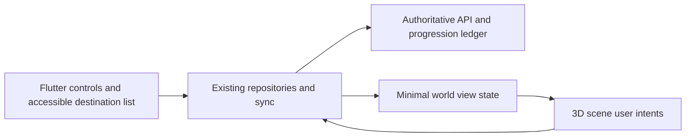

# Aura: a personal 3D universe

Proposal, 28 September 2026. No features in this document have been implemented. Read alongside the [observed application audit](./APPLICATION_AUDIT.md) and [market evidence](./MARKET_AND_LAUNCH.md).

**29 September update:** the owner selected public 3D availability for all eligible users, replacing the beta-distribution default in this proposal. Follow [the current release plan](../../releases/NEXT_RELEASE_PLAN.md) for scope, implementation status and release gates. The mechanics and engineering research below remain proposal context.

## Product decision

**Build a small world that grows with your life and welcomes you back.** The owner wants a personal universe, an avatar, habits, reflection, mindfulness, quests and games. The first release should deliver a convincing version of that experience on one island. Expansion follows evidence that people return voluntarily.

Recommended audience: people who enjoy cozy games and want a gentle mobile self-care ritual. Begin research with adults already using either category; this research choice does not silently change Aura's existing 13+ product policy. Global ambition requires checking existing rollout restrictions rather than assuming every country is launch-ready.

The distinctive proposition is the combination of a private autobiographical world, very short tactile play, flexible effort and forgiving return. An avatar with habit rewards alone is already common. This is a positioning hypothesis to validate, not a claim that no competitor offers these elements.

## The first visit

1. See an inviting island and the existing companion represented as a simple 3D avatar. A clear invitation says “Make a little space for yourself.”
2. Choose “Something tiny,” “A little more,” or “Just explore.” This is a choice about effort, not an inferred diagnosis or mood score.
3. Pick one activity: one existing habit, a short reflection or a one-minute mindful game. Check-in and help remain directly accessible outside the scene.
4. See one permanent, understandable change: place a sprout, arrange a star or choose a small decoration. Explain its connection to the completed action.
5. Leave freely. On return, the world is intact. Missing days never kills plants, removes earned objects or makes the companion disappointed.

Target for testing: a new user understands the connection and sees their first change within 90 seconds. Preserve the speed of existing quick check-in; do not make users walk an avatar somewhere to record a feeling.

## World and feature priorities

| Destination or feature | Concrete interaction | Value | Release |
|---|---|---|---|
| Home island and avatar | Orbit the camera, tap a destination, watch the avatar move along a short path; choose a look and place a few objects | A personal place worth returning to | First slice |
| Habit Grove | Existing habits become chosen plants; an eligible completion adds a visible growth step | Makes small actions tangible | First slice |
| Breathing Tide Pool | Open the existing breathing tool or play Tide Garden | A short calming break | First slice |
| Reflection Constellation | Choose a star token after a reflection; optionally attach a private entry reference | A visual record of lived moments | First slice, simple tokens |
| Future You Observatory | Open existing capsules from a spatial landmark; scheduled capsules remain sealed until eligible | Anticipation and continuity | First slice, reuse existing flow |
| Gentle quests | At most one optional, handcrafted invitation: “Notice something, care for one thing, leave a star” | Discovery without a daily obligation | Beta |
| Return ritual | “Your world is here” plus a choice to resume, choose a tiny action or explore | A welcoming return after absence | Beta |
| Memory trails | Arrange selected private objects into a walkable sequence with user-written meanings | Personal narrative beyond streaks | After retention evidence |
| Sound Garden | Place sound sources to build a personal ambience | Creative, repeatable play | Later game |
| Comet Journey | A focus session leaves a route in the sky when it ends; timer works with renderer asleep | Supports real-world focus without battery drain | Later |
| Shared clearing | Enter a separate public template through existing Rooms; retain moderation and reporting | Optional company | Later, separate privacy review |

The initial island can show four landmarks but only needs three reachable stations: Grove, Tide Pool and Observatory. Reflection tokens can appear overhead. Do not build multiple planets, open chat, trading, user-generated games or a large multiplayer world in the first release.

“Many games” is a good long-term content direction. Ship two games with different purposes first, then add games when players ask for variety and the existing ones show repeat use. A large catalogue at launch creates art, accessibility, tuning and support costs before proving the core loop.

## Two games to prototype

### Orbit Loom — playful reflection, 45–90 seconds

Tap or drag several stars to form a small constellation. There is no correct pattern, timer pressure or score. Choose an optional meaning from a neutral prompt such as “Something I noticed.” Save the shape as a cosmetic token; attaching personal writing is optional and remains private.

Provide tap-to-connect and automatic arrangement. A player can finish without precise dragging, sound, colour recognition or typing. Do not give extra growth for disclosing more intimate material. Mood categories do not determine whether a constellation looks attractive.

### Tide Garden — mindful play, 60–120 seconds

A gentle visual rhythm moves petals across a pool. Follow it if comfortable, tap at any pace, or use automatic motion. End whenever ready and select a flower arrangement. Reuse the existing breathing session controls and pause behaviour where possible.

No microphone or breath sensor is needed. The app must not claim to measure breathing quality, calmness or therapeutic improvement. Reduced-motion mode offers still stages and the same outcome. Game completion is an interaction event, not proof that someone performed a physical breathing exercise.

### Later candidates

- **Pebble arrangements:** balanced-looking compositions without falling, losing or precision penalties.
- **Sound Garden:** mix a few ambient sources, save a scene and let it play with the 3D renderer stopped.
- **Memory Trail:** revisit privately selected moments in a chosen sequence; never automatically surface a painful note.
- **Comet Journey:** a focus interval maps to a decorative route; no continuous 3D rendering in the background.

Test one question per game: does it give players a satisfying break, help them reflect, or support real-world action? Screen time alone is not success.

## Rules for growth and privacy

All feelings receive equal care. Do not make sad days dark, barren or less rewarded. Users choose aesthetic weather independently of check-in data. Rest and exploration remain legitimate ways to use the app.

Keep the existing server-authoritative progression model. Eligible actions produce idempotent grants; retrying sync, reopening a game or replaying an animation cannot farm currency. Repeated play can remain enjoyable without repeated rewards. Never use an AI assessment of journal content to decide a reward.

Private writing stays within the existing encrypted personal-data boundary. The renderer receives only the minimum display state. A memory object may reference an entry locally, but its text should not appear in scene telemetry, crash logs, URLs, analytics or admin views. New persistent world data must participate in export, deletion and sync contracts.

For optional sharing, generate a neutral postcard from user-selected cosmetics, show a preview and require an explicit share action. Do not include mood, habit names, private writing, progress dates or stable identifiers by default. Even world geometry can reveal behavioural patterns: do not automatically publish the user's actual private island as a multiplayer map.

## Visual and interaction direction

Use one coherent art direction: softly lit stylized miniatures, readable silhouettes, a restrained palette and warm materials. Preserve Aura's existing identity rather than adding a generic neon space interface. The avatar should remain recognizable at phone scale. Keep a clear foreground action and quiet background detail.

Use a limited orbit camera and tap-to-travel paths in the first version. Free movement, jumping and precision joystick controls add effort to a self-care session. This is still real 3D: spatial depth, camera motion, avatar movement and interactive objects. The accessible alternative is a flat destination list with equivalent activities and outcomes.

Flutter overlays should own labels, help, controls and accessible semantics. Support large text, VoiceOver/TalkBack, reduced motion, independent audio controls and generous touch targets. Make selected and unavailable states explicit. Never require users to identify a tiny object by colour alone.

## Engineering approach

Retain Flutter, Riverpod and existing repositories as the application shell. Introduce a renderer boundary, not a second application state system.

World actions call the same habit, reflection, capsule and ritual flows as ordinary screens. The engine cannot write directly to the database or award currency. After an action, the UI can show provisional feedback and reconcile it with authoritative sync; define rollback behaviour before implementation.

**Candidate to spike:** Thermion exposes a Flutter/Dart integration with Filament and 3D asset support. It is a candidate, not a validated production choice for Aura. Test the repository's exact Flutter version, minimum OS targets, old Android hardware, lifecycle handling and asset pipeline before committing. [Thermion package](https://pub.dev/packages/thermion_flutter), [project documentation](https://thermion.dev/).

Unity as a Library is a possible alternative for a future game-heavy product, but its documented mobile full-screen constraints and retained memory after unloading make it a larger integration decision. It should not be the default for this small scene without measurement. [Unity integration limitations](https://docs.unity.com/en-us/engine/6000.3/manual/platform-specific/cross-platform-features/unityasa-library).

Flame remains a candidate for 2D mini-games or a lightweight fallback; it does not by itself solve the proposed native 3D world. [Flame](https://flame-engine.org/).

### Required technical spike

Timebox approximately 3–5 engineering days, conditional on platform familiarity and a usable sample asset. Build one scene, one rigged avatar, one object interaction and one Flutter overlay on iOS and Android. Do not build the economy or custom engine during this spike.

Planning targets below are **unmeasured acceptance targets**, not current performance claims:

| Check | Initial target or required evidence |
|---|---|
| Frame pacing | Stable 30fps low tier; aim for 60fps on suitable devices |
| Memory | Start with an incremental scene budget of 100MB; measure native/GPU use and revise before commitment |
| Warm entry | Interactive within 2 seconds on selected reference devices |
| Initial asset payload | Aim below 25MB; separately measure installed size and decoded texture memory |
| Lifecycle | Repeated enter/exit, background/resume, audio interruption and low-memory handling |
| Battery | Ten-minute physical-device comparison against the current app; no continued rendering in background |
| Accessibility | Same tasks and rewards through flat controls, large text and screen reader |
| Compatibility | Actual supported OS/device matrix, including a representative 3GB Android device where supported |

Track licensed source files, export settings, polygon/texture budgets and asset versions. Decide compression only after confirming runtime support. Include a low-detail/static fallback that preserves all care actions. Simulator performance cannot validate GPU, heat or battery behaviour.

### Proposed data work, not existing schema

Define contracts before migrations: a versioned private world layout, selected cosmetic IDs, progression/unlock references and optional encrypted memory references. Keep cosmetic entitlement separate from placement. Reuse existing sync mutations where possible; new entities need conflict resolution, tombstones, migration defaults, export and account deletion coverage.

Test duplicate actions, offline replay, account switching, reinstall/recovery, stale clients and malformed asset IDs. A failed asset download should show the ordinary activity screen, not block a habit or erase progress. Bound remotely configurable content to validated asset IDs; avoid arbitrary executable scene content.

## Delivery phases and decision gates

These are planning ranges for an engineer with art assistance, not delivery commitments. Asset availability, device failures and current code complexity can change them.

| Phase | Work | Gate |
|---|---|---|
| 0: reliability, roughly 2–4 days | Rooms freshness/error states, accurate Keepsakes errors, environment references, semantics investigation | Core activity access remains trustworthy during failure |
| 1: concept research, 7–10 days | Ten interviews, five observed concept sessions, simple interactive island prototype | Most participants understand what grows and want another visit |
| 2: renderer spike, 3–5 days | One scene on physical platforms and accessible fallback | Performance/lifecycle evidence meets agreed budget |
| 3: first working slice, 2–4 weeks after gates | Island, avatar, existing care destinations, two games, limited cosmetics and authoritative sync | A complete first visit and return journey, including offline recovery |
| 4: adult beta, about 2 weeks | Approximately 50 testers, interviews and privacy-safe measurement | Evidence of useful repeat activity; fix friction before expansion |
| 5: expand selectively | More games, quests and social clearing | Players request and reuse each extension |

Art and research can overlap engineering, but none of these ranges justify promising a complete universe in one week. A multi-world social game is a substantially larger project.

## Measure care and return

Propose a companion product metric: **weekly meaningful-care users**, defined as users completing a chosen habit, reflection or care activity on at least three distinct days. Keep the handbook's existing WSU definition visible and report both; do not silently redefine a metric that currently includes social activity. A solo user's meaningful use should be measurable without forcing a Room visit.

Initial beta decision targets, not industry benchmarks: 60% complete the first meaningful action within 90 seconds; 70% explain the action-to-world connection unprompted; D7 return of at least 25%; qualitative evidence that returning after a missed day feels welcoming. With about 50 testers these percentages are noisy signals, not statistically reliable proof. Record denominators and recruitment source.

Set a crash-free-session target of at least 99.5%, while acknowledging that a small beta cannot establish it confidently. Measure device performance separately. Keep telemetry minimal and consented under existing policy; no note text, mood labels or private habit names. Do not expand youth analytics without a specific product/privacy decision.

## Recommended defaults for the next implementation brief

One island; existing companion translated into a simple 3D asset; orbit plus tap-to-travel; private world; two mini-games; English-first research; organic recruitment; no new subscription promise while Plus remains disabled. Art direction and spending remain adjustable after the concept sessions. The immediate next action is the reliability phase followed by a small, measured 3D prototype.
