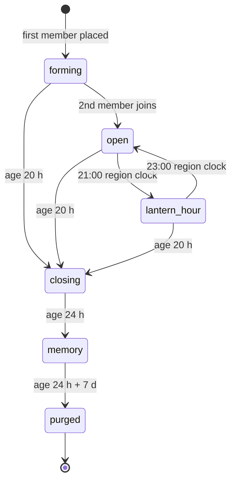
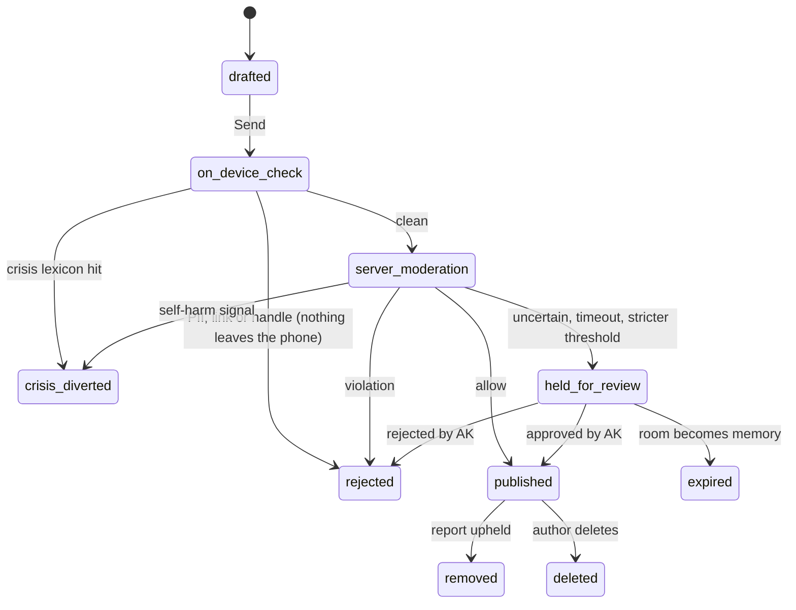
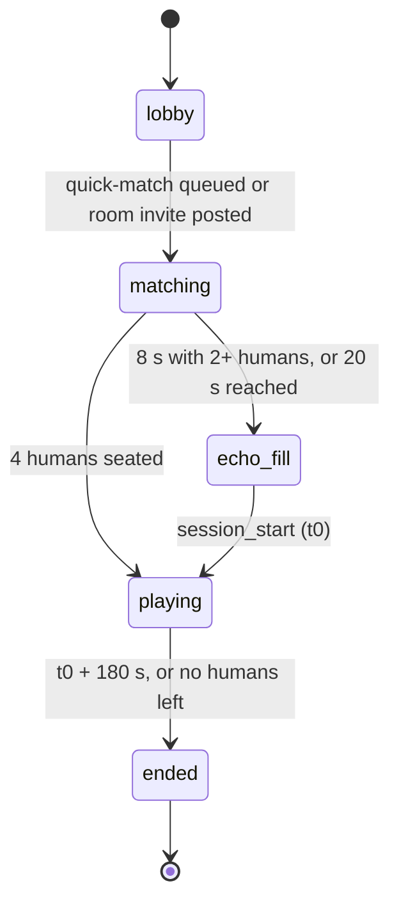

## Feature Specification — Social Layer

Covers F5 Mood Rooms, F6 Reflections and F7 Breath Ripples. F8 age gate, F9 safety and moderation, and F12 gift billing are specified elsewhere; this section defines only their hooks.

### Shared rules for every stranger surface

- **One mixed-age pool.** Everyone 13+ shares the same rooms, reflections, games and echoes, with no feature limits. No partition, queue or fallback step uses age.
- **Server boundary (DS-10).** Stranger-facing reads and writes go through NestJS or Postgres RPCs returning pseudonyms only; clients never see another user's account ID, age or DOB. Each membership gets a random `member_id` and a generated pseudonym that can't carry abuse or contact details.
- **Silhouettes are not fingerprints:** evolution stage, mood hue and at most one standard cosmetic; limited items render generic `[ASSUMPTION]`.
- **Never present:** DMs, text replies, profiles, follower counts, public gesture tallies, photos, links, paid priority entry.

**Under-18 accounts.** Same full experience; no client can tell who is under 18. Invisible protections, from the stored DOB (F8):
- **Stricter auto-moderation** for grooming, PII and sexual content on any reflection by an under-18 account or in a room containing one (F6).
- **Reports involving an under-18 account** (either side) go to the **Minors & grooming** lane (F9).
- **Instant ban, evidence preservation and mandatory reporting** (POCSO / IT Rules) for sexual content involving minors or grooming (F9) `[LEGAL]`.
- **Gift signal:** 3+ gifts in 7 days from one adult to the same under-18 account flag that lane; gifts still go through `[ASSUMPTION]`. Analytics: aggregate only.

| Surface | "I need help now" (F9) | Report / Block / Mute | Send a gift (F12) |
|---|---|---|---|
| Room header | Lifebuoy icon, every room state incl. memory | Room menu: "Report a problem here" | — |
| Member sheet (tap a silhouette) | — | All three | Yes, any 13+ account |
| Reflection card and composer | Text link under the composer | All three, from the card's ⋯ menu | Yes, from the gesture tray |
| Breath Ripples HUD | Lifebuoy top-right, whole session | Tap a light: all three | Never; no commerce in the game `[ASSUMPTION]` |

**Report reasons** (one tap, optional note; lanes per F9): (1) in danger or self-harm → crisis lane, reporter sees helplines; (2) harassment; (3) sexual content or advances; (4) hate; (5) contact or personal info; (6) spam or selling; (7) may be under 13 → Minors & grooming; (8) other.

**Block** is account-level: content hidden both ways, the pair never matched again. **The blocked user sees no change:** gestures to the blocker look sent but are dropped, and a gift fails before any charge. **Mute** is per membership: hides that member's reflections, gestures and pulses for you only.

---

### F5 Mood Rooms

**P0 · Milestone A (closed alpha).** Riya, "Anxious" at 11 pm before an exam, and Arjun, home to an empty flat, need proof in two taps that others feel the same right now. A Mood Room is a small, temporary, pseudonymous space where support is given through gestures.

#### Behaviour
- **Entry:** every saved check-in (F1) offers "Join a room of people feeling this"; active rooms sit in a Home "Your rooms" strip. No browsing.
- **One active room per user per quadrant**; you return to it with the same pseudonym.
- **Size and life:** up to **24 members** (membership, not concurrency); **24 h** from creation; no new members after 20 h `[ASSUMPTION]`; then read-only **memory** for **7 days**; then purged.
- **Shows:** theme, silhouettes with mood chips, "5 here now", "18 people have been here today", gestures, reflections (F6). **Counts are real members**, never echoes or staff.
- **Gestures:** the 8 presets, aimed at a member, a reflection or the room. The recipient sees "Quiet Comet sent you Warm Tea"; others see an unnamed animation. Only authors see counts on their reflections `[ASSUMPTION]`.
- **Lantern Hour 21:00–23:00 local**, per timezone region: a shared lantern event in open rooms; matching concentrates people.
- **Leaving** frees the quadrant slot; no rejoining. **Exit micro-survey** "Did you feel less alone?" after ≥30 s, max once a day `[ASSUMPTION]`.

#### State machine

Closing accepts no members; members can still post ("becomes a memory at 11:40 pm"). Memory is read-only; report and block work. Purge (pg_cron) hard-deletes content, pseudonyms and memberships; reported items go to the F9 evidence store (180 days) `[LEGAL]`.

#### Matching and realtime

**Partition key:** `language_pool × quadrant × timezone_region`, via NestJS `POST /rooms/match`, p95 ≤ 800 ms `[ASSUMPTION]`; thresholds in `matching_config`, tunable without a release. **Live** = Presence within 2 min. **Joinable** = under 20 h old, < 24 members, no block with the joiner.

- **Language pools:** English · Telugu + Tenglish · Hindi + Hinglish, from the app language `[ASSUMPTION]`. **Hindi + Hinglish rooms stay off** (flag) until moderation is ready, beta at the earliest; those users join English meanwhile.
- **Timezone regions** `[ASSUMPTION]`, by device UTC offset at join, each with one Lantern Hour clock so members share an evening (±2 h): `americas` ≤ -2:30 (America/Chicago) · `europe_africa` -2:00 to +3:00 (Europe/Berlin) · `south_asia` +3:30 to +6:30, incl. Gulf (Asia/Kolkata) · `east_asia_pacific` ≥ +7:00 (Asia/Tokyo).

| Step | Rule | Used when |
|---|---|---|
| 0 | Return to the user's active room for this quadrant | User holds one |
| 1 Exact mood | Joinable room whose seed (creator's) mood matches, ≥1 live | Found |
| 2 Quadrant | Joinable partition room with most live members | Step 1 empty |
| 3 Adjacent merge | Neighbouring quadrant on the same pleasantness side (Storm↔Rain, Moonlight↔Sunrise), ≥3 live. **Never pleasant with unpleasant** | Partition < 3 live over 15 min |
| 4 Async | Partition room with most 24 h activity, else a new room; "N people have been here today" | Nothing live |

- **New room spawns** when nothing is joinable, or outside Lantern Hour when the best candidate has ≥12 live `[ASSUMPTION]`. In Lantern Hour rooms fill to 24 first.
- **Thin-partition merge** `[ASSUMPTION]`: < 12 joins in 24 h → same language and quadrant in the busiest region (expected `south_asia`); if still thin, non-English pools merge into English. Merged rooms keep their home region's Lantern Hour.
- **Re-entry within 24 h:** server-side `room_members` restores seat and pseudonym via the Your rooms strip, a same-quadrant check-in or a notification (F14).
- **Realtime (transport unchanged):** private Supabase Realtime Broadcast channel `room:{room_id}`; Presence `{member_id, pseudonym, silhouette_id, mood}`. Writes via the DS-10 layer enforce limits and blocks, then Broadcast IDs only (`gesture_sent`, `reflection_published`, `reflection_removed`, `room_state`); text is fetched through that layer, so blocked pairs never see each other's content.

#### Requirements

| ID | Priority | Requirement | Acceptance criteria |
|---|---|---|---|
| REQ-ROOM-01 | P0 | Room offer after check-in | Any 13+ account sees the offer after a saved check-in, identical at every age. Negative: offline, it reads "Rooms open when you're back online" and makes no call. |
| REQ-ROOM-03 | P0 | Fallback ladder and cap | ☐ Steps run 0→4 ☐ Step 3 never pairs Storm/Rain with Moonlight/Sunrise ☐ Step 4 always returns a room ☐ Negative: concurrent joins never create a 25th member. |
| REQ-ROOM-04 | P0 | One room per quadrant | Arjun, in a Storm room since 10:00, checks in "Frustrated" at 18:00 and returns to it with the same pseudonym. Negative: never two Storm rooms. |
| REQ-ROOM-05 | P0 | Fresh pseudonym per room | One account in two rooms has different pseudonyms and member_ids. Negative: no response to another client contains an account_id. |
| REQ-ROOM-06 | P0 | Gestures | 8 presets reach live recipients < 1 s p95. Negative: unknown or over-limit gestures are rejected server-side. |
| REQ-ROOM-07 | P0 | Lifecycle and counts | Read-only at 24 h; 0 content rows after 24 h + 7 d outside the evidence store; counts are real members. Negative: non-members can't read a memory. |
| REQ-ROOM-08 | P0 | Safety hooks | Report/block/mute ≤2 taps from sheet, card and menu; help icon in every state. Negative: the blocked user's UI shows no change. |
| REQ-ROOM-09 | P1 | Gift entry (F12) | On member sheet and gesture tray for every 13+ account. Negative: never in Breath Ripples; gifting a blocker fails before charge. |
| REQ-ROOM-10 | P0 | Partition and merge | A Dallas Telugu partition with < 12 joins in 24 h merges into `south_asia`; a busier one stays. Negative: no Hindi + Hinglish room while the flag is off. |
| REQ-ROOM-11 | P0 | Regional Lantern Hour | `south_asia` rooms run it 21:00–23:00 IST, `americas` on America/Chicago incl. DST. Negative: never outside the window. |
| REQ-ROOM-12 | P0 | Age stays server-side | Meera (16) and Arjun (26) can share a room. Negative: no client payload holds age, DOB or an under-18 flag; clients can't unset stricter moderation. |

#### Abuse and safety hooks
- **Limits** `[ASSUMPTION]`: 3 new room joins per quadrant per 24 h (re-entry free); gestures 1 per 2 s, 40 per room per hour, same gesture to same member ≤3 per 10 min; 1 "Breathe together" invite per 10 min; reports unlimited for reason 1, 20/day otherwise.
- **Over-limit gestures drop silently**; 3 limit hits in 24 h shadow-mute that account's gestures for 24 h and signal F9 strikes.
- **No following:** fresh pseudonyms, no profiles, the join limit and no rejoin stop anyone tracking a target across rooms.

#### Under-18 accounts
- Same rooms, Lantern Hour, gifts and survey; protections (Shared rules) end invisibly at 18.
- "May be under 13" reports from 2 distinct members pause that account's rooms and games pending review `[ASSUMPTION]`.

#### Liquidity and cold start
- **Alpha (~300–500 invited; English, Telugu + Tenglish):** mostly `south_asia`, so thin regions and pools merge; ~10–15 joins and one room per quadrant per day `[ASSUMPTION]`. Step 1 off. IST Lantern Hour is the live window, with an opt-in reminder (F14).
- **Beta (~20,000):** EU, UK and Australia open; up to 48 partitions, auto merge, all ladder steps.
- **Never fake presence:** no bots, seeded members or inflated counts.

#### Post-v1 (P2)
- **Bring-a-friend private rooms** (hook: `rooms.kind`). Purge emits a content-free `room_closed` summary for the Shared Universe Album.

---

### F6 Reflections

**P0 · Milestone B (open beta).** Arjun wants to say "first Diwali alone in this city" without a reply thread to manage. Reflections are short moderated posts in a room, answered only with gestures.

#### Behaviour
- **Composer:** ≤200 characters, emoji allowed. Max **3 per user per room per rolling 24 h** ("2 of 3 left today"), 10 per account per day `[ASSUMPTION]`.
- **Not allowed:** links, @handles, emails, phone numbers (incl. +91, spacing, and digits spelled out in English, Telugu or Hindi, any script), UPI IDs, contact-swap phrases ("insta id", "telegram pe aao", "number ivvu").
- **Published:** newest first, no ranking or editing; author can delete; purged with the room.
- **Held:** only the author sees "Waiting for a quick check" (overnight: "This may take until morning"); expires unpublished if the room becomes a memory first.
- **Rejected:** gentle copy by category ("Reflections can't include contact details. Want to try without it?"); text returns to the composer. Only harassment, hate, sexual and spam are strikes (F9).
- **Crisis-diverted:** never published; the F9 support sheet opens at once; item enters the crisis lane; no strike.
- **Fail closed:** omni-moderation error or > 5 s → held; nothing is released by timeout. Offline sends queue and run the pipeline on reconnect.

#### State machine

#### Moderation pipeline
1. **On-device:** PII/link regex plus crisis and contact-swap lexicon in EN, TE, Tenglish, HI and Hinglish (shared with F9); works offline.
2. **Server** (NestJS, **p95 ≤ 2 s** Send-to-outcome): repeats step 1 plus a grooming phrase list, then **OpenAI omni-moderation**, the only automated classifier (no LLM). Self-harm → crisis-diverted; sexual/minors or grooming → rejected to Minors & grooming; high → rejected; medium → held; else published.
3. **Stricter thresholds** for sexual, harassment, grooming and PII when the author or any room member is under 18; also for Telugu, Tenglish and Hinglish, where omni-moderation is weaker `[ASSUMPTION]`.
4. **Human queue:** AK alone until 5,000 DAU (F9). **While he sleeps** (00:30–07:30 IST `[ASSUMPTION]`) clean text auto-publishes and holds wait; crisis diversion needs no human (overnight target: F9); a sexual/minors or grooming hit shadow-mutes the author until review `[ASSUMPTION]`.
5. **Near-duplicates** in more than 2 rooms within 24 h are held as spam `[ASSUMPTION]`.
6. **Auto-hide** after 3 reports from distinct members, or 1 sexual or contact report when the author or reporter is under 18 `[ASSUMPTION]`.
7. **Kill switch:** a per-partition flag pauses the composer ("Reflections are resting for a bit. Gestures still work."); set by AK or at > 50 held `[ASSUMPTION]`, so overnight holds don't trip it.

#### Requirements

| ID | Priority | Requirement | Acceptance criteria |
|---|---|---|---|
| REQ-REF-01 | P0 | Length and daily cap | 201 characters disables Send. Negative: a 4th reflection in one room within 24 h is blocked in the UI and rejected by the API. |
| REQ-REF-02 | P0 | No contact details | "98765 43210", "insta: @quietcomet", "name@okaxis" and a number spelled out in Telugu are rejected on-device. Negative: the same text sent straight to the API is rejected. |
| REQ-REF-03 | P0 | Latency, fail closed | Outcome ≤2 s p95; omni-moderation down → held; overnight holds wait for AK or room close. Negative: 0 reflections published without a server or moderator decision. |
| REQ-REF-04 | P0 | Crisis diversion | Crisis-lexicon text in any of the 5 languages is not published; the sheet opens < 1 s, day or night; item enters the crisis lane. Negative: no other member sees it; no strike. |
| REQ-REF-05 | P0 | Held and gesture-only | Only the author sees held items. Negative: API rejects any `parent_id` (reply) payload; no edit endpoint exists. |
| REQ-REF-06 | P0 | Auto-hide | 3 distinct reports, or 1 sexual/contact report involving an under-18 account, hide the item within 5 s. Negative: repeat reports by one member count once. |
| REQ-REF-07 | P0 | One external classifier | Reflection text leaves Aura only to OpenAI omni-moderation. Negative: no LLM or other provider call in the path. |
| REQ-REF-08 | P0 | Invisible under-18 thresholds | A borderline sexual score is held in a room with an under-18 account, published in an all-adult one. Negative: identical UI and copy; nobody can infer an under-18 member. |

#### Abuse and safety hooks
- Caps (3/room, 10/day), near-duplicate hold, and all reflections held while an account has an active strike (F9).
- Report, block and mute on every card; blocked pairs never see each other's reflections.

#### Under-18 accounts
- Same composer and caps; protections above are invisible. Minors & grooming items stay in the evidence store, never the F9 training corpus `[ASSUMPTION]`.

#### Liquidity and cold start
- **Alpha:** not shipped; rooms run on gestures alone.
- **Beta:** **target held rate** ≤5% English, ≤20% Telugu, Tenglish, Hinglish `[ASSUMPTION]`; AK clears ~300 reviews a day `[ASSUMPTION]`; the kill switch covers overload. Held rates gate Hindi + Hinglish rooms.

#### Post-v1 (P2)
- **Text replies** (hook: nullable `parent_id`, rejected in v1). **Community capsules** reuse this pipeline.

---

### F7 Breath Ripples

**P0 · Milestone B (open beta).** In exam week words are too much for Riya; a 3-minute co-breath with 1 to 3 strangers gives company without conversation. Nothing one player does can hurt the others.

#### Behaviour
- **Session:** 2–4 seats; 10 s settle-in, **16 cycles** of inhale 4 s / exhale 6 s, 10 s fade-out: 3 min `[ASSUMPTION]`.
- **Input:** hold to inhale, release to exhale; "tap to switch" mode, haptic pacer and reduce-motion for accessibility.
- **Visuals:** night ocean, one light per seat; better sync, wider ripples, more fish. **Minimum ripple and 3 fish always.** No score, number, countdown, leaderboard, voice or text.
- **Contact:** one-tap haptic pulse and 3 gestures: Hug, Deep Breath, You're Not Alone `[ASSUMPTION]`.
- **Leaving is silent:** your light dims into an echo; others never see "left" or "failed".
- **End:** "Breathe again", "Back to room", "Done", optional "How do you feel now?" (F1). ≥8 cycles logs the Breathe habit (F2) `[ASSUMPTION]`.
- **Entry:** "Breathe together" in a room (room pseudonym) or quick-match from Home (fresh pseudonym).

#### State machine

**Player states:** *playing* (events arriving; light breathes) → *disconnected* (nothing for 3 s; light follows the pacer) → *echo* (> 10 s or left; light dims, labelled "echo", driven by a recording; brightens back on one reconnect).

#### Matching and realtime
- **Quick-match: one global queue** (no language pool or age split); blocked pairs excluded. Clients poll the NestJS `game-match` endpoint every 2 s; its RPC groups atomically (`FOR UPDATE SKIP LOCKED`).
- **Start rules:** 4 humans → start; at 8 s with ≥2 humans → start and echo-fill; at 20 s → start with whoever waits plus echoes. **Max wait 20 s**; no "no one found" screen.
- **Room invite:** "Quiet Comet wants to breathe together · 2/4" shows to live members for 20 s, then starts with echo-fill.
- **Channel (transport unchanged):** private Supabase Realtime Broadcast `game:{session_id}`, Presence for join/leave. Breath events go client to client; seats, reports and echoes are written via DS-10. Clients estimate server clock offset at lobby; the pacer runs locally from `t0`.

| Event | Payload | Sender, rate |
|---|---|---|
| `session_start` | `{t0, inhale_ms, exhale_ms, cycles, seats:[{seat, kind: human\|echo\|guide, label}]}` | Server, once |
| `breath_state` | `{seat, phase: in\|out, t}` | Player, per press/release |
| `pulse` | `{seat, t}` | Player, ≤1 per 3 s |
| `gesture` | `{seat, type, t}` | Player, ≤1 per 5 s |
| `heartbeat` | `{seat, t}` | Player, every 2 s if idle |
| `seat_update` / `session_end` | `{seat, kind, label}` / `{t}` | Server |

`t` = event time in server-clock ms. Normal play is < 1 event/s; **hard cap 10 events/s/player** (client throttles, receivers ignore excess, server flags to F9). **Latency** `[ASSUMPTION]`: built for p95 RTT ≤ 400 ms on Indian 4G; lights interpolate over 250 ms; sync uses `t`, so it holds up to 1.5 s one-way delay, incl. players far from Mumbai.

**Sync (client-side only; never shown as a number, never sent):** for each inhale or exhale start *k*, seat *i* has time *tᵢₖ* (humans from `breath_state`, echoes from their recording, guides from the pacer). *refₖ* = median of *tᵢₖ*; alignment *aᵢₖ* = max(0, 1 − |*tᵢₖ* − *refₖ*| / 1500 ms), 0 if missed; group sync *S* = mean *aᵢₖ*, smoothed (EMA α 0.3). Ripple radius = r_min + S × (r_max − r_min); fish = 3 + round(12 × S). The reference is the group median, so players drifting together still count as in sync.

**Echoes (clearly labelled)**
- **Recorded** at session end from each human with ≥12 cycles who hasn't opted out ("Let my breathing become an echo", on by default, per privacy notice): pacer-relative transition offsets (50 ms steps), pacer version, completion %, ISO week. **No account, member, device or age data; no pulses or gestures.** Separate `echo_library` schema, no foreign keys.
- **Selected** by pacer version, completion ≥90%, median offset ≤600 ms `[ASSUMPTION]`, never twice in one session.
- **Honest:** echoes breathe only, in paler labelled light; intro says "2 people and 2 echoes of people who breathed here before"; never counted as people.
- **Guide light:** while the library has < 50 eligible echoes `[ASSUMPTION]`, empty seats get a "guide" on the pacer, never presented as a person.
- **Retention:** 90 days `[ASSUMPTION]`. Opt-out stops future recording; past echoes are unlinked, so can't be deleted individually `[LEGAL]`.

#### Requirements

| ID | Priority | Requirement | Acceptance criteria |
|---|---|---|---|
| REQ-GAME-01 | P0 | Match ≤20 s | Given 1 human waiting, when 20 s pass, then play starts with echo or guide fill; p50 match < 20 s. Negative: no "no one found" or retry state exists. |
| REQ-GAME-03 | P0 | No fail state | ☐ No score, number, countdown, leaderboard ☐ Minimum ripple and 3 fish at S = 0 ☐ A session completes with one human. |
| REQ-GAME-04 | P0 | Silent disconnect | A player offline 15 s dims into an echo and play continues. Negative: others never see "failed", "left" or "disconnected". |
| REQ-GAME-05 | P0 | Event budget | A client sending 50 events/s: receivers ignore the excess; the account is flagged. |
| REQ-GAME-06 | P0 | Sync stays on device | Negative: no sync value on the channel or server; under-18 sessions reach analytics only in aggregate. |
| REQ-GAME-07 | P0 | Honest, anonymous echoes | Echo seats are labelled and never pulse or gesture; `echo_library` has no column joining to accounts, members or devices, and no age. |
| REQ-GAME-08 | P0 | Safety in game | Help icon all session, sheet < 1 s; report/block/mute by tapping a light. Negative: no gift, purchase or upsell in game or lobby. |
| REQ-GAME-09 | P0 | Echo opt-out honoured | With echoes on, a 12-cycle session writes one unlinked row. Negative: after opt-out, that user's later sessions write none. |

#### Abuse and safety hooks
- Pulse and gesture limits at sender and receiver; mute stops a seat's haptics; haptics can be switched off globally. No penalty for quitting, ever.
- Session event log (seat and member IDs) kept 7 days `[ASSUMPTION]`; 180 days in the F9 evidence store once reported.

#### Under-18 accounts
- Same queue, echoes and invites; protections per Shared rules.

#### Liquidity and cold start
- **Alpha:** not shipped; internal and tester sessions seed the echo library.
- **Beta:** one global queue concentrates everyone waiting; each region's Lantern Hour promotes invites.

#### Post-v1 (P2)
- **Zen Stone Stacking** and **Celestial Melody Weaving** reuse lobby, matching, echo-fill and channel code via `game_type`.
