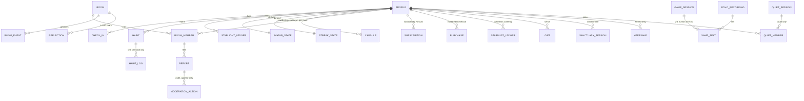

## Data Model (High Level)

Postgres on Supabase (ap-south-1). **RLS on every table.** NestJS uses the service role for ledger, matching, moderation, billing and admin work. Clients never see another user's `user_id`: **all stranger-facing reads go through NestJS endpoints or reviewed `security definer` RPCs that return room pseudonyms only** (DS-10). Client-generated UUIDs make offline writes idempotent (see Offline Mode).

### Entity map

### Core tables
| Area | Table | Key fields | Notes |
|---|---|---|---|
| Identity | `profiles` | `user_id`, `birth_date` (full, DS-6), `is_minor` (generated from `birth_date`), `ui_locale` (`en` / `te` / `te-Latn` / `hi` / `hi-Latn`), `language_pool`, `timezone`, `tz_region`, `country`, `deleted_at` | `is_minor` never changes what a user can do. It drives only invisible protections (analytics exclusion, stricter auto-moderation, minors lane). |
| | `user_consents` | `user_id`, `purpose`, `policy_version`, `granted_at`, `withdrawn_at` | Per purpose: core processing (incl. sensitive data), analytics, echo recordings (opt-out), moderation-training corpus (opt-out). |
| | `age_gate_blocks` | none server-side | The under-13 block is a device-level lock only; nothing identifying is stored (F8). |
| Personal | `moods` | `id`, `quadrant`, `name_key`, `sort` | Fixed catalogue of 16 in v1. |
| | `check_ins` | `id` (client UUID), `user_id`, `mood_id`, `quadrant`, `tags[]`, `note_ct`, `voice_path`, `local_day`, `device_ts`, `server_ts`, `source` (`app` / `widget`) | Append-only. `note_ct` = envelope-encrypted note (DS-1). |
| | `habits`, `habit_logs` | `habit_logs` unique on (`habit_id`, `local_day`); `habits.committed_from` / `paused_through` (dates, nullable, W02) | Per-day last-write-wins. Commitments are the person's own opt-in to reversible world decay (presentation-only, never the ledger; never available under 18; RULES.md §13). `habit_commitment_events` (server-only, W07): append-only `start`/`end` + day per habit, written by trigger, deleted with the account, feeds aggregate measurement (`docs/measurement/commitments.md`). |
| | `starlight_ledger` | `user_id`, `amount`, `reason`, `source_id`, `local_day` | Append-only; written by NestJS; daily caps enforced server-side (DS-5). |
| | `avatar_state`, `streak_state` | stage, total Starlight, hue, rings, glow, constellation stars, `is_resting`, equipped cosmetics / glow streak, lifetime glow days, rest-day bank | **Derived by NestJS from the ledgers** (DS-5); the client renders `AuraAvatarState` optimistically offline. |
| | `capsules` | `unlock_type` (`date` / `mood`), `unlock_at`, `trigger_mood_id` / `trigger_quadrant`, `cooldown_until`, `sealed_at`, `opened_at`, `payload_ct`, `media_paths[]` | Encrypted payload and media (DS-1). Unlocks scheduled as BullMQ jobs. |
| | `sanctuary_sessions` | `id` (client UUID), `user_id`, `activity` (breathe / grounding / stillness / savour / sounds / night_wind_down), `variant`, `duration_s`, `local_day`, `device_ts` | F15. **Content-free**: no text, audio or mood. Written via sync push; feeds the "Sanctuary minutes" keepsake. Included in the account purge `[ASSUMPTION]`. |
| | `keepsakes` | `user_id`, `keepsake_key`, `earned_at` | F13. **Derived by NestJS** from existing records (like `avatar_state`); never sold or removed; no link to rooms, pseudonyms or content. |
| Social | `rooms` | `quadrant`, `mood_ids[]`, `language_pool` (`en` / `te` / `hi`), `tz_region`, `theme`, `capacity` (24), `opened_at`, `closes_at`, `memory_until`, `status`; from B `lantern_level`, `intention_key`, `intention_holds` | **One mixed-age pool (D2).** Partition key: `language_pool × quadrant × tz_region`. Lantern and intention fields are room totals only (F5), purged with the room. |
| | `room_members` | `room_id`, `user_id`, `member_id`, `pseudonym`, `mood_at_join`, `joined_at`, `left_at` | Pseudonyms unique per room (DS-2). `mood_at_join` is shown as a chip (DS-3). `user_id` is never returned to clients. |
| | `room_events` | `room_id`, `member_id`, `type` (`gesture`), `gesture_type`, `target_reflection_id?` | Rate-limited in NestJS. |
| | `reflections` | `room_id`, `member_id`, `body`, `status` (`pending` / `published` / `held` / `rejected` / `crisis_diverted`), `mod_scores`, `involves_minor`, `decided_by`, `decided_at` | Only `published` is visible to others. `involves_minor` applies stricter thresholds. |
| | `blocks` | `blocker_user_id`, `blocked_user_id` | Resolved server-side from a pseudonym; matching keeps blocked pairs apart. |
| | `game_sessions`, `game_seats` | `language_pool?`, `tz_region`, `room_id?`, seat `kind` (`human` / `echo`), `joined_at`, `left_at`, `completed` | |
| | `echo_recordings` | `breath_trace` (compressed timings), `duration_s`, `created_at` | **No link back to the source user.** Only from users who haven't opted out. |
| | `quiet_sessions`, `quiet_members` | `mode` (study / read / rest), `tz_region`, `t0`, `soundscape_seed`, `capacity` / `session_id`, `user_id`, `member_id`, `joined_at`, `left_at` | F16. Clients get **counts only**; `user_id` and `member_id` are never returned (DS-10). Members purged 7 days after the session `[ASSUMPTION]`; reported items go to `evidence_holds`. |
| Trust & safety | `reports`, `moderation_actions`, `sanctions` | lane (`crisis` / `minors_grooming` / `harassment` / `spam`), SLA timestamps, actor, reason | `moderation_actions` is append-only (audit). |
| | `evidence_holds` | `item_ref`, `reason`, `hold_until` (**180 days**), `reported_to`, `report_ref` | Overrides the 7-day purge (DS-4); restricted access. |
| | `moderation_corpus` | `text`, `language`, `label`, `decided_at` | **De-identified**, no user or room link; excludes opted-out users. Used later to train an in-house model. |
| | `crisis_events` | `surface`, `locale`, `created_at` | **Aggregate only, no `user_id`** (DS-7). |
| Money | `subscriptions` | `user_id`, `store`, `product_id`, `original_transaction_id` / `purchase_token`, `state` (`trial` / `active` / `grace` / `billing_retry` / `expired` / `refunded`), `trial_ends_at`, `expires_at` | **Owned by NestJS** (DS-9), from App Store Server Notifications V2 and Play RTDN. |
| | `purchases`, `entitlements` | store, product, transaction id, status | Consumables (gifts), non-consumables (cosmetics); entitlements derived from subscriptions and purchases. |
| | `store_notifications` | `store`, `raw_payload`, `signed_payload_verified`, `processed_at` | Append-only log; replayable if a handler bug occurs. |
| | `gifts` | `sender_user_id`, `recipient_member_id`, `room_id`, `purchase_id`, `stardust_amount` | Everyone 13+ (D2). Max 5 sent per day. |
| | `stardust_ledger`, `user_cosmetics` | signed amounts, reason, ref | Balance = sum of ledger. No cash-out, no transfers. |
| Ops | `device_tokens`, `notification_prefs`, `data_requests`, `feature_flags` | | `data_requests` covers export and deletion (DPDP, and GDPR from beta). |

### Data-shape decisions (locked by AK, 23 Sep 2026)
| # | Decision | Chosen | Consequence to build for |
|---|---|---|---|
| **DS-1** | Protection of private notes, voice, capsules | **Envelope encryption**: per-user data key wrapped by a server master key held outside the DB | NestJS holds the key-wrapping path; the admin console has no decrypt route; crisis detection on private text runs on-device |
| **DS-2** | Pseudonym scope | **Fresh per room** | Blocks and strikes follow `user_id` server-side |
| **DS-3** | Mood in stranger contexts | **Mood-at-join chip** on each silhouette; no history, no live updates | `room_members.mood_at_join` |
| **DS-4** | Room content retention | **24 h room + 7-day read-only memory**, then hard-delete; reported or removed items kept **180 days** | Purge job in BullMQ; `evidence_holds` override |
| **DS-5** | Avatar/streak authority | **Server ledger decides**; client optimistic | Ledger writes go through NestJS |
| **DS-6** | Age storage | **Full date of birth** | Privacy notice must justify it; `is_minor` computed; birthday rollover automatic |
| **DS-7** | Crisis events | **Aggregate only** | Next-day gentle check is scheduled on-device |
| **DS-8** | Teen Local Mode data | **N/A**: no Local Mode (D2) | |
| **DS-9** | Purchase validation | **Own validation in NestJS** (no RevenueCat) | `subscriptions`, `store_notifications`, signed-payload verification, RTDN via Pub/Sub |
| **DS-10** | Stranger-facing reads | **NestJS / RPC layer** returning pseudonyms only | One reviewed choke point for the most sensitive boundary |
